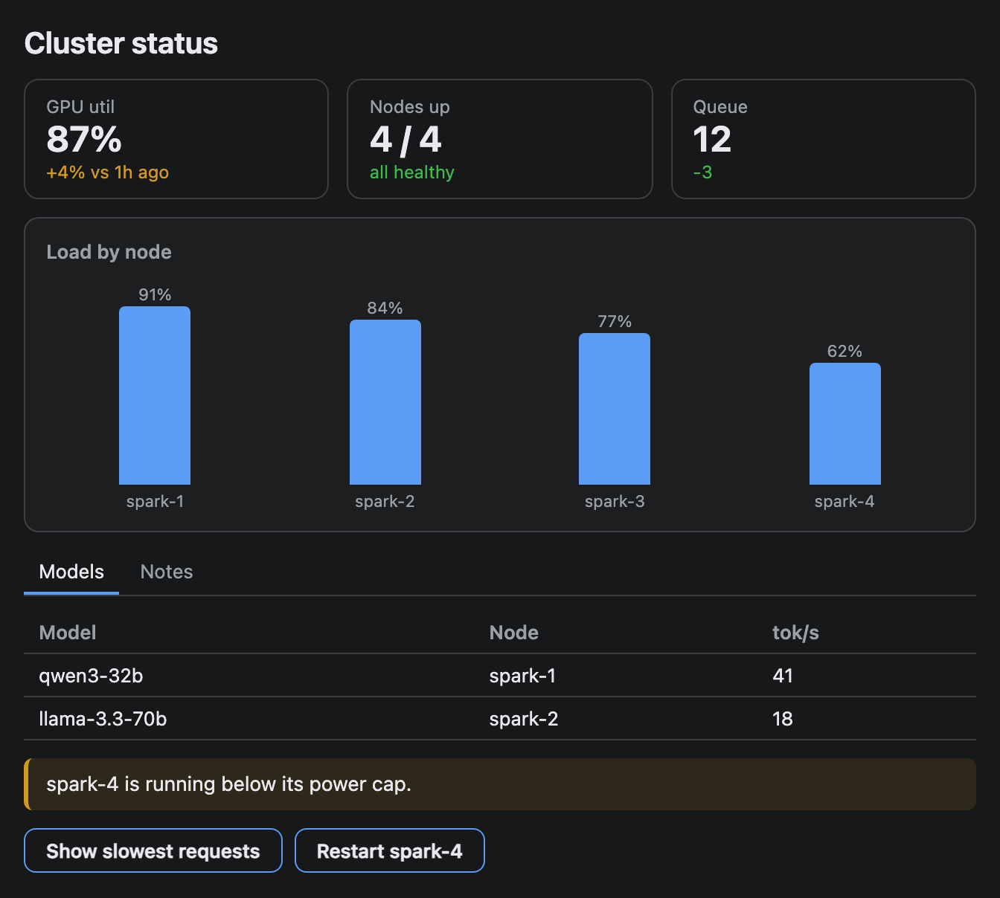
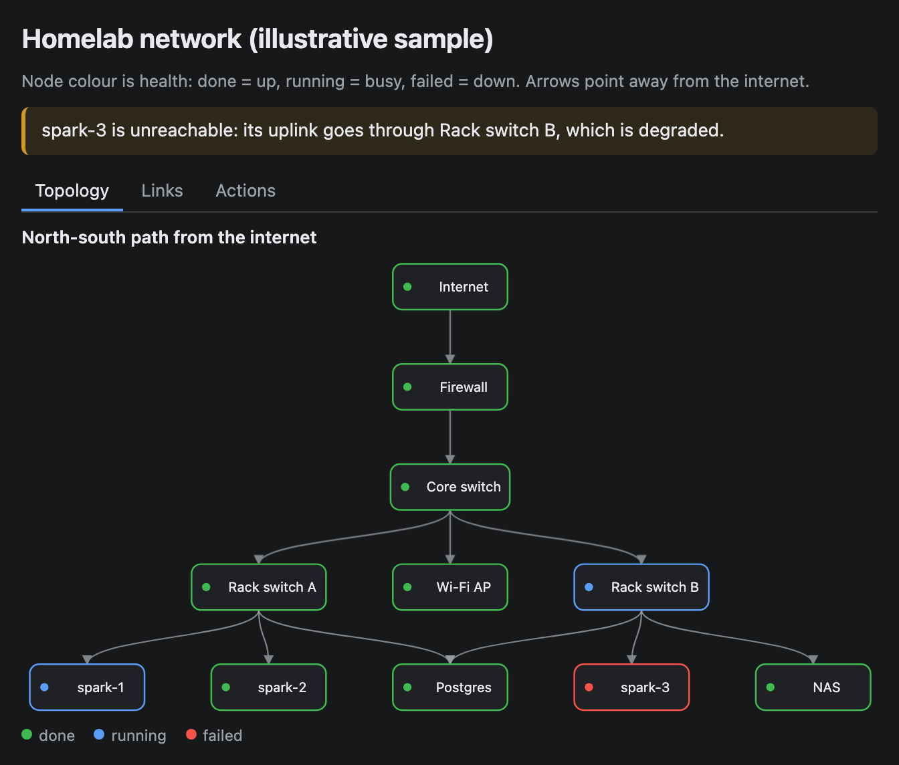
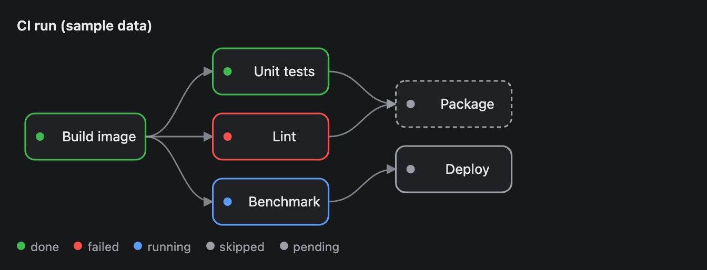
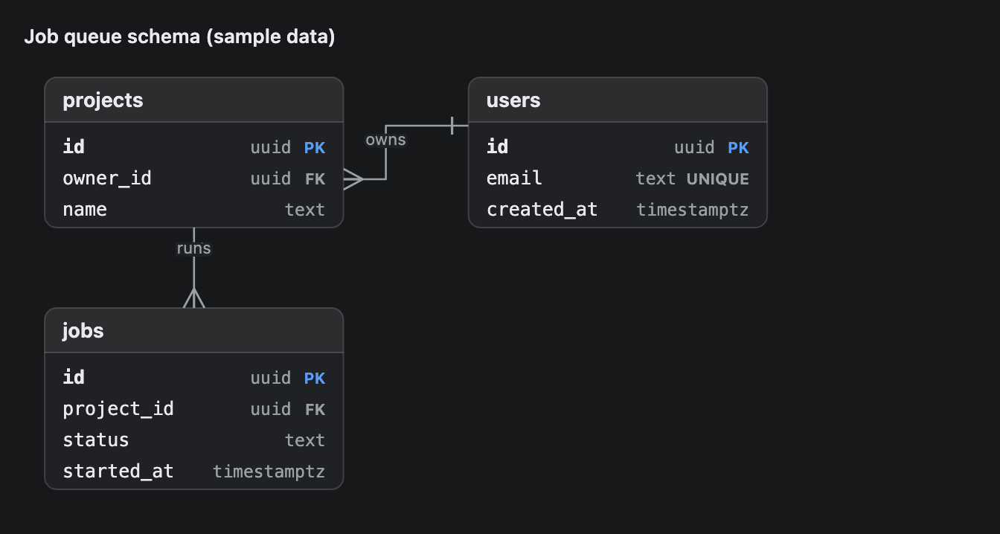
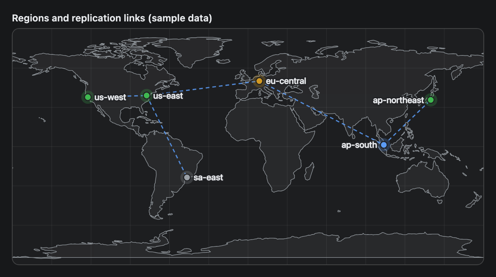
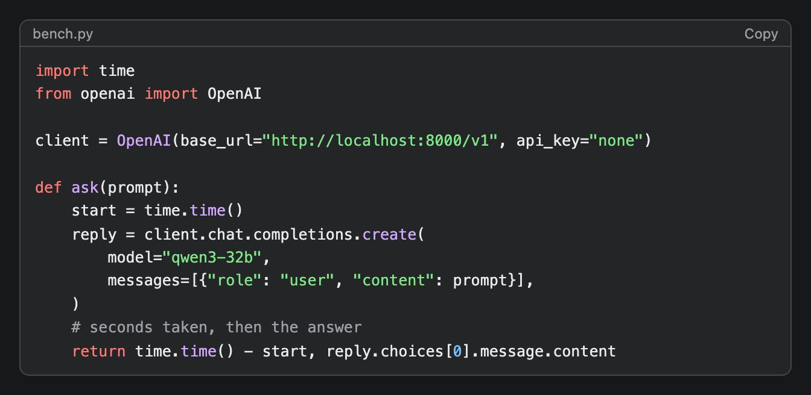
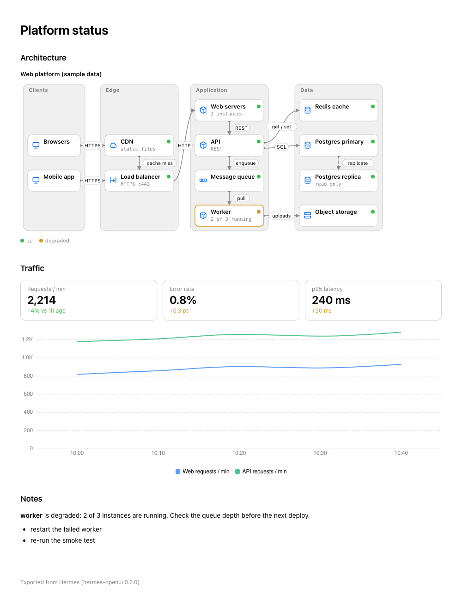

# hermes-openui

Ask your Hermes agent to **draw**: dashboards, charts, DAG and ER diagrams, infrastructure and geographic maps, tables. They appear as interactive widgets inside the Hermes desktop chat. Everything runs locally: no network, no accounts, no telemetry.

<table>
<tr>
<td></td>
<td></td>
</tr>
</table>

> "Draw a DAG of our nightly build." &nbsp;·&nbsp; "Show GPU, queue and error rate as a dashboard with a line chart." &nbsp;·&nbsp; "Make an ER diagram of users, orders and order_items."

## What you get

- **One tool, `render_widget`.** The agent writes a few lines of *OpenUI Lang* (a compact component language); the plugin validates it, saves a widget, and the agent puts one line in its reply. The widget appears in the chat when the turn finishes.
- **22 components** (32 with helpers): metric tiles, tables, tabs, cards, line / area / pie / radar / bar charts, DAG pipelines, ER diagrams, infrastructure maps, offline maps, code, markdown, FAQs, and clickable choices. See the [component gallery](docs/ui-components/README.md) for a screenshot and example of each.
- **Plain English works.** You do not name the tool. Hermes's Tool Search keeps it out of the model's context until a request needs it.
- **Cheap on context.** About 20 tokens always on; about 3,000 tokens the first time it is used (the component reference); a few hundred per widget.
- **Two display modes.** `preview` (default) works out of the box. `native` renders in the app itself and makes widgets tiny, at the price of running with full app authority. See [Display modes](#display-modes).
- **Interactive.** Buttons and choices send their text back to the agent as your next turn.
- **Export to HTML.** Ask for a few widgets, or a whole report, as one standalone offline HTML file, saved where you say. See [Export to HTML](#export-to-html).
- **Your own components.** Link a small JavaScript file in the plugin's settings and the agent can use the components it adds. See [Custom components](#custom-components).

## Gallery

<table>
<tr>
<td valign="top" width="33%"><a href="docs/ui-components/Dag.md"></a><br><b>Pipeline</b> &middot; <a href="docs/ui-components/Dag.md">Dag</a><br><sub>A CI run with done, failed, running, skipped and pending steps</sub></td>
<td valign="top" width="33%"><a href="docs/ui-components/Erd.md"></a><br><b>Schema</b> &middot; <a href="docs/ui-components/Erd.md">Erd</a><br><sub>Tables, keys and relations from one short definition</sub></td>
<td valign="top" width="33%"><a href="docs/ui-components/GeoMap.md"></a><br><b>Map</b> &middot; <a href="docs/ui-components/GeoMap.md">GeoMap</a><br><sub>Pins and links on an offline world map</sub></td>
</tr>
<tr>
<td valign="top" width="33%"><a href="docs/ui-components/AreaChart.md"></a><br><b>Chart</b> &middot; <a href="docs/ui-components/AreaChart.md">AreaChart</a><br><sub>Tokens per minute by model, stacked</sub></td>
<td valign="top" width="33%"><a href="docs/ui-components/CodeBlock.md"></a><br><b>Code</b> &middot; <a href="docs/ui-components/CodeBlock.md">CodeBlock</a><br><sub>Highlighted code with a Copy button</sub></td>
<td valign="top" width="33%"><a href="docs/ui-components/Faq.md"></a><br><b>Answers</b> &middot; <a href="docs/ui-components/Faq.md">Faq</a><br><sub>Expandable answers with lists and tables inside</sub></td>
</tr>
<tr>
<td valign="top" width="33%"><a href="docs/ui-components/InfraMap.md"></a><br><b>Infrastructure</b> &middot; <a href="docs/ui-components/InfraMap.md">InfraMap</a><br><sub>Four zones of a web platform, with labeled links and a status legend</sub></td>
<td valign="top" width="33%"><a href="docs/ui-components/InfraMap.md"></a><br><b>Network</b> &middot; <a href="docs/ui-components/InfraMap.md">InfraMap</a><br><sub>An office network drawn top to bottom, with zone tones and a dashed remote link</sub></td>
</tr>
</table>

Each picture is a real render of the example code on that component's page, with sample data. All 22 components, with the code for every picture, are in the [component gallery](docs/ui-components/README.md).

## Requirements

| | |
|---|---|
| Hermes Agent | 0.22.5 or newer. The manifest sets `requires_hermes: ">=0.22.5"`, so an older Hermes will not load the plugin. 0.22.5 is the only version it was tested on. Widgets render in the **desktop app** only; the CLI, TUI and messaging platforms see a file path. |
| Python | None to install. The plugin runs inside Hermes's own interpreter (Hermes itself needs 3.11+) and imports only the standard library. |
| Node.js | Optional, 18 or newer. With it, source is checked by the real OpenUI parser. Without it, a built-in structural check catches the common mistakes. **Custom components lose their type checks without Node**, and a bad argument then draws as if it were missing, so install it if you link packs. |

## Install

### Recommended: Hermes's installer

```sh
hermes plugins install newtonapple/hermes-openui --enable
```

Hermes clones the repository (about 10 MB with the docs, tests and build sources), runs its security scan, records where the plugin came from and enables it. That record is what lets `hermes plugins update hermes-openui` and `hermes plugins check-updates` work later. Hermes also prints a warning that the source is not from its catalog. That is expected for any plugin installed from a Git URL.

In the desktop app, the same install is **Capabilities → Plugins → Install from Git**.

Without `--ref`, the install follows the default branch, `main`, which can be ahead of the latest release. To install an exact release, see [Versioning](#versioning).

Then start a **new** chat in that profile and ask for a chart. If the profile's gateway is already running, restart it first (see below).

### Multiple profiles

Each Hermes profile has its own home (`~/.hermes/profiles/<name>`), its own `plugins/` folder and its own enabled list in `config.yaml`. Hermes has no shared plugin folder for a plugin like this one, so install it once per profile:

```sh
hermes profile list                                                      # profile names
hermes plugins install newtonapple/hermes-openui --enable                # the default profile
hermes -p <name> plugins install newtonapple/hermes-openui --enable      # a named profile
```

- Each profile gets its own clone, so each one updates on its own: `hermes -p <name> plugins update hermes-openui`. Settings such as `mode` are per profile too.
- A profile whose gateway is running needs a restart before the tool appears: `hermes -p <name> gateway restart`. Run it in a separate terminal, not from a chat that the gateway serves.
- The desktop half of the plugin is shared. Per Hermes's docs, the app keeps one copy for every profile.
- In the desktop app, **Capabilities → Plugins** shows an **Install here** button for a profile that lacks a plugin the app already knows. It opens the same install dialog, using the Git source recorded at the first install. This comes from Hermes's source code and has not been clicked.
- `hermes profile create <name> --clone-all` copies plugins into the new profile. `--clone` copies the config but not `plugins/`, so the new profile would list the plugin as enabled with no files behind it. Both come from Hermes's docs and were not tested.

### Alternative: copy from a checkout with `scripts/install.sh`

```sh
git clone https://github.com/newtonapple/hermes-openui.git
cd hermes-openui
sh scripts/install.sh                                       # the default profile
sh scripts/install.sh --home ~/.hermes/profiles/<name>      # a named profile
```

The script copies the 1.8 MB the plugin needs at run time into `<home>/plugins/hermes-openui` and enables it. It needs only `sh` and `cp`, and no network after the clone. That suits three cases: you are offline, you want to try changes you have not committed, or you already have a checkout and want it in several profiles with one command each.

What you give up:

| | `hermes plugins install` | `scripts/install.sh` |
|---|---|---|
| Security scan at install | yes | no |
| Source recorded by Hermes | yes | no |
| `hermes plugins update` and `check-updates` | work | do not work, there is no Git record |
| Disk per profile | about 10 MB | 1.8 MB |
| Needs the network | yes | no, after the clone |
| Uncommitted changes | not included | copied as they are |

Options: `--home DIR` picks the Hermes home, and `--no-enable` copies the files without enabling the plugin. An existing copy moves to `<home>/cache/hermes-openui-previous-<time>`, never deleted.

To keep Git tracking for a local checkout, use a `file://` URL instead: `hermes plugins install file:///absolute/path/to/hermes-openui --enable`. Hermes warns about the local scheme, then treats it like any Git install (scan, source record, `update`). It installs committed code only. A bare path such as `./hermes-openui` is read as GitHub shorthand and fails.

### Check that it worked

```sh
hermes plugins list | grep hermes-openui                  # status: enabled
hermes plugins doctor ~/.hermes/plugins/hermes-openui
```

For a named profile, add `-p <name>` to the first command and use `~/.hermes/profiles/<name>/plugins/hermes-openui` in the second.

In a new desktop chat: *"Draw a bar chart of 3, 5 and 2 for a, b and c."* A widget should appear.

## Use it

You do not call the tool. Ask for something visual:

- *Draw a DAG of extract → clean → train → evaluate → publish, with train running.*
- *Put Berlin and Tokyo on a map and link them.*
- *Show these four numbers as KPI tiles.*
- *Ask me which sample to build next as clickable choices.*

If the agent answers in text instead, say **"as an inline widget"** or name the tool: *"use render_widget"*. Other diagram skills (Excalidraw, architecture diagrams) compete for words like "diagram"; being explicit settles it.

How it works behind the scenes, in order: the agent calls `render_widget(reference=true)` once to get the exact component signatures, then `render_widget(source=...)`. The tool returns a directive such as `::preview{file="…/widgets/gpu-status-1a2b3c.html"}`, which the agent puts alone on its own line. Details are in [docs/development.md](docs/development.md).

### Display modes

| | `preview` (default) | `native` |
|---|---|---|
| How it shows | The app's built-in `::preview`: a sandboxed frame per widget | This plugin's desktop half renders the widget in the chat itself, via `::openui` |
| File per widget | 275–390 KB self-contained HTML | 1–2 KB of source |
| Cost to show 20 widgets | about 530 ms and roughly 300 MB of extra memory | about 50 ms and about 4 MB, one shared runtime |
| Isolation | Sandboxed (opaque-origin iframe) | **None**: runs with the app's full authority |
| Buttons | Send a **hidden** turn to the agent | Type a **visible** user message (the plugin SDK cannot send hidden ones) |
| Remote gateways | Works | Local files only |
| Setup | none | enable the desktop half **and** set `mode` |

To use `native`: open **Capabilities → Plugins**, switch **Desktop** on for *OpenUI widgets* (review it first: it is a desktop plugin with full app authority), then set `mode: native` in the plugin's settings, or in `config.yaml`:

```yaml
plugins:
  entries:
    hermes-openui:
      settings:
        mode: native
```

Installing already created a `plugins:` block in that file (it holds `enabled:`). Add `entries:` **under it**. A second top-level `plugins:` key is a duplicate and is not valid YAML.

The desktop half is the file `desktop/plugin.js` inside the plugin folder. Per Hermes's docs, the app copies it into `~/.hermes/desktop-plugins/hermes-openui/` on its own when the plugin lands in a profile's `plugins/` folder, and it stays off until you switch it on. Do not copy the file there by hand. The app treats a hand-placed file as a separate plugin and never refreshes it, so it goes stale after an update. If the switch is missing, try **Rescan** on the Capabilities → Plugins page, or restart the app. This comes from Hermes's docs and has not been checked in the app. The plugin file itself is verified against the app's loader.

Timings and memory were measured in headless Chrome, not in the desktop app, so treat them as indicative. In `native` mode the directive shows as a plain line wherever the desktop half is off; switch back with `mode: preview`.

## Components

Every component has a page with its signature, arguments, rendered examples and pitfalls: **[docs/ui-components](docs/ui-components/README.md)**. Layout and data: Stack, Text, Card, Metric, Table, Tabs, Callout, Button. Charts: LineChart, AreaChart, PieChart, RadarChart, BarChart. Diagrams: Dag, Erd, GeoMap, InfraMap. Rich content: Markdown, CodeBlock, Image, Faq, Choice.

## Export to HTML

Ask in chat, at any point: *"Export that dashboard as an HTML page"*, *"Save the last three widgets as one report"*, or *"Put the platform map and a latency chart into a report and save it to ~/Documents/platform.html."* The agent calls a second tool, `export_widgets`, and replies with the path of one standalone file. The file opens in any browser, works offline, follows the viewer's light or dark setting, and keeps charts and diagrams interactive.



- Each section is new OpenUI Lang or a widget already shown in the chat, so a report can mix both.
- The reply carries the file as a `MEDIA:` tag. The Desktop app and the messaging gateways read it, so the file arrives as a file card or an attachment. How that works, and what is not verified: [docs/exporting.md](docs/exporting.md#how-the-file-shows-up-in-hermes).
- With no path, the file goes to `exports/` in the profile's Hermes home. It is not `cache/documents`, which Hermes prunes. Set `export_dir` to change the default, or name a path in the request.
- The tool refuses protected places (`~/.ssh`, Hermes's own folders, `/etc` and the like), and it keeps an existing file unless the request says to overwrite it.
- From the terminal: `hermes openui widgets` and `hermes openui export NAME... --out PATH`.

Details, limits and known gaps: [docs/exporting.md](docs/exporting.md).

## Custom components

A custom component is a small JavaScript file, a **pack**. Link it in the plugin's settings and the agent can use its components in `render_widget` and `export_widgets` like any built-in one. The pack's first comment is a JSON header, so Hermes knows what it adds without running it. A page carries a pack only when the source uses one of its components.

```yaml
plugins:
  entries:
    hermes-openui:
      settings:
        components:
          - ~/hermes-packs/badges.js        # a file
          - ~/hermes-packs/team             # or a folder of .js files
```

Packs work in preview mode only, and run inside the same sandbox as the rest of a widget. The guide has a complete small pack to copy. Check a pack before linking it with `hermes openui components check FILE`, and see what is linked with `hermes openui components list`.

Writing a pack, the rules and the safety model: [docs/custom-components.md](docs/custom-components.md).

## Configuration

| Setting | Values | Default | Meaning |
|---|---|---|---|
| `mode` | `preview`, `native` | `preview` | How widgets are shown. Read on every call, so a change applies without a restart. |
| `components` | list of paths | empty | Component pack files, or folders of them. See [Custom components](#custom-components). Read on every call. |
| `export_dir` | absolute path | empty | Where `export_widgets` saves a file when the request names no path. Empty means `exports/` in the profile's Hermes home. |

Settings live under `plugins.entries.hermes-openui.settings` and appear on the plugin's page in the desktop app.

## Context cost

Measured, using Hermes's own estimate of 4 characters per token.

| What | When | Tokens |
|---|---|---|
| Tool listing line | every chat, with Tool Search on (the default) | about 20 |
| Tool schema (1.3 KB) | every API call **only if** Tool Search is off | about 325 |
| `export_widgets` listing line | every chat, with Tool Search on | about 20 |
| `export_widgets` schema (1.6 KB) | every API call **only if** Tool Search is off | about 400 |
| Component reference | the first use in a chat | about 3,100 |
| Custom component reference | the first use, **only when packs are linked** | one line per component. The four InfraMap lines, now built in, add about 320 |
| Your widget source | each widget, stays in the history | about 250–600 |
| Tool result | each widget | about 100 |

The bundled skill (`hermes-openui:openui-render`, about 1,000 tokens) is loaded on demand only.

## Security and privacy

- **No network, ever.** The browser runtime is embedded in each page; nothing is fetched. A test fails the build if network code appears in any shipped file.
- **No telemetry.** OpenUI's libraries contain opt-in telemetry code; none of it is in the shipped bundles, and the build runs with its opt-outs and `--ignore-scripts`.
- **Writes only to `$HERMES_HOME/widgets/`**, with a generated suffix on every name so an old message's widget is never overwritten. Nothing is cleaned up automatically; delete old files when you like.
- **Images** are read only from absolute paths with an image extension, at most 100 KB each in a widget (1 MB in an export), and embedded in the page.
- **Export writes only `.html` or `.htm` files.** The destination must pass Hermes's own write guard, which never lets the tool bypass an approval, and a built-in list of protected places that applies on top of it. A file is written whole or not at all, and an existing file is kept unless the request says `overwrite`.
- **Exported pages make no network requests.** In headless Chrome, a page with a map, tiles, a chart and Markdown had none and logged no console errors.
- **A custom pack runs in the widget's sandbox**, with no access to the app. A lint refuses network and dynamic-code APIs in a pack, but it only catches mistakes. The sandbox is the boundary, so link only packs you trust.
- **`preview` widgets run sandboxed.** In `native` mode the desktop half has full app authority; it only reads `…/widgets/<name>.oui` files and renders them with a declarative parser (no source is ever evaluated as code).
- Third-party code in the bundles is listed in [THIRD_PARTY_NOTICES.md](THIRD_PARTY_NOTICES.md); all permissive.

## Troubleshooting

| Symptom | Cause and fix |
|---|---|
| The agent never uses it | The plugin is not enabled or the chat predates it: `hermes plugins list`, then start a **new** chat. Or ask for it explicitly: "as an inline widget". |
| `::preview{…}` shows as text | You are not in the desktop app, or the file was deleted. |
| "Unknown component `X`" for a component you linked | The pack is not linked, or it failed a check. Run `hermes openui components list`: it names the file and the reason. A chat that read the reference before you linked the pack needs to fetch it again. |
| "Custom components … only work in preview mode" | `mode` is `native`. Set it to `preview`: native mode renders in the app and does not run user scripts. |
| An export is refused | The path is a protected place, needs approval, is relative, or the file exists. The error says which. Leave `path` out for the default folder, or pass `overwrite`. |
| `::openui{…}` shows as text | `mode` is `native` but the desktop half is off. Enable it, or set `mode: preview`. |
| A blank widget | The page exceeded the app's 512 KiB read limit. The tool refuses pages over 480 KB, so this means the file was edited or truncated by hand. |
| "Widget is missing component(s): X" | A component's runtime pack was not embedded. Report it; the tool normally picks packs from the source. |
| The tool says errors and writes nothing | Read `errors`, fix the source, call again. They name the line or variable. |
| "checked: structural" instead of "node" | Node is not installed, so only the built-in checks ran. Install Node 18+ for full validation. |
| `hermes plugins install ./path` fails | Hermes reads a bare path as GitHub shorthand. Use a `file://` URL (`file:///absolute/path`) or `sh scripts/install.sh`. |
| `hermes plugins update` says the plugin "was not installed from git" | It was copied with `scripts/install.sh`, which leaves no Git record. Run `hermes plugins remove hermes-openui`, then `hermes plugins install newtonapple/hermes-openui --enable`. |

## Update, reinstall and uninstall

Add `-p <name>` to the `hermes` commands (and `--home ~/.hermes/profiles/<name>` to `install.sh`) to act on a profile instead of the default home.

| Goal | Installed with `hermes plugins install` | Installed with `scripts/install.sh` |
|---|---|---|
| Update | `hermes plugins update hermes-openui`. It pulls the default branch and, per Hermes's docs, runs the security scan on the new code before replacing the files. | `git pull && sh scripts/install.sh`. The files are replaced, the plugin stays enabled and keeps its settings, and the old copy moves to `<home>/cache/`. |
| Reinstall over the top | `hermes plugins install newtonapple/hermes-openui --force --enable` | Run the script again. |
| Pause | `hermes plugins disable hermes-openui`. The files stay. Use `enable` to resume. | Same. |
| Uninstall | `hermes plugins remove hermes-openui`. It deletes the plugin folder, takes it out of the enabled list and clears its settings. The rest of `config.yaml` is untouched. | Same. |
| Clean reinstall with default settings | `remove`, then install again. | `remove`, then run the script. |

Things to know:

- `hermes plugins update` fails on a script-installed copy. Remove it and install with `hermes plugins install` to get updates.
- `install.sh` enables the plugin every time it runs, including one you disabled on purpose. Use `--no-enable` to leave the state alone.
- `remove` keeps the generated widgets in `<home>/widgets/` and any `previous` copies in `<home>/cache/`. Delete them yourself if you want them gone. Old chat messages point at the widget files, so deleting one removes that message's widget.
- If you copied `desktop/plugin.js` into `~/.hermes/desktop-plugins/hermes-openui/` by hand, as an earlier version of this README suggested, delete that folder. The app does not manage a hand-placed file.
- Widgets already in a chat keep working after an uninstall, because each is a self-contained file.

## Versioning

The version is in `plugin.yaml`. Each release has an entry in [CHANGELOG.md](CHANGELOG.md) and a Git tag named `vX.Y.Z`. The numbers follow [Semantic Versioning](https://semver.org/). Before 1.0.0, a minor release can change behavior, and the changelog says when it does.

| Bump | When |
|---|---|
| Major | A component or an argument is removed or renamed, the `render_widget` parameters change, or a setting is renamed. Widgets written for the old version stop working. |
| Minor | A new component, argument, setting or display mode. Existing widgets keep working. |
| Patch | Bug fixes, documentation, or rebuilt assets with no change in behavior. |

Without `--ref`, `hermes plugins install` follows the default branch, `main`, which can be ahead of the latest release. It does not accept a tag for `--ref`, only a full 40-character commit SHA. To install an exact release, look up the commit its tag points to and pin that:

```sh
SHA=$(git ls-remote https://github.com/newtonapple/hermes-openui 'refs/tags/v0.2.0^{}' | cut -f1)
hermes plugins install newtonapple/hermes-openui --ref "$SHA" --enable
```

## Development

```sh
python3 -m unittest discover -s tests        # standard library only
hermes plugins validate .                    # Hermes's own plugin validator (the catalog CI gate)
cd build && npm ci && npm run build          # regenerate assets/ and desktop/plugin.js from source
python3 tools/check_docs.py                  # verify docs/ui-components
python3 tools/shoot.py EXAMPLE.oui OUT.png --pack PACK.js   # screenshot a widget, optionally with a custom pack
python3 tools/shoot.py --html EXPORT.html OUT.png --theme dark   # screenshot an exported page from file://
```

The generated files (`assets/`, `desktop/plugin.js`, `THIRD_PARTY_NOTICES.md`) are committed so that installing needs no build; rebuilding from the lockfile reproduces the same bytes (the manifest records a SHA-256 of each uncompressed bundle). Agents working in this repository should read [AGENTS.md](AGENTS.md); the design notes and the pitfalls found along the way are in [docs/development.md](docs/development.md).

## License

MIT, see [LICENSE](LICENSE). Bundled third-party code: [THIRD_PARTY_NOTICES.md](THIRD_PARTY_NOTICES.md). OpenUI is by Thesys.
