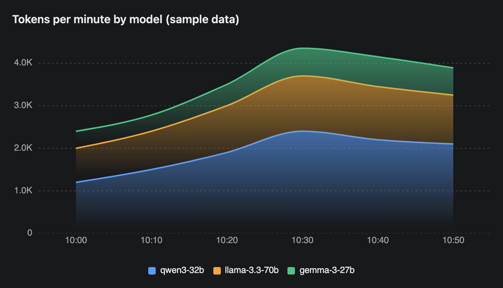
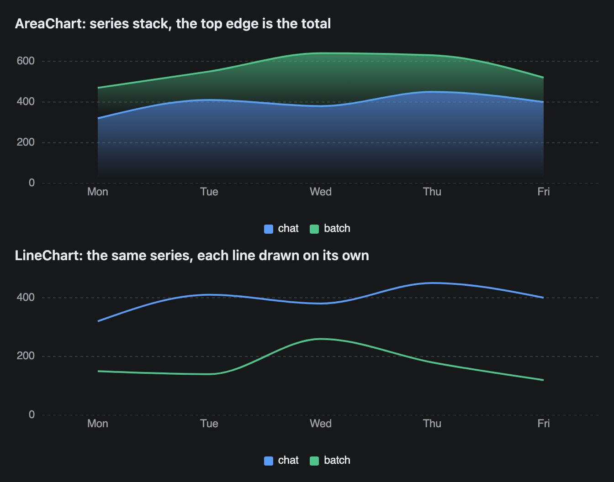
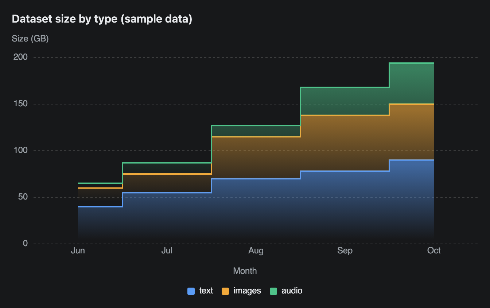

# AreaChart

A filled chart where the series are stacked on top of each other. The top edge is the total, and each coloured band is one series' share of it. It is a stacked chart only, with no overlapping option.



## Signature

```text
AreaChart(labels: string[], series: Series[], variant?: "linear" | "natural" | "step", xLabel?: string, yLabel?: string, height?: number)
Series(category: string, values: number[])
```

## When to use

- Parts of a growing total over time: tokens per model, disk per dataset, requests per status class.
- You care about the total as much as the split.

Not for series that are not parts of one sum. Two nodes at 90% and 80% GPU utilisation would stack to a meaningless 170%, so use [LineChart](LineChart.md) to compare them.

## Arguments

The arguments are the same as [LineChart](LineChart.md). `Series` is documented there too.

### AreaChart

| # | Argument | Type | Required | Notes |
|---|---|---|---|---|
| 1 | `labels` | string[] | yes | The x axis, left to right. |
| 2 | `series` | Series[] | yes | One `Series` per band. The first is at the bottom, the last on top. |
| 3 | `variant` | `"linear"`, `"natural"` or `"step"` | no | Default `"natural"` (smooth). |
| 4 | `xLabel` | string | no | A title under the x axis. |
| 5 | `yLabel` | string | no | A title above the y axis. |
| 6 | `height` | number | no | Chart height in pixels, legend included. Axis titles add to it. |

## Examples

### Stacked series with the defaults

The y axis is sized to the sum of the three series at the busiest point, not to the largest single series.

```openui
root = Stack([title, chart])
title = Text("Tokens per minute by model (sample data)", "heading")
chart = AreaChart(["10:00", "10:10", "10:20", "10:30", "10:40", "10:50"], [a, b, c])
a = Series("qwen3-32b", [1200, 1500, 1900, 2400, 2200, 2100])
b = Series("llama-3.3-70b", [800, 900, 1100, 1300, 1250, 1150])
c = Series("gemma-3-27b", [400, 380, 500, 650, 700, 640])
```


### The same data as an area and as lines

The `chat` and `batch` series appear in both charts. In the area chart `batch` sits on top of `chat`, so its top edge is the sum. In the line chart each line is the series itself. The `null` arguments keep the defaults so `height` can be set.

```openui
root = Stack([t1, area, t2, line])
t1 = Text("AreaChart: series stack, the top edge is the total", "heading")
area = AreaChart(["Mon", "Tue", "Wed", "Thu", "Fri"], [a, b], null, null, null, 200)
t2 = Text("LineChart: the same series, each line drawn on its own", "heading")
line = LineChart(["Mon", "Tue", "Wed", "Thu", "Fri"], [a, b], null, null, null, 200)
a = Series("chat", [320, 410, 380, 450, 400])
b = Series("batch", [150, 140, 260, 180, 120])
```



### Step variant with axis titles

`"step"` fits totals that grow in jumps, such as a dataset that gains files each month.

```openui
root = Stack([title, chart])
title = Text("Dataset size by type (sample data)", "heading")
chart = AreaChart(["Jun", "Jul", "Aug", "Sep", "Oct"], [t, i, a], "step", "Month", "Size (GB)")
t = Series("text", [40, 55, 70, 78, 90])
i = Series("images", [20, 20, 45, 60, 60])
a = Series("audio", [5, 12, 12, 30, 44])
```



## Tips and pitfalls

- The series always stack. The chart code defaults to stacked and the plugin does not expose a way to turn it off.
- To read an upper band you subtract the band below it. In the second example `batch` peaks at 260, but its top edge is at 640.
- Length rules are the same as for [LineChart](LineChart.md). Both charts use the same data builder.
- The y axis always starts at 0 and is sized to the largest stacked total.
- The first and last points sit inside the plot with a gap on each side, so the fill does not reach the chart edges.
- The `"step"` variant changes value halfway between two labels, not on the label.
- A click on a legend entry hides that series. This comes from the chart code and a screenshot cannot show it.

## Related

[LineChart](LineChart.md) compares series directly and documents `Series`. [PieChart](PieChart.md) shows shares at one moment. [BarChart](BarChart.md) shows one value per category.
