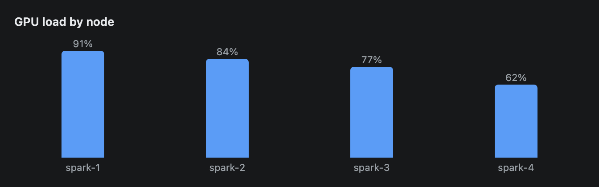
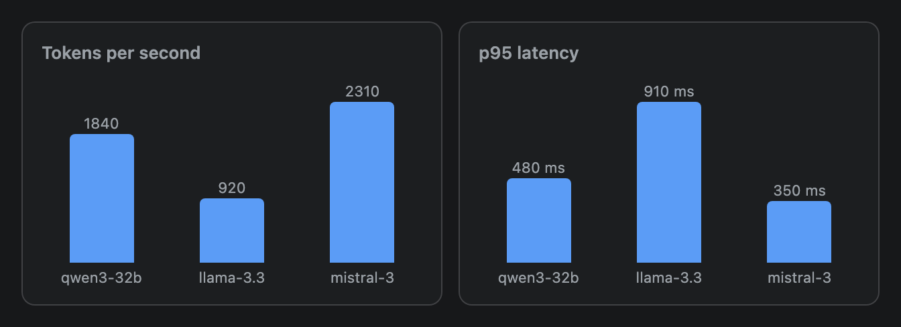
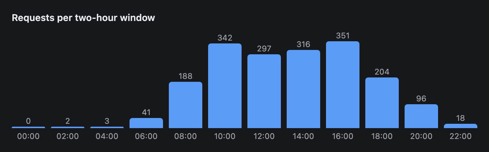

# BarChart

A vertical bar chart for one series: a label under each bar and its value on top. Give it two arrays of the same length.



## Signature

```text
BarChart(labels: string[], values: number[], title?: string, unit?: string)
```

## When to use

- One number per category: load per node, tokens per second per model, requests per hour.
- Up to about 24 bars. A test with 24 two-digit labels still fit a 640 px column (the widest a preview frame gets).

Not for several series (use [LineChart](LineChart.md)), parts of a whole (use [PieChart](PieChart.md)) or exact values you want to compare closely (use [Table](Table.md)).

## Arguments

| # | Argument | Type | Required | Notes |
|---|---|---|---|---|
| 1 | `labels` | array of strings | yes | One label per bar, under it. Keep them short. |
| 2 | `values` | array of numbers | yes | One value per bar, same length as `labels`. The validator rejects unequal lengths. |
| 3 | `title` | string | no | Bold line above the chart. Pass `null` to skip it and still set `unit`. |
| 4 | `unit` | string | no | Text added straight after each value: `"%"` gives `91%`. For a space, include it: `" ms"`. |

## Examples

### Title and unit

All four arguments. The unit is appended to the number above each bar.

```openui
root = Stack([chart])
chart = BarChart(["spark-1", "spark-2", "spark-3", "spark-4"], [91, 84, 77, 62], "GPU load by node", "%")
```


### Two charts in cards

No title and no unit, or a unit with `null` as the title. The [Card](Card.md) titles replace the chart titles.

```openui
root = Stack([throughputCard, latencyCard], "row")
throughputCard = Card([throughput], "Tokens per second")
throughput = BarChart(["qwen3-32b", "llama-3.3", "mistral-3"], [1840, 920, 2310])
latencyCard = Card([latency], "p95 latency")
latency = BarChart(["qwen3-32b", "llama-3.3", "mistral-3"], [480, 910, 350], null, " ms")
```



### Many bars

Twelve bars still fit. The quiet hour with value 0 gets a thin stub, not nothing.

```openui
root = Stack([chart])
chart = BarChart(["00:00", "02:00", "04:00", "06:00", "08:00", "10:00", "12:00", "14:00", "16:00", "18:00", "20:00", "22:00"], [0, 2, 3, 41, 188, 342, 297, 316, 351, 204, 96, 18], "Requests per two-hour window")
```



## Tips and pitfalls

- The tallest bar always fills the chart, and the others scale against it. In the first example `62%` is 68% as tall as `91%`. The bars are not drawn on a 0 to 100 scale.
- Values below 1 are scaled against 1, not against the largest value. A chart of `0.25` and `0.5` draws the larger bar at half height.
- There are no axes, gridlines, legend or hover. The value is printed above each bar, as given. `1840` stays `1840`.
- Zero and negative values draw a 2 px stub. A negative value shows its label (`-5%`) but never a bar below the line.
- Bars are 48 px wide at most. A label wider than its slot is cut off with an ellipsis, so use `"spark-1"`, not a full model path.
- One colour, one series. To compare series, use [LineChart](LineChart.md).

## Related

[Card](Card.md) frames a chart. [Table](Table.md) gives exact numbers. [LineChart](LineChart.md), [AreaChart](AreaChart.md) and [PieChart](PieChart.md) cover other shapes of data.
