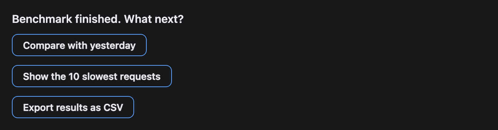
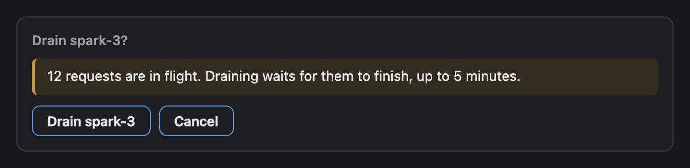

# Button

A clickable button. A click sends text back to the AI as the user's next message, so the AI can act and draw a fresh widget.


## Signature

```text
Button(label: string, action?: ActionExpression)
```

## When to use

- Follow-up actions the reader is likely to want: restart a service, show logs, compare with yesterday.
- A confirmation step before something risky, with an explicit message for each choice.

Not for asking a question with fixed answers (use [Choice](Choice.md)) or for a link, because a widget cannot open a URL. Put an address in a [Text](Text.md) instead.

A screenshot cannot show a click. The pictures on this page show how the buttons look. Their behaviour is described below.

## Arguments

| # | Argument | Type | Required | Notes |
|---|---|---|---|---|
| 1 | `label` | string | yes | The text on the button. With no action it is also the message that gets sent. |
| 2 | `action` | `ActionExpression` | no | Usually `@ToAssistant("message")`. Leave it out and a click sends the label. |

`@ToAssistant` takes its own arguments:

| # | Argument | Type | Required | Notes |
|---|---|---|---|---|
| 1 | `message` | string | yes | What the AI receives as the user's next turn. At most 500 characters. |
| 2 | `context` | any | no | The parser accepts it, but neither runtime passes it on, so the AI never sees it. |

## Examples

### A row of action buttons

The label is short and the message is a full instruction. The AI only sees the message.

```openui
root = Stack([title, status, actions])
title = Text("vllm on spark-1", "heading")
status = Callout("Queue depth is 48 and rising. GPU memory is at 96%.", "warn")
actions = Stack([restart, logs, batch], "row", "s", true)
restart = Button("Restart vllm", @ToAssistant("Restart the vllm service on spark-1 and tell me when it is serving again"))
logs = Button("Show logs", @ToAssistant("Show the last 50 lines of the vllm log on spark-1"))
batch = Button("Lower batch size", @ToAssistant("Lower the vllm max batch size on spark-1 to 16 and restart it"))
```


### Buttons with no action

Without a second argument each button sends its own label, so write the label as a request.

```openui
root = Stack([title, followUps])
title = Text("Benchmark finished. What next?", "heading")
followUps = Stack([compare, slowest, export])
compare = Button("Compare with yesterday")
slowest = Button("Show the 10 slowest requests")
export = Button("Export results as CSV")
```



### A confirmation

The Cancel button sends a message too. Every button sends something, so say what you want the AI to do, including nothing.

```openui
root = Stack([card], "row")
card = Card([warning, choices], "Drain spark-3?")
warning = Callout("12 requests are in flight. Draining waits for them to finish, up to 5 minutes.", "warn")
choices = Stack([confirm, cancel], "row", "s")
confirm = Button("Drain spark-3", @ToAssistant("Drain spark-3: stop sending it new requests, wait up to 5 minutes for in-flight requests to finish, then report the final state of the node"))
cancel = Button("Cancel", @ToAssistant("Do not drain spark-3. Leave the cluster as it is."))
```



## Tips and pitfalls

- I checked clicks in the iframe runtime, in a browser with a stand-in for the host's send function. `Restart vllm` passed its `@ToAssistant` text exactly, and a button with no action passed its label.
- The message is delivered as the user's next turn. The native plugin types it into the chat as a visible message. The iframe runtime sends a hidden turn.
- Two limits apply in both modes: a message over 500 characters is refused, and so is a click less than a second after the previous one. The app's `::preview` bridge refuses with an error reply (`too_long` or `throttled`); the widget only writes a console warning, so the reader sees nothing happen. The native plugin drops them with no notice at all. Read from the app source (`inline-preview-directive.tsx`) and the plugin code; I did not hit the limits in the running app.
- A widget is a snapshot. A button has no pressed, disabled or loading state, and the widget does not change after a click. The AI's answer is what shows the result.
- `@OpenUrl` is rejected by the plugin's linter, because the widget is sandboxed and cannot navigate. The `context` argument of `@ToAssistant` is ignored by both runtimes. Do not rely on either.
- All buttons look the same. There is no colour, icon, size or disabled option.
- A Button is as wide as its label and sits at the start of its Stack. Put several in a row Stack with `"s"` gap and `wrap` on, or in a column for a list of suggestions.

## Related

[Stack](Stack.md) lays out a row of buttons. [Callout](Callout.md) explains why the action matters. [Card](Card.md) frames a confirmation. [Choice](Choice.md) asks a question with fixed answers.
