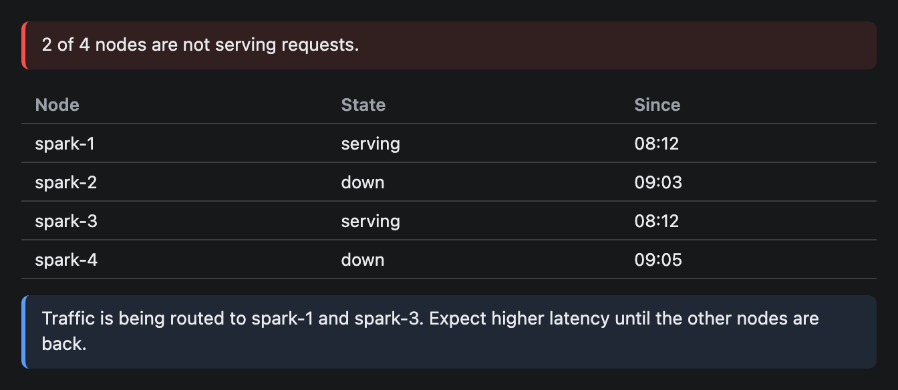
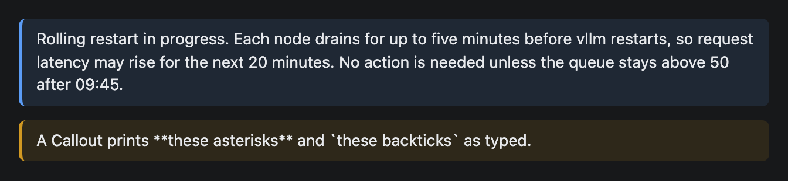

# Callout

A highlighted note with a coloured bar on its left edge. Four tones say how much attention it needs.


## Signature

```text
Callout(text: string, tone?: "info" | "success" | "warn" | "error")
```

## When to use

- A warning or an error that must not be missed: a node is down, a disk is nearly full.
- A one-line summary above a table or chart.
- A confirmation that something finished.

Not for headings (use [Text](Text.md)) or for content with formatting (use [Markdown](Markdown.md)).

## Arguments

| # | Argument | Type | Required | Notes |
|---|---|---|---|---|
| 1 | `text` | string | yes | The message. Plain text. It wraps when long. |
| 2 | `tone` | `"info"`, `"success"`, `"warn"` or `"error"` | no | Colours the left bar and the tinted background. Defaults to `"info"`. |

The four tones:

| Tone | Colour | Use it for |
|---|---|---|
| `"info"` | The app's accent colour (blue in these images) | A neutral fact. |
| `"success"` | Green | Something finished or is healthy. |
| `"warn"` | Amber | A problem that is coming. |
| `"error"` | Red | A failure that has happened. |

## Examples

### All four tones

One message per tone, written the way a real status report would.

```openui
root = Stack([info, success, warn, error])
info = Callout("spark-4 rejoined the cluster at 09:02 UTC.", "info")
success = Callout("Backup finished: 412 GB written to the NAS in 18 minutes.", "success")
warn = Callout("The disk on spark-2 is 86% full. Free some space before the next model download.", "warn")
error = Callout("vllm on spark-1 exited with code 137 (out of memory).", "error")
```


### A callout above the data

Put the one-sentence conclusion first, then the table that backs it up, then a follow-up note.

```openui
root = Stack([alert, nodes, hint])
alert = Callout("2 of 4 nodes are not serving requests.", "error")
nodes = Table(["Node", "State", "Since"], [["spark-1", "serving", "08:12"], ["spark-2", "down", "09:03"], ["spark-3", "serving", "08:12"], ["spark-4", "down", "09:05"]])
hint = Callout("Traffic is being routed to spark-1 and spark-3. Expect higher latency until the other nodes are back.", "info")
```



### Default tone, long text, plain text

With no tone the callout is `"info"`. Long text wraps. Markdown characters are not interpreted.

```openui
root = Stack([longNote, stars])
longNote = Callout("Rolling restart in progress. Each node drains for up to five minutes before vllm restarts, so request latency may rise for the next 20 minutes. No action is needed unless the queue stays above 50 after 09:45.")
stars = Callout("A Callout prints **these asterisks** and `these backticks` as typed.", "warn")
```



## Tips and pitfalls

- The text is plain. `**bold**` and backticks print as typed (second callout above), and a `\n` collapses to a space. For formatted text, use [Markdown](Markdown.md).
- A Callout has no title, icon, button or close control. It is one block of text.
- You pick the tone. Nothing checks that `"error"` matches the message.
- In a column a Callout fills the width. In a row it is only as wide as its text.
- Two or three Callouts per widget is plenty. A page of coloured bars stops looking urgent.
- `"info"` follows the app's accent colour, so it changes with the theme. The other three are fixed colours.

## Related

[Text](Text.md) with the `"muted"` variant is a quieter note. [Markdown](Markdown.md) formats longer text. [Button](Button.md) lets the reader act on a warning.
