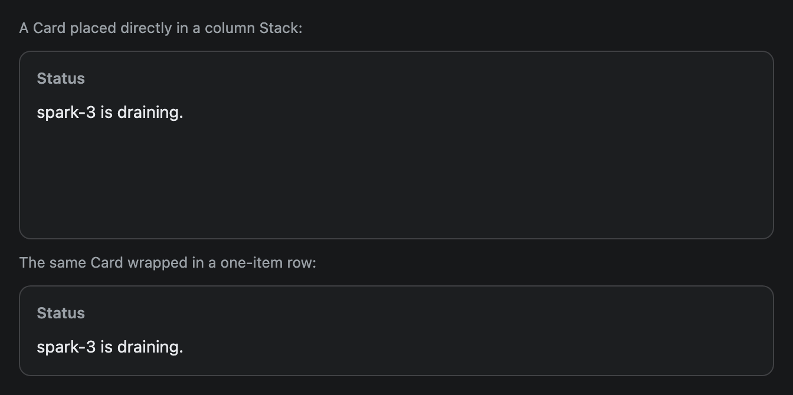
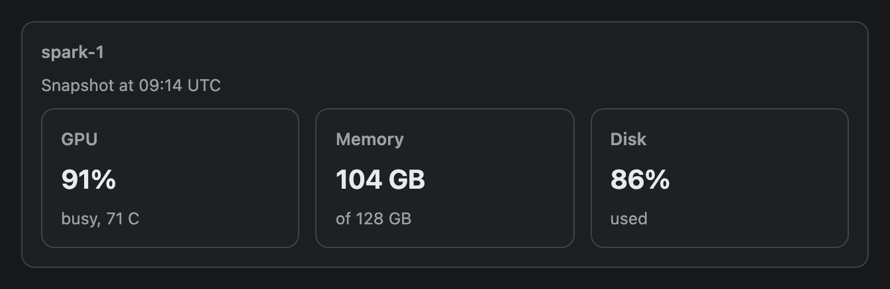

# Card

A bordered panel with an optional title. Put related content inside it, and put several Cards in a row to build a dashboard.


## Signature

```text
Card(children: any[], title?: string)
```

## When to use

- To group a table, a chart or a few lines under one small title.
- Two or three Cards in a row, each holding one view of the data.
- Inside [Tabs](Tabs.md), one Card per view.

Not for a bare list of numbers (use [Metric](Metric.md) tiles in a [Stack](Stack.md) row) or for a message that needs a colour (use [Callout](Callout.md)).

## Arguments

| # | Argument | Type | Required | Notes |
|---|---|---|---|---|
| 1 | `children` | array of components | yes | The content, top to bottom, with a 10 px gap. Any component can go inside, including another Card. |
| 2 | `title` | string | no | A small grey bold label at the top (13 px). Plain text. Leave it out and the Card has no header line. |

The children come first and the title second: `Card([chart], "Load")`.

## Examples

### Two cards in a row

Cards in a row split the width equally. Here each holds a different component: a [Table](Table.md) and a [BarChart](BarChart.md).

```openui
root = Stack([nodesCard, loadCard], "row")
nodesCard = Card([nodes], "Nodes")
nodes = Table(["Node", "State"], [["spark-1", "serving"], ["spark-2", "serving"], ["spark-3", "draining"], ["spark-4", "serving"]])
loadCard = Card([load], "GPU load")
load = BarChart(["spark-1", "spark-2", "spark-3", "spark-4"], [91, 84, 40, 62], null, "%")
```


### A short card on its own line

A Card placed directly in a column is at least 160 px tall, even with one line of text. Wrapping it in a one-item row gives it the height of its content.

```openui
root = Stack([bareLabel, bare, wrappedLabel, wrappedRow])
bareLabel = Text("A Card placed directly in a column Stack:", "muted")
bare = Card([bareText], "Status")
bareText = Text("spark-3 is draining.")
wrappedLabel = Text("The same Card wrapped in a one-item row:", "muted")
wrappedRow = Stack([wrapped], "row")
wrapped = Card([wrappedText], "Status")
wrappedText = Text("spark-3 is draining.")
```



### Cards inside a card

Nesting works. The outer Card has a title and a muted line, and the inner row holds three Cards.

```openui
root = Stack([outer])
outer = Card([title, inner], "spark-1")
title = Text("Snapshot at 09:14 UTC", "muted")
inner = Stack([gpu, memory, disk], "row")
gpu = Card([gpuValue, gpuNote], "GPU")
gpuValue = Text("91%", "title")
gpuNote = Text("busy, 71 C", "muted")
memory = Card([memoryValue, memoryNote], "Memory")
memoryValue = Text("104 GB", "title")
memoryNote = Text("of 128 GB", "muted")
disk = Card([diskValue, diskNote], "Disk")
diskValue = Text("86%", "title")
diskNote = Text("used", "muted")
```



## Tips and pitfalls

- The 160 px minimum is real and surprising. The code sets `flex: 1 1 160px` on every Card. In a row that means "start at 160 px wide". In a column it means "start at 160 px tall". A Card holding a chart or a table is taller than that anyway, so you only notice it with short content. [Metric](Metric.md) has the same behaviour at 120 px.
- Cards in a row without `wrap` squeeze together. With `wrap` on, five Cards broke into three on the first line and two on the second, and the second line's Cards grew wider.
- The title is plain text. A Card does not collapse, scroll or react to clicks.
- One Card can hold a [Button](Button.md) row, a [Callout](Callout.md) and a table together. Keep it to one idea per Card.
- Nested Cards add a border and 14 px of padding each time, so two levels is about the limit before the content gets narrow.

## Related

[Stack](Stack.md) lays Cards out in a row. [Tabs](Tabs.md) hold one Card per view. [Table](Table.md) and [BarChart](BarChart.md) are the usual contents.
