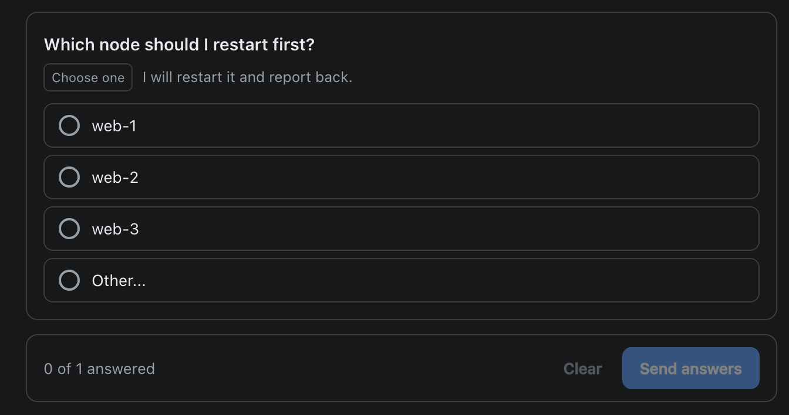
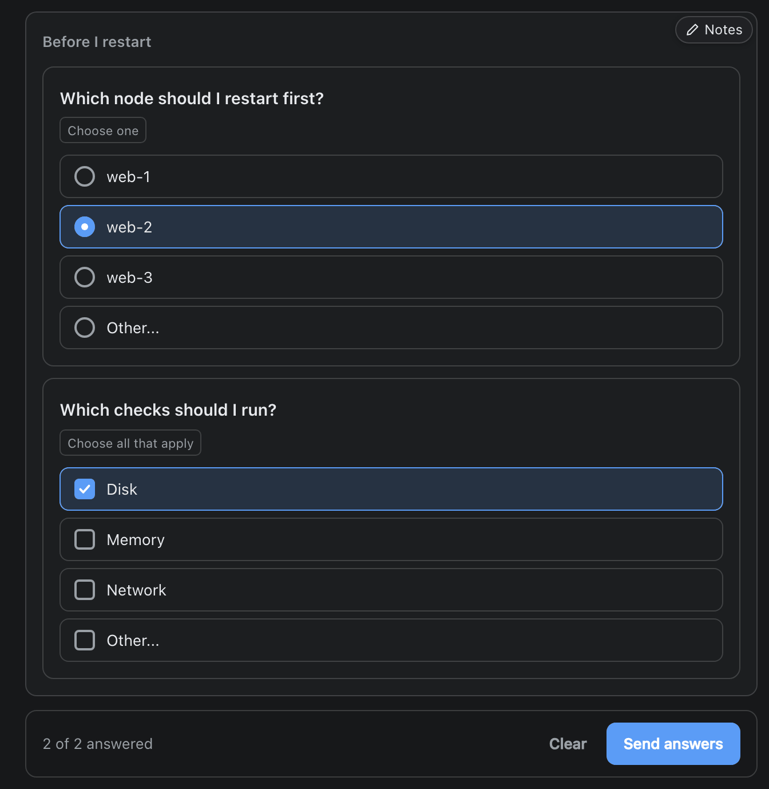
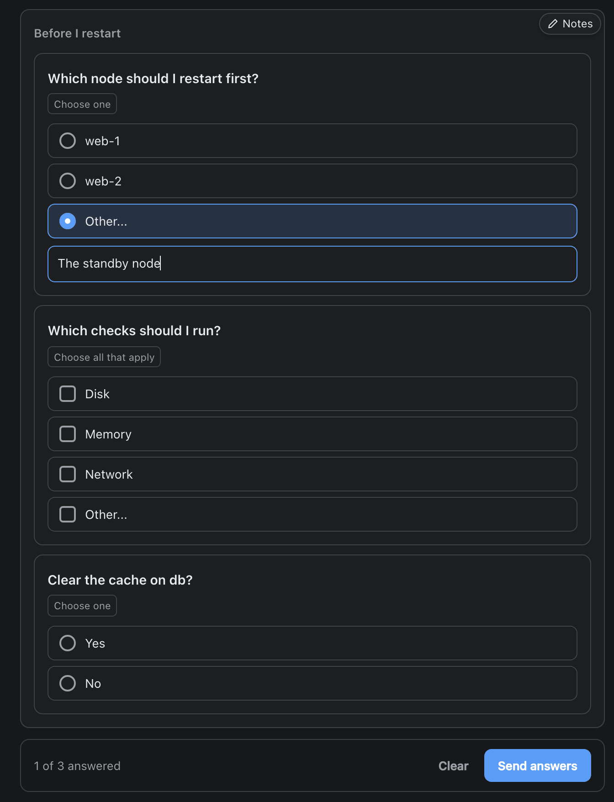
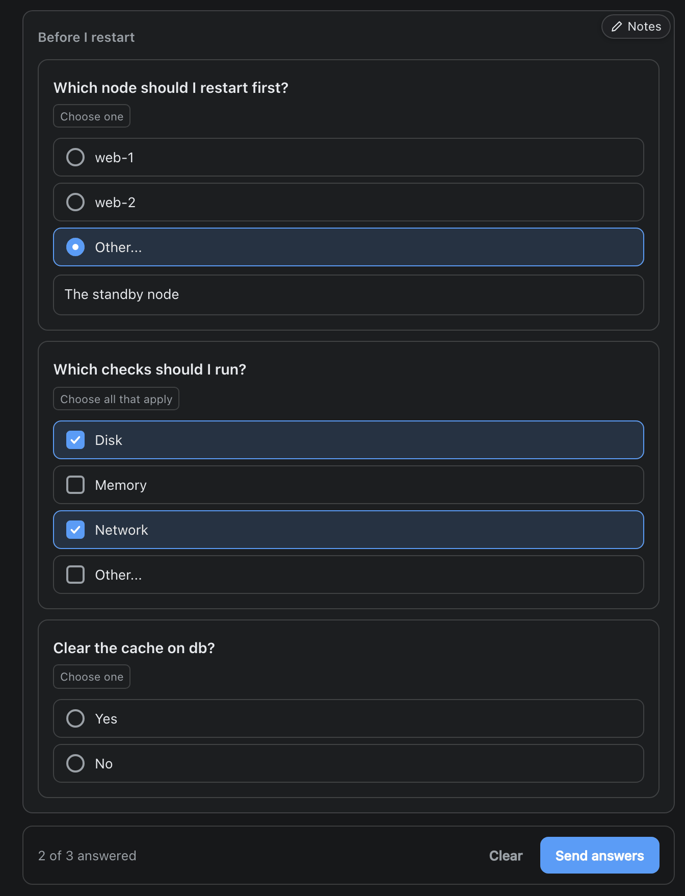
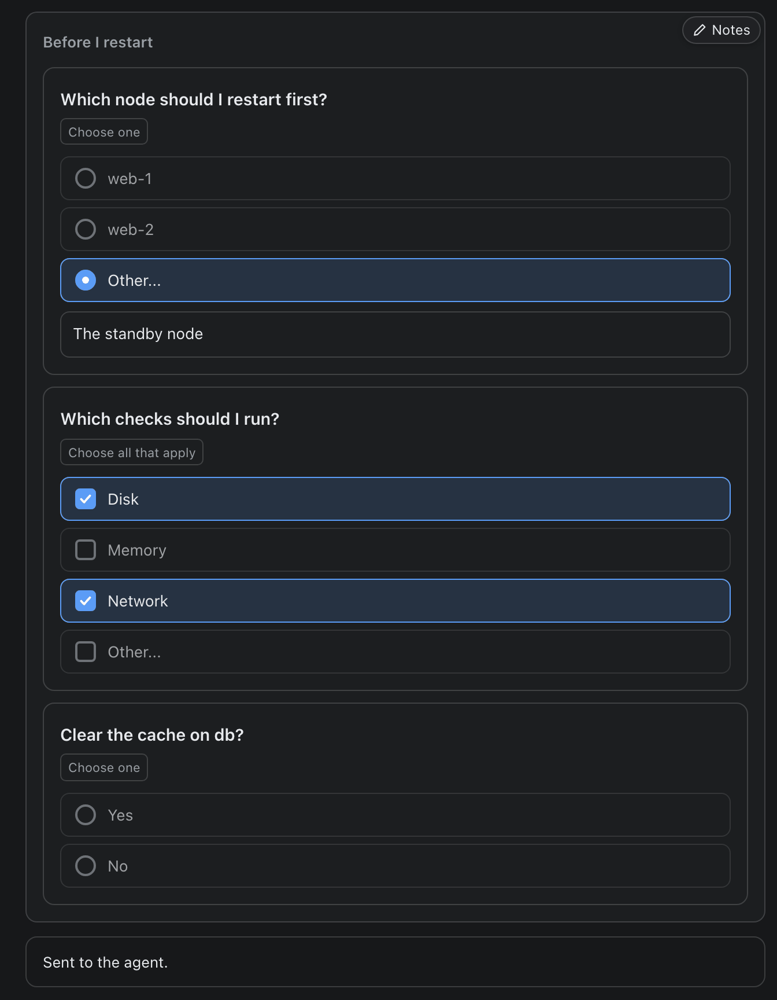
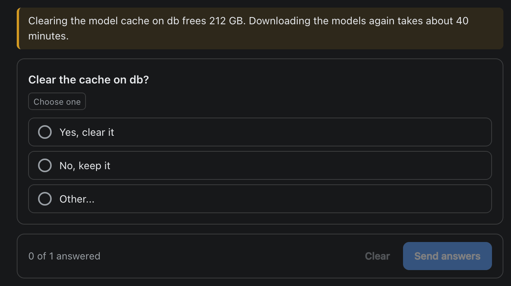
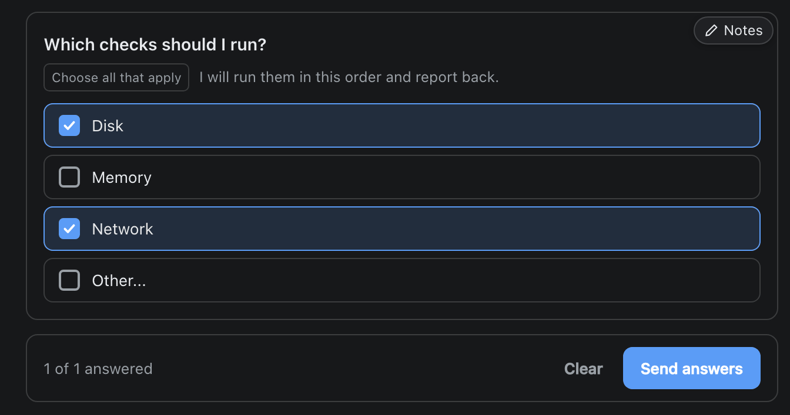
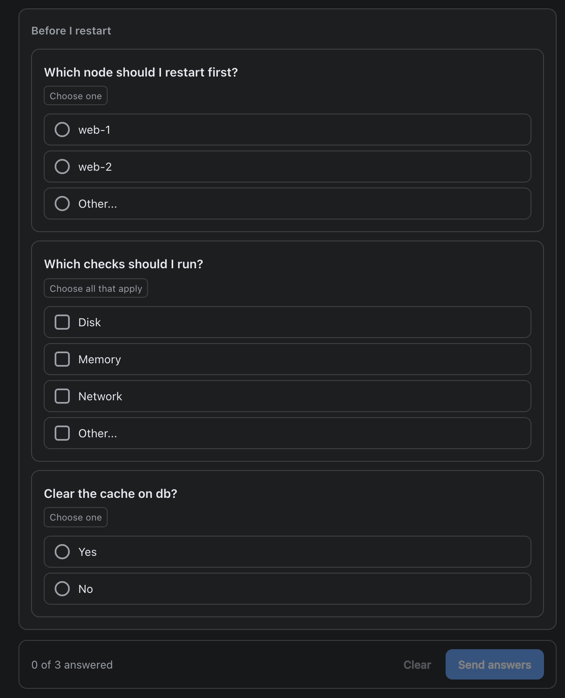
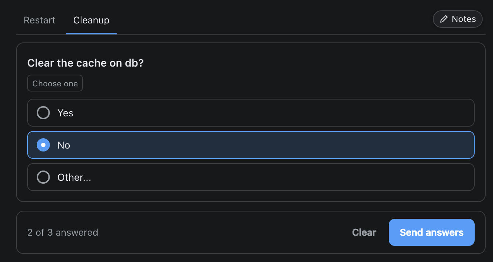

# Choice

A question with a short list of options for the user to answer. Choices are staged: a click selects, and **one Send answers button** under the widget sends every answer of the widget together as the next chat message. An option can allow several answers (`multiple`), and every question has an **Other...** row with a text box of its own (unless `other` is false).



## Signature

```text
Choice(question: string, options: string[], hint?: string, multiple?: boolean, other?: boolean)
```

## When to use

- A clarifying question with a few known answers: which node, which environment, yes or no. Ask all of them in ONE widget, in a [Card](Card.md) or in [Tabs](Tabs.md): the user answers them together and sends once.
- A confirmation before something risky, placed under a [Callout](Callout.md) that explains the cost.
- A question where several answers can be right (`multiple: true`), or where the user may want to say something else (the Other row).

Not for a command that should run as written: use [Button](Button.md) with `@ToAssistant`, which sends the exact text you give it on one click.

## Arguments

| # | Argument | Type | Required | Notes |
|---|---|---|---|---|
| 1 | `question` | string | yes | Shown in bold above the options. Also the first half of the message sent back. |
| 2 | `options` | string[] | yes | One row per entry, stacked in a column, each with a selection indicator: a round radio for a single question, a square checkbox for `multiple`. The component description asks for 2 to 6. |
| 3 | `hint` | string | no | A small grey line between the question and the options. |
| 4 | `multiple` | boolean | no | `true`: options toggle independently and several can be answered. Default `false`: one answer. |
| 5 | `other` | boolean | no | Default `true`: a last row **Other...** that opens a text box. `false` hides it. |

**Skipped optional arguments before a later one are written `null`.** To set `multiple` and skip `hint`: `Choice("Which checks?", ["Disk", "Memory"], null, true)`. To hide the Other row and skip both `hint` and `multiple`: `Choice("Clear the cache?", ["Yes", "No"], null, null, false)`. The validator says so, with an example, when a Choice is written wrong.

## Single and multiple

A single question and a multiple one look different, so the reader knows before clicking whether one answer or several are wanted:

| | Single (default) | Multiple (`multiple: true`) |
|---|---|---|
| Tag under the question | `Choose one` | `Choose all that apply` |
| Indicator on every row, the **Other...** row too | a **round** radio; chosen = filled with a dot | a **square** checkbox; chosen = filled with a check mark |
| Role (assistive technology) | the question is a `radiogroup`, each option a `radio` with `aria-checked` | the question is a `group`, each option a `checkbox` with `aria-checked` |
| A second click on a chosen row | unselects it | unselects it |

Selecting needs no letter: the rows carry none, and a click, Space or Enter selects. The unchosen outline is drawn in the muted text colour (the theme border is too faint to see), at least 3:1 against the card in the dark and the light theme, and the chosen row keeps its tinted background and accent border as well.



The same card in the light theme: [choice-single-vs-multiple-light.png](../images/choice-single-vs-multiple-light.png).

```openui
root = Stack([plan])
plan = Card([q1, q2], "Before I restart")
q1 = Choice("Which node should I restart first?", ["web-1", "web-2", "web-3"])
q2 = Choice("Which checks should I run?", ["Disk", "Memory", "Network"], null, true)
```

Do not write the words yourself in the `hint`: the tag already says `Choose one` or `Choose all that apply`.

## What a click does

A click **selects**; it sends nothing. Every Choice of the widget (also the ones in [Tabs](Tabs.md) and [Card](Card.md)) shares one board, so the answers survive a tab switch.

- **Single mode** (the default): a click selects the option, a second click on it unselects it, and picking another option moves the selection.
- **`multiple: true`**: each option toggles on its own. The words of the answer are joined with `; ` in option order.
- **Other...** selects the row, opens a text box under the options (placeholder `Type your own answer`, 500 characters at most, a few lines tall) and puts the cursor in it. In single mode Other replaces the selected option; in multiple mode it comes in addition to the options. An Other row that is selected but empty counts as **not answered**, and the card says so under the box. `other: false` leaves the row out.

### The Send answers bar

A bar at the bottom of the widget, outside Tabs and Cards, appears when the widget has at least one Choice. It reads `2 of 3 answered` (it counts the questions on a tab nobody has opened yet too), a **Send answers** button (enabled when at least one question is answered) and a quiet **Clear**.





A question left without an answer does not block sending: the message lists it as `(no answer)`, so the agent knows it was skipped.

**After Send** every Choice locks and keeps its answers highlighted, the bar says `Sent to the agent.`, and nothing can be changed or sent again. The agent has to render a new widget to ask again.



### The message

One Choice in the widget, in single mode, answered with an option and no Other text keeps the format agents already expect, a spaced em dash:

```text
<question> — <option>
```

For the first example that is `Which node should I restart first? — web-2`.

One exception, so a question can never run an app command: the app runs a message that starts with `/` and a command name as that command (`/new`, `/yolo`). When the one-question line would start that way, for example the question `/new session?`, the numbered message below is sent instead. It starts with `Answers to`, so it is safe. An ordinary question keeps the line above, byte for byte.

Anything else is one numbered message in plain ASCII punctuation. The header names the widget (native mode knows its file name; the preview page writes `this widget`):

```text
Answers to the questions in widget `restart-plan` (3):

1. Which node should I restart first?
   web-2
2. Which checks should I run?
   disk; memory; other: also look at the logs
3. Clear the cache on db?
   (no answer)
```

The Other text is labelled `other:`. A multi-line Other text keeps its lines, indented under the question. Two Choices with the same question, options and flags count as one question.

### What is cleaned

The message is **sent as written, with no draft to review**, and the question and option words come from the agent. Before they go out, control and invisible characters (zero width, bidi marks, the soft hyphen) are removed, whitespace is collapsed, a question is cut at 200 characters and an option at 120 (a cut text ends in `...`), and anything that the app or the gateway would turn into an attached reference is written with `(at)` instead of `@`: the app's kinds (`@file:`, `@url:`, `@folder:`, `@image:`, `@tool:`, `@line:`, `@terminal:`, `@session:`), a bare `@diff` or `@staged`, `@git:`, and `@` followed by any word and a colon (`@foo:bar`), because the gateway expands those too when a plugin provides them. It is the same rule Notes uses for words it quotes. An `@` in an e-mail address or before a space is left alone. **The user's own Other text is sent as typed**, except for control and invisible characters; their `@` stays.

### Limits

| Mode | Longest message | If it is longer |
|---|---|---|
| Preview (the app's inline frame) | 500 characters, and one message a second | The questions are clipped first (below). If it is still over, the bar says `This answer is N characters and this display mode sends at most 500. Shorten the answers.` and sends nothing |
| Native (the desktop renderer) | 4,000 characters for an answer that comes from the Choice bar | The same sentence with 4,000 |

The preview cap belongs to the app and the plugin cannot change it. In native mode the 4,000 belongs to the plugin and is for the Choice bar only: a `Button(..., @ToAssistant(text))` an agent writes stays at 500 characters, because the bar calls its own sending function and an action has no way to reach it. The user can only shorten their own Other text, never the agent's questions, so **in preview a message over 500 characters is written again with each question clipped** to 50 characters, then to 30, then to 20 if it is still too long (a clipped question ends in `...`, and the numbers stay, so every answer still maps to its question), and the first version that fits is sent. About four short questions fit unclipped; five questions of 100 characters with short answers are sent clipped. Only when even the shortest version is over 500 is the answer refused, with the sentence above and nothing locked: the user shortens the Other text or clears an answer and sends again. Native mode never clips.

**Which chat.** In native mode the answers go to the chat that holds the widget (a tile or the primary chat, the same address Notes uses for a draft), not to whichever message box was clicked last. Without a chat marker around the widget the app's "last focused" box is used, as before. A `Button` sent by the same widget goes to the same chat; its 500 character cap and one-second gap are unchanged.

### Native mode: kept while the transcript redraws

The chat can remove and redraw a widget as you scroll. In native mode the staged answers and the sent flag are kept in memory and in `sessionStorage` under `hermes-openui:answers:<widget file name>`, the way Notes keeps notes, so a redrawn widget shows what you had picked (and stays locked after Send). The saved board belongs to one set of questions: if the widget is redrawn under the same file name with another set (a question added, removed or replaced), the answers that still fit are kept but it opens unlocked, so a new question is never shown as already sent. Quitting the app loses them. A preview page keeps its answers for as long as the page lives.

### Keyboard and focus

Each question is a `radiogroup` (single) or a `group` (multiple) named by its question text. Its options are real buttons with `role="radio"` or `role="checkbox"` and `aria-checked`, and the group has **one Tab stop**. **Space** or **Enter** toggles the focused option and the **arrow keys** move between the options of the question. There is no letter shortcut: the app sends a typed letter to its message box before a widget can see it, so a letter key would both toggle the option and type into the message. In the Other box **Enter** does not send: it moves to the next question (or to the bar), **Shift+Enter** is a new line, and **Escape** leaves the box. After a successful Send, if the Send button had the focus it moves to the status line (`Sent to the agent.`), otherwise the focus stays where it is.

### Notes mode and exported pages

In Notes mode (native) a Choice and the bar are inert, like a Button, and a Table next to a Choice can still be noted. An **exported** page has no chat to send to: the options can be looked at, the Send button is disabled and the bar says `Interactive buttons work inside Hermes only`.

## Examples

### A question with a hint

The hint tells the reader what happens next. Options are short so the sent message stays readable.

```openui
root = Stack([ask])
ask = Choice("Which node should I restart first?", ["web-1", "web-2", "web-3"], "I will restart it and report back.")
```


### Confirm a risky action

A warning [Callout](Callout.md) gives the cost, and a two-option `Choice` asks for the decision. The options read well after the question.

```openui
root = Stack([note, ask])
note = Callout("Clearing the model cache on db frees 212 GB. Downloading the models again takes about 40 minutes.", "warn")
ask = Choice("Clear the cache on db?", ["Yes, clear it", "No, keep it"])
```



### Several answers

`multiple: true` lets the user pick any number of options and shows square checkboxes and the tag `Choose all that apply`. `hint` is skipped, so it is written `null`.

```openui
root = Stack([ask])
ask = Choice("Which checks should I run?", ["Disk", "Memory", "Network"], "I will run them in this order and report back.", true)
```



### Questions in a Card, answered together

Put every question in one widget. The Card groups them; the bar below it counts and sends them all. The second question allows several answers and the third has no Other row.

```openui
root = Stack([plan])
plan = Card([q1, q2, q3], "Before I restart")
q1 = Choice("Which node should I restart first?", ["web-1", "web-2"])
q2 = Choice("Which checks should I run?", ["Disk", "Memory", "Network"], null, true)
q3 = Choice("Clear the cache on db?", ["Yes", "No"], null, null, false)
```



### Questions in Tabs

The bar sits under the tabs, so it counts the questions of every tab, also the ones nobody has opened, and an answer stays when the user switches tabs.

```openui
root = Stack([tabs])
tabs = Tabs([t1, t2])
t1 = TabItem("Restart", [r1, r2])
t2 = TabItem("Cleanup", [c1])
r1 = Choice("Which node should I restart first?", ["web-1", "web-2"])
r2 = Choice("Drain the node first?", ["Yes", "No"])
c1 = Choice("Clear the cache on db?", ["Yes", "No"])
```



## Tips and pitfalls

- **This is a change from the previous release (0.5.0).** A click used to send `<question> — <option>` at once and lock that one question. Now nothing is sent until Send answers, a widget with any Choice gets the bar, and every Choice gets an Other row (write `other: false` to keep the old closed list).
- Write the question and options so `<question> — <option>` still reads as a sentence when there is one question: "Clear the cache on db? — Yes, clear it" works. "Are you sure? — OK" does not say what was agreed.
- Ask everything in one widget. A second widget has its own bar and its own message.
- The messages add up. In preview about four short questions fit in 500 characters; beyond that the questions are clipped to 50, 30 or 20 characters in the message you receive, with their numbers. Keep questions short and put the detail in the option words.
- Unanswered questions arrive as `(no answer)`. Do not treat that as a "no".
- The 2 to 6 limit is advice only. The code does not enforce it, and a long list makes a tall widget.
- Options are plain text. There are no per-option icons, links or descriptions. Put detail in the `hint` or the question.
- The user can change answers until they press Send. After that the widget is final.

## Related

[Button](Button.md) sends a custom message on click. [Callout](Callout.md) adds context above a question. [Faq](Faq.md) holds answers to questions the user might ask. [Card](Card.md) and [Tabs](Tabs.md) hold several questions.
