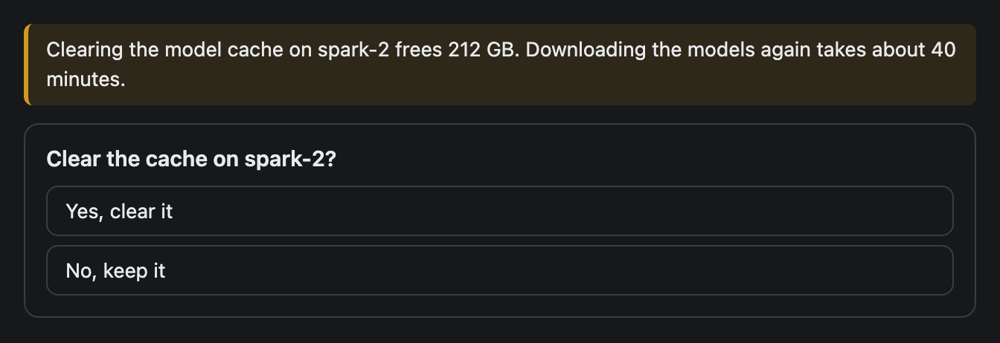

# Choice

A question with a short list of buttons for the user to pick from. A click sends the choice back to the agent as the next chat message.


## Signature

```text
Choice(question: string, options: string[], hint?: string)
```

## When to use

- A clarifying question with a few known answers: which node, which environment, yes or no.
- A confirmation before something risky, placed under a [Callout](Callout.md) that explains the cost.

Not for free text. The widget has no input field. Not for a command that should run as written: use [Button](Button.md) with `@ToAssistant`, which sends the exact text you give it.

## Arguments

| # | Argument | Type | Required | Notes |
|---|---|---|---|---|
| 1 | `question` | string | yes | Shown in bold above the options. Also the first half of the message sent back. |
| 2 | `options` | string[] | yes | One button per entry, stacked in a column. The component description asks for 2 to 6. |
| 3 | `hint` | string | no | A small grey line between the question and the buttons. |

### What a click does

Clicking an option sends this text to the agent as the user's next turn:

```text
<question> — <option>
```

For the first example that is `Which node should I restart first? — spark-2`. The separator is a spaced em dash, exactly as shown.

After a pick, every button is disabled, the chosen one is highlighted, the others fade to half opacity and the line `Sent to the agent.` appears. This is read from the component code. The screenshots on this page show the idle state only.

## Examples

### A question with a hint

The hint tells the reader what happens next. Options are short so the sent message stays readable.

```openui
root = Stack([ask])
ask = Choice("Which node should I restart first?", ["spark-1", "spark-2", "spark-3"], "Pick one. I will restart it and report back.")
```


### Confirm a risky action

A warning [Callout](Callout.md) gives the cost, and a two-option `Choice` asks for the decision. The options read well after the question.

```openui
root = Stack([note, ask])
note = Callout("Clearing the model cache on spark-2 frees 212 GB. Downloading the models again takes about 40 minutes.", "warn")
ask = Choice("Clear the cache on spark-2?", ["Yes, clear it", "No, keep it"])
```



## Tips and pitfalls

- Write the question and options so `<question> — <option>` reads as a sentence. "Clear the cache on spark-2? — Yes, clear it" works. "Are you sure? — OK" does not say what was agreed.
- Each `Choice` keeps its own pick, so two in one widget are independent.
- The 2 to 6 limit is advice only. The code does not enforce it, and a test with seven options drew seven buttons. A long list makes a tall widget.
- Options are plain text. There are no per-option icons, links or descriptions. Put detail in the `hint` or the question.
- A click cannot be undone from the widget. The buttons stay disabled for that widget.

## Related

[Button](Button.md) sends a custom message on click. [Callout](Callout.md) adds context above a question. [Faq](Faq.md) holds answers to questions the user might ask.
