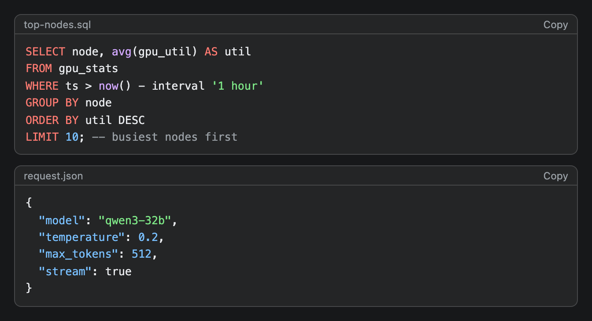
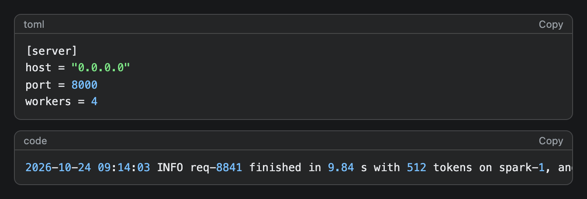

# CodeBlock

A box of code with simple syntax colours, an optional title and a Copy button. Write newlines as `\n` inside the string.


## Signature

```text
CodeBlock(code: string, language?: string, title?: string)
```

## When to use

- A command, config or query the reader will copy.
- A short script or a JSON body.
- A code sample inside [Tabs](Tabs.md), one tab per language.

Not for one short inline command in a sentence (use the `"code"` variant of [Text](Text.md) or backticks in [Markdown](Markdown.md)).

## Arguments

| # | Argument | Type | Required | Notes |
|---|---|---|---|---|
| 1 | `code` | string | yes | The code. Use `\n` for line breaks, `\"` for double quotes and `\\` for a backslash. Single quotes need no escape. |
| 2 | `language` | string | no | Picks the colours. Not case-sensitive. See the table below. |
| 3 | `title` | string | no | Shown at the top left, for example a file name. |

Languages with colours:

| Language | Also accepted | Comment style |
|---|---|---|
| `python` | `py`, `python3` | `#` |
| `js` | `javascript`, `jsx`, `ts`, `tsx`, `typescript`, `node` | `//` and `/* */` |
| `bash` | `sh`, `shell`, `zsh` | `#` |
| `sql` | `postgres`, `postgresql`, `pgsql` | `--` and `/* */` |
| `yaml` | `yml` | `#`. Unquoted keys are blue. |
| `go` | `golang` | `//` and `/* */` |
| `rust` | `rs` | `//` and `/* */` |
| `json` | none | none. Keys are blue, strings green. |

## Examples

### Python with a title

Keywords are red, strings green, numbers blue, calls purple and comments grey. The title replaces the language name in the header.

```openui
root = Stack([code])
code = CodeBlock("import time\nfrom openai import OpenAI\n\nclient = OpenAI(base_url=\"http://localhost:8000/v1\", api_key=\"none\")\n\ndef ask(prompt):\n    start = time.time()\n    reply = client.chat.completions.create(\n        model=\"qwen3-32b\",\n        messages=[{\"role\": \"user\", \"content\": prompt}],\n    )\n    # seconds taken, then the answer\n    return time.time() - start, reply.choices[0].message.content", "python", "bench.py")
```


### SQL and JSON

SQL keywords are red and the `--` comment is grey. In JSON the keys are blue and the string values green.

```openui
root = Stack([sql, json])
sql = CodeBlock("SELECT node, avg(gpu_util) AS util\nFROM gpu_stats\nWHERE ts > now() - interval '1 hour'\nGROUP BY node\nORDER BY util DESC\nLIMIT 10; -- busiest nodes first", "sql", "top-nodes.sql")
json = CodeBlock("{\n  \"model\": \"qwen3-32b\",\n  \"temperature\": 0.2,\n  \"max_tokens\": 512,\n  \"stream\": true\n}", "json", "request.json")
```



### No language, or one that is not listed

With no language and no title the header says `code`. A language outside the table keeps its name in the header but gets only partial colour. The long log line in the second block runs past the right edge and scrolls.

```openui
root = Stack([toml, log])
toml = CodeBlock("[server]\nhost = \"0.0.0.0\"\nport = 8000\nworkers = 4", "toml")
log = CodeBlock("2026-10-24 09:14:03 INFO req-8841 finished in 9.84 s with 512 tokens on spark-1, and this long line runs past the right edge of the column")
```



## Tips and pitfalls

- The header label is the `title` if you give one, else the `language` in lower case, else `code`. With a title the language is not shown.
- For a language outside the table, strings, numbers and any word followed by `(` still get colour. Keywords and comments do not. The reference says other languages render unhighlighted, but the toml block above has green strings and blue numbers.
- The colouring is a small regex pass, not a parser. Any word that is not a keyword and is followed by `(` turns purple, in every language except JSON, even with a space before the bracket. A log fragment like `s (512` shows `s` as a call.
- Long lines do not wrap. The block scrolls sideways and there are no line numbers.
- There is no height limit. A 100-line block makes a very tall widget.
- JSON `true`, `false` and `null` are not coloured. SQL keywords match in any case.
- The Copy button copies the `code` string. The label changes to `Copied` for 1.5 seconds, or to `Copy blocked` if the browser refuses. In my headless test it said `Copy blocked`, so I could not confirm that copying works inside the desktop app.

## Related

[Markdown](Markdown.md) can embed a code block between paragraphs. [Tabs](Tabs.md) hold one block per language. [Text](Text.md) has a `"code"` variant for one short line.
