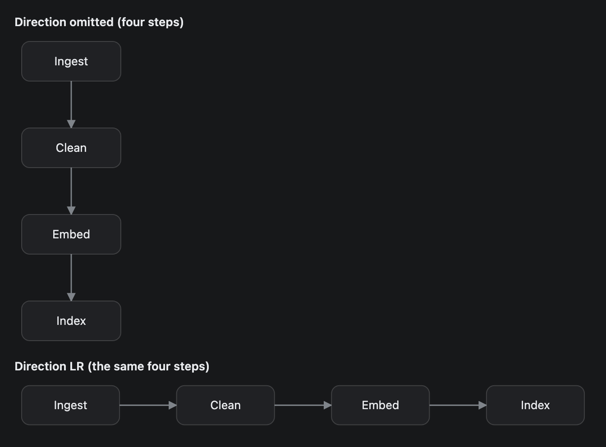
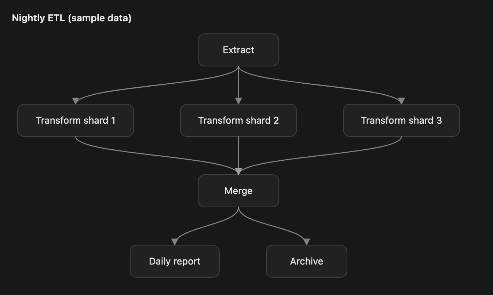
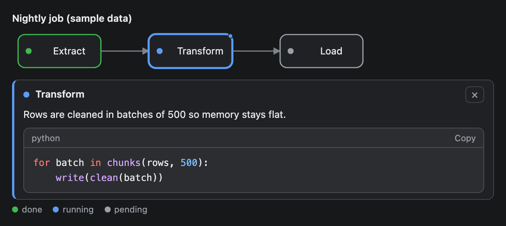

# Dag

A directed graph of boxes and arrows, laid out in layers for you. Use it for pipelines, task graphs and dependency chains. Each box can carry a status such as done or failed.


## Signature

```text
Dag(nodes: DagNode[], edges: string[][], direction?: "LR" | "TB", title?: string, tooltips?: Tooltip[])
DagNode(id: string, label: string, status?: "done" | "running" | "failed" | "pending" | "skipped")
```

## When to use

- A pipeline or CI run where each step has a state.
- A dependency graph, such as which job waits for which.
- A fan-out and fan-in: one step feeding several, several feeding one.

Not for graphs with cycles (the edge that closes a loop is dropped), database tables ([Erd](Erd.md)) or a plain list of steps ([Table](Table.md)).

## Arguments

### Dag

| # | Argument | Type | Required | Notes |
|---|---|---|---|---|
| 1 | `nodes` | DagNode[] | yes | One `DagNode` per box. |
| 2 | `edges` | string[][] | yes | Pairs `[fromId, toId]`. The arrow points from the first to the second. Use the **id strings**, not the variable names. |
| 3 | `direction` | `"LR"` or `"TB"` | no | Left to right or top to bottom. Omit it, or pass `null`, for automatic. |
| 4 | `title` | string | no | A bold line above the graph. |
| 5 | `tooltips` | Tooltip[] | no | A hover tooltip, with an optional click-to-open panel, for some nodes. The target is the node id. See [Tooltips](#tooltips). |

### DagNode

| # | Argument | Type | Required | Notes |
|---|---|---|---|---|
| 1 | `id` | string | yes | Unique inside the graph. Edges refer to it. |
| 2 | `label` | string | yes | The text in the box. Keep it short. |
| 3 | `status` | `"done"`, `"running"`, `"failed"`, `"pending"` or `"skipped"` | no | Adds a coloured dot and outline: green, the accent colour, red, grey, grey with a dashed outline. No status means a plain box. |

A legend under the graph names each status that is in use.

## Examples

### Statuses and a node with two parents

Package waits for both Unit tests and Lint, so two arrows meet there. Passing `null` for `direction` still lets you add a `title`.

```openui
root = Stack([flow])
flow = Dag([n1, n2, n3, n4, n5, n6], [["build", "unit"], ["build", "lint"], ["build", "bench"], ["unit", "package"], ["lint", "package"], ["bench", "deploy"]], null, "CI run (sample data)")
n1 = DagNode("build", "Build image", "done")
n2 = DagNode("unit", "Unit tests", "done")
n3 = DagNode("lint", "Lint", "failed")
n4 = DagNode("bench", "Benchmark", "running")
n5 = DagNode("package", "Package", "skipped")
n6 = DagNode("deploy", "Deploy", "pending")
```


### Automatic and forced direction

The same four steps twice. With no `direction` the graph runs top to bottom. `"LR"` forces one row.

```openui
root = Stack([auto, forced])
auto = Dag([a1, a2, a3, a4], [["ingest", "clean"], ["clean", "embed"], ["embed", "index"]], null, "Direction omitted (four steps)")
a1 = DagNode("ingest", "Ingest")
a2 = DagNode("clean", "Clean")
a3 = DagNode("embed", "Embed")
a4 = DagNode("index", "Index")
forced = Dag([b1, b2, b3, b4], [["ingest", "clean"], ["clean", "embed"], ["embed", "index"]], "LR", "Direction LR (the same four steps)")
b1 = DagNode("ingest", "Ingest")
b2 = DagNode("clean", "Clean")
b3 = DagNode("embed", "Embed")
b4 = DagNode("index", "Index")
```



### Fan-out and fan-in

Without statuses the boxes stay plain. `"TB"` suits a graph that is wide in the middle.

```openui
root = Stack([flow])
flow = Dag([n1, n2, n3, n4, n5, n6, n7], [["extract", "shard-1"], ["extract", "shard-2"], ["extract", "shard-3"], ["shard-1", "merge"], ["shard-2", "merge"], ["shard-3", "merge"], ["merge", "report"], ["merge", "archive"]], "TB", "Nightly ETL (sample data)")
n1 = DagNode("extract", "Extract")
n2 = DagNode("shard-1", "Transform shard 1")
n3 = DagNode("shard-2", "Transform shard 2")
n4 = DagNode("shard-3", "Transform shard 3")
n5 = DagNode("merge", "Merge")
n6 = DagNode("report", "Daily report")
n7 = DagNode("archive", "Archive")
```



## Tooltips

Pass `Tooltip` items as the last argument to comment on a node. The target is the node id. Hover or Tab to a node with a dot to read its hint; click it, or press Enter or Space, to open a panel under the graph with the detail text and a snippet. Edges cannot have a tooltip. The full rules are on the [Tooltip](Tooltip.md) page.

```openui
root = Stack([flow])
flow = Dag([n1, n2, n3], [["extract", "transform"], ["transform", "load"]], null, "Nightly job (sample data)", [a1])
n1 = DagNode("extract", "Extract", "done")
n2 = DagNode("transform", "Transform", "running")
n3 = DagNode("load", "Load", "pending")
a1 = Tooltip("transform", "Takes about 6 minutes", "Rows are cleaned in batches of 500 so memory stays flat.", "for batch in chunks(rows, 500):\n    write(clean(batch))", "python")
```



## Tips and pitfalls

- An edge that names an id no `DagNode` has prints a red warning under the graph and the edge is skipped.
- Automatic direction tries left to right first and switches to top to bottom when the graph is wider than 624 px. A box is at least 110 px wide with 64 px gaps, so three layers stay in a row and four switch, even with short labels.
- Forcing `"LR"` on a long chain scales the graph down to fit, so the text gets smaller. By the chart code it scrolls sideways once it would drop below about 78% of its natural size.
- Long labels widen their box by about 7 px per character. That can tip the automatic direction to top to bottom.
- An edge that closes a loop is dropped with no warning. With x to y, y to z and z to x, only the first two are drawn.
- In a single straight row, an edge that skips a node (a to c while b sits between) runs behind b and looks the same as the chain a to b to c.
- `"skipped"` and `"pending"` are both grey. Only the dashed outline tells them apart.
- Edges have no labels and cannot have a tooltip. A box has no action that sends anything to the agent: a [Tooltip](Tooltip.md) only shows text. You cannot place nodes. The layout orders them inside each layer.

## Related

[Tooltip](Tooltip.md) adds hover notes and detail panels to nodes. [InfraMap](InfraMap.md) draws servers and services in zones, with labeled links. [Erd](Erd.md) draws database tables. [Table](Table.md) lists steps with details. [Card](Card.md) wraps a graph under a heading.
