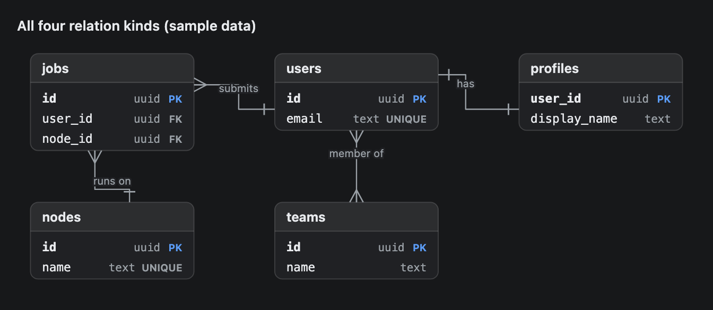
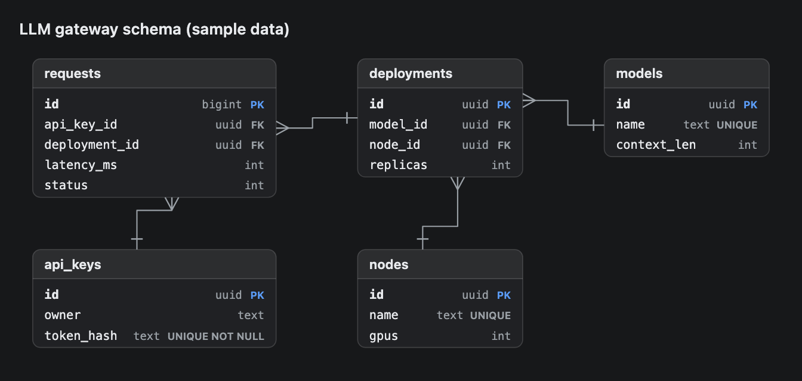

# Erd

An entity-relationship diagram. Each table is a box with its columns, and lines with crow's-foot ends show how the tables relate. Use it to explain a database schema.


## Signature

```text
Erd(entities: Entity[], relations: Relation[], title?: string)
Entity(name: string, fields: string[])
Relation(from: string, to: string, kind?: "1:1" | "1:N" | "N:1" | "N:M", label?: string)
```

## When to use

- Show the tables, columns and keys of a schema.
- Show how tables point at each other: one to many, one to one, many to many.

Not for steps that run in order ([Dag](Dag.md)) or for the rows of a table ([Table](Table.md)).

## Arguments

### Erd

| # | Argument | Type | Required | Notes |
|---|---|---|---|---|
| 1 | `entities` | Entity[] | yes | One `Entity` per table. |
| 2 | `relations` | Relation[] | yes | One `Relation` per line. |
| 3 | `title` | string | no | A bold line above the diagram. |

### Entity

| # | Argument | Type | Required | Notes |
|---|---|---|---|---|
| 1 | `name` | string | yes | Table name. Relations refer to it. |
| 2 | `fields` | string[] | yes | One string per column: `"name type flags"`. The first word is the column, the second the type, everything after is the flags. `"id uuid PK"`, `"email text UNIQUE"`, `"token text UNIQUE NOT NULL"`. |

### Relation

| # | Argument | Type | Required | Notes |
|---|---|---|---|---|
| 1 | `from` | string | yes | An entity **name**, not a variable name. |
| 2 | `to` | string | yes | An entity name. |
| 3 | `kind` | `"1:1"`, `"1:N"`, `"N:1"` or `"N:M"` | no | Default `"1:N"`: the first entity is the one side, the second is the many side. `"N:1"` flips it. |
| 4 | `label` | string | no | Short text on the line, such as `"owns"`. |

## Examples

### A small schema with labelled relations

`users` has many `projects`, and a project has many `jobs`. The bar marks the one side and the crow's foot marks the many side.

```openui
root = Stack([schema])
schema = Erd([users, projects, jobs], [r1, r2], "Job queue schema (sample data)")
users = Entity("users", ["id uuid PK", "email text UNIQUE", "created_at timestamptz"])
projects = Entity("projects", ["id uuid PK", "owner_id uuid FK", "name text"])
jobs = Entity("jobs", ["id uuid PK", "project_id uuid FK", "status text", "started_at timestamptz"])
r1 = Relation("users", "projects", "1:N", "owns")
r2 = Relation("projects", "jobs", "1:N", "runs")
```


### All four relation kinds

One relation of each kind. `"N:1"` reads from the many side, so `jobs` is first and `nodes` second.

```openui
root = Stack([schema])
schema = Erd([users, profiles, teams, jobs, nodes], [r1, r2, r3, r4], "All four relation kinds (sample data)")
users = Entity("users", ["id uuid PK", "email text UNIQUE"])
profiles = Entity("profiles", ["user_id uuid PK", "display_name text"])
teams = Entity("teams", ["id uuid PK", "name text"])
jobs = Entity("jobs", ["id uuid PK", "user_id uuid FK", "node_id uuid FK"])
nodes = Entity("nodes", ["id uuid PK", "name text UNIQUE"])
r1 = Relation("users", "profiles", "1:1", "has")
r2 = Relation("users", "teams", "N:M", "member of")
r3 = Relation("users", "jobs", "1:N", "submits")
r4 = Relation("jobs", "nodes", "N:1", "runs on")
```



### Default kind and multi-word flags

Two arguments are enough for a `1:N` relation. The flags on `token_hash` are two words and stay together.

```openui
root = Stack([schema])
schema = Erd([keys, requests, models, deployments, nodes], [r1, r2, r3, r4], "LLM gateway schema (sample data)")
keys = Entity("api_keys", ["id uuid PK", "owner text", "token_hash text UNIQUE NOT NULL"])
requests = Entity("requests", ["id bigint PK", "api_key_id uuid FK", "deployment_id uuid FK", "latency_ms int", "status int"])
models = Entity("models", ["id uuid PK", "name text UNIQUE", "context_len int"])
deployments = Entity("deployments", ["id uuid PK", "model_id uuid FK", "node_id uuid FK", "replicas int"])
nodes = Entity("nodes", ["id uuid PK", "name text UNIQUE", "gpus int"])
r1 = Relation("api_keys", "requests")
r2 = Relation("deployments", "requests")
r3 = Relation("models", "deployments")
r4 = Relation("nodes", "deployments")
```



## Tips and pitfalls

- `from` and `to` take the name given to `Entity`, such as `"users"`. A name nothing matches prints a red warning under the diagram and the relation is skipped.
- `label` is the fourth argument. To label a default relation pass `null` for `kind`: `Relation("users", "jobs", null, "owns")`.
- An `FK` flag draws nothing. Only a `Relation` draws a line.
- Only `PK` is styled (bold column name, accent-coloured flag). `UNIQUE`, `FK` and the rest are grey text.
- A field with only a name, such as `"email"`, shows the name with no type.
- You cannot place tables. The layout uses a grid of at most three columns and puts related tables near each other. In the second example `jobs` is listed fourth but lands first.
- A box grows to fit its longest column. Lines run around boxes that are in the way.

## Related

[Dag](Dag.md) draws ordered steps. [Table](Table.md) shows rows of data. [Card](Card.md) wraps a diagram under a heading.
