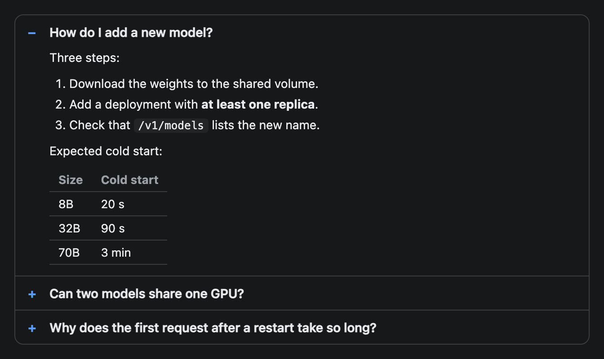

# Faq

A list of questions that open to show their answers. The answers are Markdown, so they can hold lists, bold text and code.


## Signature

```text
Faq(items: FaqItem[], firstOpen?: boolean)
FaqItem(question: string, answer: string)
```

## When to use

- Several short answers that readers will scan by question, such as a troubleshooting list under a dashboard.
- Reference material you want collapsed so it does not push the rest of the widget down.

Not for one long explanation ([Markdown](Markdown.md)) and not for a question the user should answer ([Choice](Choice.md)).

## Arguments

### Faq

| # | Argument | Type | Required | Notes |
|---|---|---|---|---|
| 1 | `items` | FaqItem[] | yes | One `FaqItem` per question, in display order. |
| 2 | `firstOpen` | boolean | no | `true` opens the first answer when the widget loads. Default is all closed. |

### FaqItem

| # | Argument | Type | Required | Notes |
|---|---|---|---|---|
| 1 | `question` | string | yes | The row text. Plain text only. |
| 2 | `answer` | string | yes | Markdown. Write line breaks as `\n`, and `\n\n` for a new paragraph. |

## Examples

### All answers collapsed

Each row shows a plus sign. The answers are not drawn until a row is opened. A screenshot can only show this starting state.

```openui
root = Stack([faq])
faq = Faq([q1, q2, q3, q4])
q1 = FaqItem("How do I restart vLLM on a node?", "Ask the agent: `Restart the vllm service on spark-1`. It runs `systemctl restart vllm` and checks `/health` afterwards.")
q2 = FaqItem("Why is GPU memory at 100%?", "vLLM reserves a fixed share of GPU memory at start-up (`--gpu-memory-utilization`). A full gauge is normal and does not mean a leak.")
q3 = FaqItem("What does a 429 from the gateway mean?", "The API key hit its rate limit. Wait for the `Retry-After` period or ask for a higher quota.")
q4 = FaqItem("Where are the logs?", "Per node: `journalctl -u vllm`. Gateway requests are stored in the `requests` table.")
```


### First answer open, with Markdown

`firstOpen` set to `true` shows the first answer straight away. Its answer holds a numbered list, bold text, inline code and a table.

```openui
root = Stack([faq])
faq = Faq([q1, q2, q3], true)
q1 = FaqItem("How do I add a new model?", "Three steps:\n\n1. Download the weights to the shared volume.\n2. Add a deployment with **at least one replica**.\n3. Check that `/v1/models` lists the new name.\n\nExpected cold start:\n\n| Size | Cold start |\n|---|---|\n| 8B | 20 s |\n| 32B | 90 s |\n| 70B | 3 min |")
q2 = FaqItem("Can two models share one GPU?", "Yes, if their combined memory fits. Lower `--gpu-memory-utilization` on both so neither reserves the whole card.")
q3 = FaqItem("Why does the first request after a restart take so long?", "The server loads the weights and warms its caches on the first call. Later requests are fast.")
```



## Tips and pitfalls

- Only one answer is open at a time. Opening another row closes the first, and clicking an open row closes it.
- Answers use the same renderer as [Markdown](Markdown.md), so lists, bold, inline code, quotes, tables and fenced code blocks work. A fenced block gets a language label and a Copy button (tested outside these examples).
- Questions are plain text. Backticks and asterisks in a `question` show as typed.
- Escape a double quote inside a string with a backslash: `\"`.
- A closed answer is not rendered at all, so nothing hidden can show through.
- `firstOpen` only sets the starting state. After that the reader controls it.
- The screenshots show the starting state. They cannot show a click, so the open and close behaviour here comes from reading the component code.

## Related

[Markdown](Markdown.md) shows rich text without collapsing. [Choice](Choice.md) asks the user a question. [Tabs](Tabs.md) split content into labelled panels. [Card](Card.md) wraps a list under a heading.
