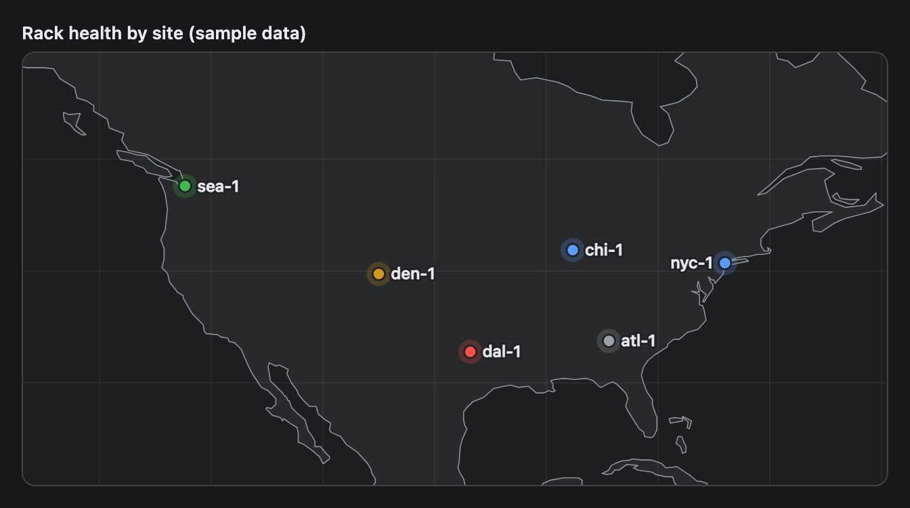

# GeoMap

An offline world map with coloured pins and optional dashed links. It draws coastlines from data shipped with the plugin, so it needs no network and no map tiles. The view zooms to fit your pins.


## Signature

```text
GeoMap(points: GeoPoint[], links?: string[][], title?: string)
GeoPoint(label: string, lat: number, lon: number, tone?: "good" | "warn" | "bad" | "info" | "neutral")
```

## When to use

- Show where sites, regions or nodes are.
- Show which pairs are connected, such as replication or a VPN, with links.

Not for street-level detail: the coastlines are coarse and there are no place names. Not for values per region either (use [Table](Table.md) or [BarChart](BarChart.md)).

## Arguments

### GeoMap

| # | Argument | Type | Required | Notes |
|---|---|---|---|---|
| 1 | `points` | GeoPoint[] | yes | One `GeoPoint` per pin. |
| 2 | `links` | string[][] | no | Pairs `[labelA, labelB]` of pin **labels**, each drawn as a dashed line. Pass `null` to skip. |
| 3 | `title` | string | no | A bold line above the map. |

### GeoPoint

| # | Argument | Type | Required | Notes |
|---|---|---|---|---|
| 1 | `label` | string | yes | Printed next to the pin. Links use it to find the pin, so keep it unique. |
| 2 | `lat` | number | yes | Decimal degrees. South is negative. |
| 3 | `lon` | number | yes | Decimal degrees. West is negative. |
| 4 | `tone` | `"good"`, `"warn"`, `"bad"`, `"info"` or `"neutral"` | no | Green, amber, red, accent blue or grey. Without it the pin is `"info"`. |

## Examples

### A regional map with links

Four pins, three links and three tones. The map zooms to the pins plus a margin.

```openui
root = Stack([map])
map = GeoMap([p1, p2, p3, p4], [["ams-1", "fra-1"], ["fra-1", "par-1"], ["par-1", "mad-1"]], "Edge sites in Europe (sample data)")
p1 = GeoPoint("ams-1", 52.37, 4.90, "good")
p2 = GeoPoint("fra-1", 50.11, 8.68, "good")
p3 = GeoPoint("par-1", 48.86, 2.35, "warn")
p4 = GeoPoint("mad-1", 40.42, -3.70, "bad")
```


### A world map

Pins on four continents zoom the view out to the whole world. Each link is a straight dashed line between two labels.

```openui
root = Stack([map])
map = GeoMap([p1, p2, p3, p4, p5, p6], [["us-west", "us-east"], ["us-east", "eu-central"], ["eu-central", "ap-south"], ["ap-south", "ap-northeast"], ["us-east", "sa-east"]], "Regions and replication links (sample data)")
p1 = GeoPoint("us-west", 37.77, -122.42, "good")
p2 = GeoPoint("us-east", 39.04, -77.49, "good")
p3 = GeoPoint("eu-central", 50.11, 8.68, "warn")
p4 = GeoPoint("ap-south", 1.35, 103.82, "info")
p5 = GeoPoint("ap-northeast", 35.68, 139.69, "good")
p6 = GeoPoint("sa-east", -23.55, -46.63, "neutral")
```


### Pin tones without links

Pass `null` for `links` when you only want pins. The last pin has no `tone`, so it looks the same as `"info"`.

```openui
root = Stack([map])
map = GeoMap([p1, p2, p3, p4, p5, p6], null, "Rack health by site (sample data)")
p1 = GeoPoint("sea-1", 47.61, -122.33, "good")
p2 = GeoPoint("den-1", 39.74, -104.99, "warn")
p3 = GeoPoint("dal-1", 32.78, -96.80, "bad")
p4 = GeoPoint("chi-1", 41.88, -87.63, "info")
p5 = GeoPoint("atl-1", 33.75, -84.39, "neutral")
p6 = GeoPoint("nyc-1", 40.71, -74.01)
```



## Tips and pitfalls

- The map has no tiles, country names or city names. Your pin labels are the only text on it.
- The coastlines are coarse. A single pin zooms to about 24 by 12 degrees, where the shore looks jagged.
- The view is always twice as wide as it is tall. Pins far apart show the whole world.
- Links are straight lines on the flat map, not great circles. A link from `us-west` to `ap-northeast` is drawn the long way, across North America, the Atlantic, Europe and Asia, not over the Pacific.
- A link that names a label no pin has is skipped with no warning. If two pins share a label, links use the last one.
- Labels are not moved apart. Three pins about half a degree apart (Amsterdam, Rotterdam, Utrecht) print their labels on top of each other.
- Labels sit to the right of the pin and flip to the left near the right edge.

## Related

[Table](Table.md) lists sites with details. [Metric](Metric.md) shows one number per site. [Card](Card.md) wraps a map under a heading.
