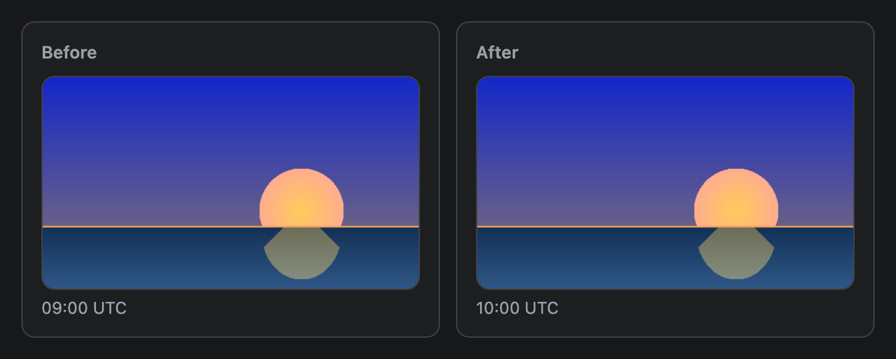
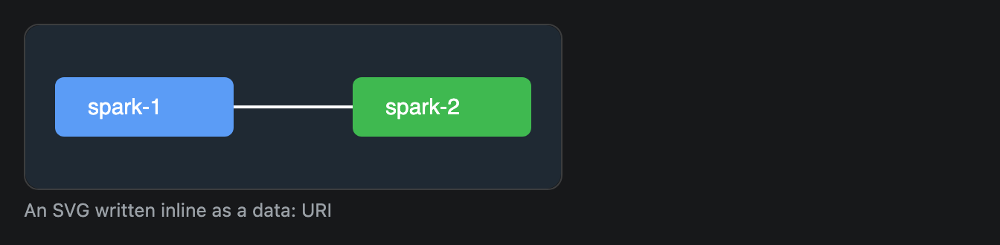
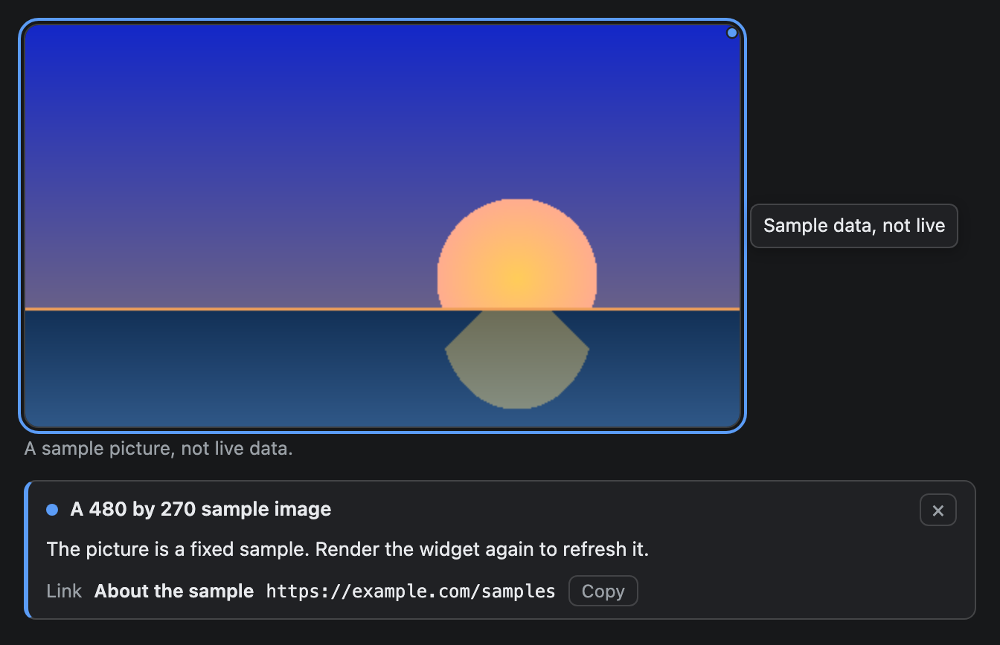

# Image

A picture from a local file or a `data:` address, with optional alt text and a caption. The plugin reads the file and embeds it in the widget.


## Signature

```text
Image(src: string, alt?: string, caption?: string, tooltips?: Tooltip[])
```

## When to use

- A screenshot, a diagram or a photo the AI has already saved as a file.
- A small icon or diagram you write inline as an SVG `data:` address.

Not for charts (use [BarChart](BarChart.md) and friends, which stay sharp and need no file) or for large photos, because each image is limited to 100 KB.

## Arguments

| # | Argument | Type | Required | Notes |
|---|---|---|---|---|
| 1 | `src` | string | yes | An absolute local path such as `/path/to/chart.png`, or a `data:` address. |
| 2 | `alt` | string | no | A description. It is shown in place of the picture if loading fails. |
| 3 | `caption` | string | no | A small grey line under the picture. |
| 4 | `tooltips` | array of `Tooltip` | no | At most one: a hover tooltip and a click panel for the picture. Written last, so pass `null` for a skipped `alt` or `caption`. See [Tooltips](#tooltips). |

In these examples the path is `/path/to/sample.png`. The screenshot tool swaps it for a sample picture that ships with the docs. In your own widget, write the real absolute path of your file.

## Examples

### A picture with a caption

The picture keeps its own size, up to the width of the column. The caption sits underneath.

```openui
root = Stack([photo])
photo = Image("/path/to/sample.png", "A 480 by 270 sample image", "The caption sits under the image in small grey text.")
```


### Pictures in cards

Two pictures in a row shrink to share the width. Cards add a title above each.

```openui
root = Stack([before, after], "row")
before = Card([beforeImage], "Before")
beforeImage = Image("/path/to/sample.png", "Sample image, before", "09:00 UTC")
after = Card([afterImage], "After")
afterImage = Image("/path/to/sample.png", "Sample image, after", "10:00 UTC")
```



### An inline SVG

A `data:` address needs no file and no size check. The SVG is written in the string, with `%23` standing for `#` in the colours.

```openui
root = Stack([diagram])
diagram = Image("data:image/svg+xml;utf8,<svg xmlns='http://www.w3.org/2000/svg' width='360' height='110'><rect width='360' height='110' rx='10' fill='%231f2933'/><rect x='20' y='35' width='120' height='40' rx='6' fill='%235b9cf6'/><rect x='220' y='35' width='120' height='40' rx='6' fill='%233fb950'/><path d='M140 55 H220' stroke='white' stroke-width='2'/><text x='42' y='60' fill='white' font-size='15' font-family='sans-serif'>spark-1</text><text x='242' y='60' fill='white' font-size='15' font-family='sans-serif'>spark-2</text></svg>", "Two nodes joined by a link", "An SVG written inline as a data: URI")
```



## Tooltips

Pass one `Tooltip` as the last argument: `Image(src, alt, caption, [t1])`. Write `null` for an `alt` or `caption` you skip. The target is the word `image`, and the whole picture is the target, so one tooltip is the most an Image takes. There are no hotspots or regions on a picture. The picture gets a dot at its top right corner. At narrow widths an Image fills the column, so its tooltip is drawn over the picture. Hover or Tab to it for the hint; click it, or press Enter or Space, to open a panel under the image and its caption. The full rules are on the [Tooltip](Tooltip.md) page.

```openui
root = Stack([photo])
photo = Image("/path/to/sample.png", "A 480 by 270 sample image", "A sample picture, not live data.", [a1])
a1 = Tooltip("image", "Sample data, not live", "The picture is a fixed sample. Render the widget again to refresh it.", null, null, "info", "https://example.com/samples", "About the sample")
```



## Tips and pitfalls

- The path must be absolute. A leading `~` and a `file://` prefix are accepted. A relative path, a missing file or an unknown type makes `render_widget` return an error that the AI can fix.
- Allowed types are png, jpg, jpeg, gif, webp and svg. Each file is limited to 100 KB. A bigger file is refused, with a hint to downscale it. The whole widget has a size budget too, so charts or a map on the same widget leave less room.
- Remote `http` and `https` addresses are left alone, and the sandboxed widget is not guaranteed to load them. Save the file and use its path.
- A `data:` address skips the per-file check, but its text counts toward the widget's size.
- A picture keeps its own size. It is left-aligned, never enlarged, and scaled down only when it is wider than its container. There is no width, height or zoom argument, so resize the file instead.
- A load failure draws a dashed box that reads `Image failed to load` plus the `alt` text, and the caption stays below. Always give an `alt`.
- Pictures have a thin rounded border.

## Related

[Card](Card.md) frames and titles a picture. [Stack](Stack.md) puts pictures in a row. [Markdown](Markdown.md) does not draw images.
