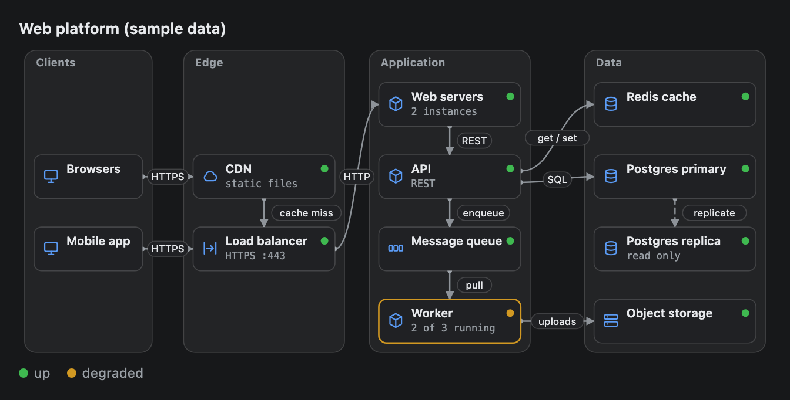
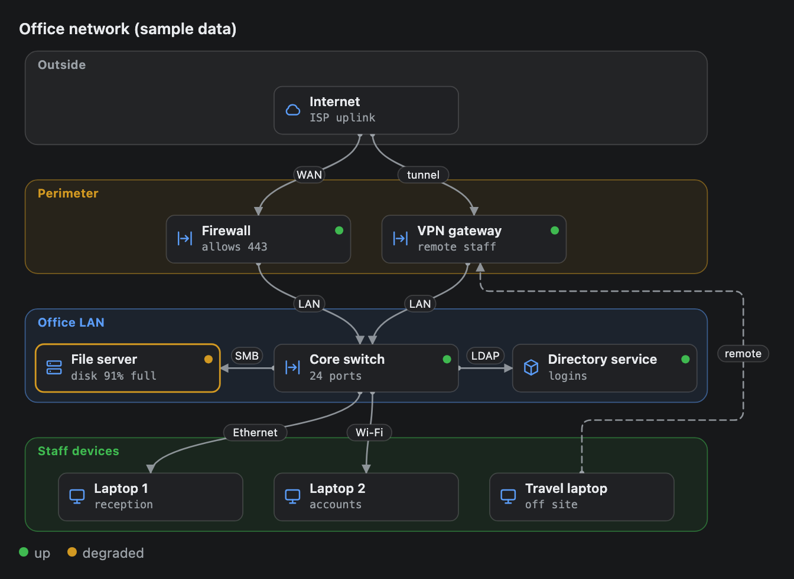
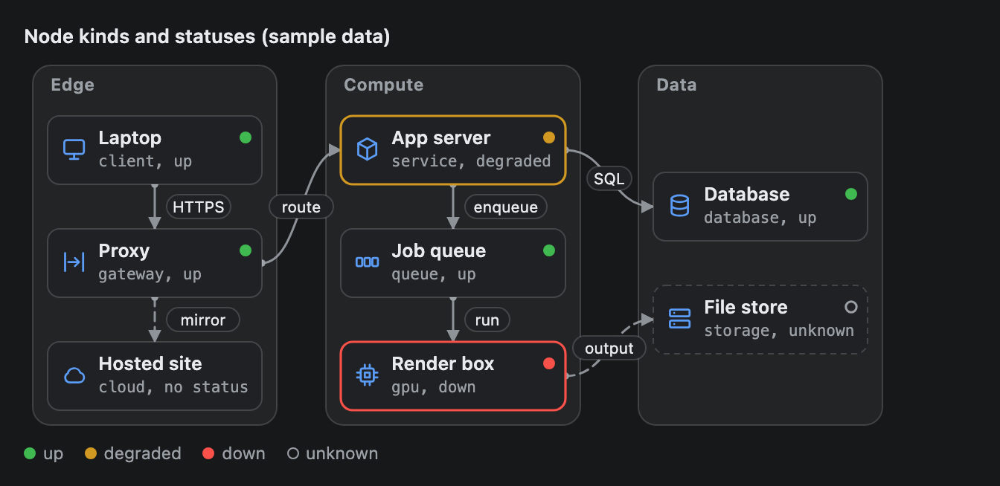

# InfraMap

A map of infrastructure. Zones such as networks, racks or clouds hold nodes such as servers, databases and queues, and labelled arrows show which node talks to which. A node can carry an icon for its kind and a health status.



## Signature

```text
InfraMap(zones: InfraZone[], links: InfraLink[], title?: string, direction?: "LR" | "TB")
InfraZone(name: string, nodes: InfraNode[], tone?: "neutral" | "info" | "good" | "warn" | "bad")
InfraNode(id: string, label: string, kind?: "client" | "gateway" | "service" | "gpu" | "database" | "storage" | "queue" | "cloud", status?: "up" | "degraded" | "down" | "unknown", detail?: string)
InfraLink(from: string, to: string, label?: string, style?: "solid" | "dashed")
```

## When to use

- Explain how a system fits together: which clients reach which servers, and which service uses which database.
- Show where a fault is. Give each node a `status` and the unhealthy ones get a coloured outline.
- Sketch a network from the internet down to the devices (use `"TB"`).

Not for steps that depend on each other ([Dag](Dag.md)), database tables ([Erd](Erd.md)), places on a world map ([GeoMap](GeoMap.md)) or more than about 4 zones and 12 nodes (split it into two maps).

## Arguments

An InfraMap holds InfraZones, an InfraZone holds InfraNodes, and InfraLinks join nodes by their `id`. The three helpers are only used inside an InfraMap.

### InfraMap

| # | Argument | Type | Required | Notes |
|---|---|---|---|---|
| 1 | `zones` | InfraZone[] | yes | One per box, in the order you list them. At least one. |
| 2 | `links` | InfraLink[] | yes | One per arrow. Use `[]` for none. |
| 3 | `title` | string | no | A bold line above the map. |
| 4 | `direction` | `"LR"` or `"TB"` | no | `"LR"` makes each zone a column, left to right. `"TB"` makes each zone a row, top to bottom. Omit it, or pass `null`, for `"LR"`. |

### InfraZone

| # | Argument | Type | Required | Notes |
|---|---|---|---|---|
| 1 | `name` | string | yes | The caption at the top left of the box. The box grows to fit it. |
| 2 | `nodes` | InfraNode[] | yes | At least one. They stack top to bottom (`"LR"`) or sit side by side (`"TB"`), in the order you list them. |
| 3 | `tone` | `"neutral"`, `"info"`, `"good"`, `"warn"` or `"bad"` | no | Tints the box and its name: `"info"` in the accent colour (blue in these screenshots), `"good"` green, `"warn"` amber, `"bad"` red. Defaults to `"neutral"`, grey with no tint. |

### InfraNode

| # | Argument | Type | Required | Notes |
|---|---|---|---|---|
| 1 | `id` | string | yes | Unique across the whole map. `InfraLink` points at it. It is never drawn. |
| 2 | `label` | string | yes | The bold text in the box. Cut at 22 characters. |
| 3 | `kind` | `"client"`, `"gateway"`, `"service"`, `"gpu"`, `"database"`, `"storage"`, `"queue"` or `"cloud"` | no | Picks the icon at the left. Omit it for a plain rounded square. |
| 4 | `status` | `"up"`, `"degraded"`, `"down"` or `"unknown"` | no | Adds a dot at the right edge: green, amber, red or a hollow grey ring. `"degraded"` and `"down"` also outline the box in amber or red, and `"unknown"` in dashed grey. Omit it for no dot. |
| 5 | `detail` | string | no | A short second line in monospace, such as a port or a count. Cut at 26 characters. |

### InfraLink

| # | Argument | Type | Required | Notes |
|---|---|---|---|---|
| 1 | `from` | string | yes | The **id** of the node where the arrow starts, marked with a small dot. |
| 2 | `to` | string | yes | The **id** of the node where the arrow ends, marked with the arrowhead. |
| 3 | `label` | string | no | A protocol or purpose such as `"SQL"`, in a pill on the line. Cut at 18 characters. |
| 4 | `style` | `"solid"` or `"dashed"` | no | Defaults to `"solid"`. Use `"dashed"` for an optional or indirect path. |

A legend under the map names each status that is in use.

## Examples

### A web platform, left to right

The map at the top of this page. The Worker is `"degraded"`, so it gets an amber outline and the legend lists two statuses. The clients have no `status`, so they have no dot. Replication is dashed.

```openui
root = Stack([map])
map = InfraMap([zClients, zEdge, zApp, zData], [l1, l2, l3, l4, l5, l6, l7, l8, l9, l10, l11], "Web platform (sample data)")
zClients = InfraZone("Clients", [browsers, mobile])
browsers = InfraNode("browsers", "Browsers", "client")
mobile = InfraNode("mobile", "Mobile app", "client")
zEdge = InfraZone("Edge", [cdn, lb])
cdn = InfraNode("cdn", "CDN", "cloud", "up", "static files")
lb = InfraNode("lb", "Load balancer", "gateway", "up", "HTTPS :443")
zApp = InfraZone("Application", [web, api, queue, worker])
web = InfraNode("web", "Web servers", "service", "up", "2 instances")
api = InfraNode("api", "API", "service", "up", "REST")
queue = InfraNode("queue", "Message queue", "queue", "up")
worker = InfraNode("worker", "Worker", "service", "degraded", "2 of 3 running")
zData = InfraZone("Data", [cache, pgp, pgr, files])
cache = InfraNode("cache", "Redis cache", "database", "up")
pgp = InfraNode("db-primary", "Postgres primary", "database", "up")
pgr = InfraNode("db-replica", "Postgres replica", "database", "up", "read only")
files = InfraNode("files", "Object storage", "storage", "up")
l1 = InfraLink("browsers", "cdn", "HTTPS")
l2 = InfraLink("mobile", "lb", "HTTPS")
l3 = InfraLink("cdn", "lb", "cache miss")
l4 = InfraLink("lb", "web", "HTTP")
l5 = InfraLink("web", "api", "REST")
l6 = InfraLink("api", "queue", "enqueue")
l7 = InfraLink("queue", "worker", "pull")
l8 = InfraLink("api", "cache", "get / set")
l9 = InfraLink("api", "db-primary", "SQL")
l10 = InfraLink("db-primary", "db-replica", "replicate", "dashed")
l11 = InfraLink("worker", "files", "uploads")
```


### An office network, top to bottom

`"TB"` makes each zone a row. Each zone has a `tone`. `null` skips `status` for the nodes that have none, so `detail` can still be set. The dashed link from the Travel laptop to the VPN gateway crosses two zones, so it runs down the right side.

```openui
root = Stack([map])
map = InfraMap([zNet, zEdge, zLan, zStaff], [l1, l2, l3, l4, l5, l6, l7, l8, l9], "Office network (sample data)", "TB")
zNet = InfraZone("Outside", [net])
net = InfraNode("internet", "Internet", "cloud", null, "ISP uplink")
zEdge = InfraZone("Perimeter", [fw, vpn], "warn")
fw = InfraNode("firewall", "Firewall", "gateway", "up", "allows 443")
vpn = InfraNode("vpn", "VPN gateway", "gateway", "up", "remote staff")
zLan = InfraZone("Office LAN", [files, sw, dirs], "info")
files = InfraNode("files", "File server", "storage", "degraded", "disk 91% full")
sw = InfraNode("switch", "Core switch", "gateway", "up", "24 ports")
dirs = InfraNode("directory", "Directory service", "service", "up", "logins")
zStaff = InfraZone("Staff devices", [lap1, lap2, lap3], "good")
lap1 = InfraNode("laptop-1", "Laptop 1", "client", null, "reception")
lap2 = InfraNode("laptop-2", "Laptop 2", "client", null, "accounts")
lap3 = InfraNode("laptop-3", "Travel laptop", "client", null, "off site")
l1 = InfraLink("internet", "firewall", "WAN")
l2 = InfraLink("internet", "vpn", "tunnel")
l3 = InfraLink("firewall", "switch", "LAN")
l4 = InfraLink("vpn", "switch", "LAN")
l5 = InfraLink("switch", "files", "SMB")
l6 = InfraLink("switch", "directory", "LDAP")
l7 = InfraLink("switch", "laptop-1", "Ethernet")
l8 = InfraLink("switch", "laptop-2", "Wi-Fi")
l9 = InfraLink("laptop-3", "vpn", "remote", "dashed")
```



### Every kind and status

A reference. Each node's `detail` names its kind and status, so you can match each icon and dot.

```openui
root = Stack([map])
map = InfraMap([zEdge, zCompute, zData], [l1, l2, l3, l4, l5, l6, l7], "Node kinds and statuses (sample data)")
zEdge = InfraZone("Edge", [laptop, proxy, hosted])
laptop = InfraNode("laptop", "Laptop", "client", "up", "client, up")
proxy = InfraNode("proxy", "Proxy", "gateway", "up", "gateway, up")
hosted = InfraNode("hosted", "Hosted site", "cloud", null, "cloud, no status")
zCompute = InfraZone("Compute", [app, jobs, render])
app = InfraNode("app", "App server", "service", "degraded", "service, degraded")
jobs = InfraNode("jobs", "Job queue", "queue", "up", "queue, up")
render = InfraNode("render", "Render box", "gpu", "down", "gpu, down")
zData = InfraZone("Data", [db, disk])
db = InfraNode("db", "Database", "database", "up", "database, up")
disk = InfraNode("disk", "File store", "storage", "unknown", "storage, unknown")
l1 = InfraLink("laptop", "proxy", "HTTPS")
l2 = InfraLink("proxy", "app", "route")
l3 = InfraLink("app", "jobs", "enqueue")
l4 = InfraLink("jobs", "render", "run")
l5 = InfraLink("app", "db", "SQL")
l6 = InfraLink("render", "disk", "output", "dashed")
l7 = InfraLink("proxy", "hosted", "mirror", "dashed")
```



## Tips and pitfalls

- `InfraLink` takes node **id strings**. A variable name (`InfraLink(web, api)`) or a label (`"Postgres"` when the id is `"pg"`) is rejected before anything is drawn. The validator lists the known ids and, for a label, the id you meant: `` InfraMap link uses unknown node id `Postgres` in `to` (...). `Postgres` is a label; the id is `pg`. ``
- An id must be unique across all zones, not just inside one. A duplicate is rejected (`InfraMap has duplicate node ids: api`). If one is drawn anyway, a red line under the map names it and every link goes to the first node with that id.
- An empty zone, a link from a node to itself, a map with no zones, and a `kind`, `status` or `tone` that is not in the list are also rejected.
- In preview mode the map shrinks to fit the preview frame (the app caps it at 40rem and never above 640 px; 560 px at the app's default 14 px font), but not below 78% of its natural width. Past that it scrolls sideways, and a screenshot shows the last zone cut off with no scrollbar or fade. About 4 zones fit: five zones of two nodes with 4-letter link labels need at least 668 px, so they scroll. In native mode the map uses the width of the chat column: it stays at its natural width, left aligned, when there is room, and shrinks and then scrolls in a column that is narrower than the map.
- In `"LR"`, each link label widens the gap between its two zones. Four zones with two short nodes each and 4-letter labels are 682 px wide and shrink to fit. The same map with 18-character labels is 940 px wide and scrolls.
- In `"TB"`, every node takes the width of the widest node, so one long label widens them all. About 5 nodes in a row fit, and six scroll. Three short-labelled nodes are 437 px wide, and one long label makes them 725 px.
- Kinds draw these icons: `"client"` a monitor, `"gateway"` an arrow between two bars, `"service"` a cube, `"gpu"` a chip with pins, `"database"` a cylinder, `"storage"` two stacked drives, `"queue"` three small boxes, `"cloud"` a cloud. No `kind` draws a plain square. Pick by role: a firewall, a VPN and a switch are all `"gateway"`.
- Status is your judgement, not a measurement. The legend lists only the statuses used, always in the order up, degraded, down, unknown. A map where no node has a status has no legend.
- Text is cut with an ellipsis at 22 characters for a label, 26 for a `detail` and 18 for a link label. A zone name is never cut. If any node has a `detail`, every node gets the taller box, and nodes without one keep their label on the top line.
- Put nodes that talk to each other next to each other. Neighbours in a zone get a short straight arrow with its label beside it. A link that skips a node bows around the edge of the column and can cross other arrows, and two links between the same pair in one zone nearly overlap.
- A link across more than one zone runs in a lane outside the zones and can end up close to another arrow in a gap. A label pill slides to a free spot, but on a crowded map it can still cover another arrow. If two arrows look merged, reorder the nodes or drop a link.
- You cannot place a node, and nodes have no click action. A `null` skips an optional argument: `InfraNode("internet", "Internet", "cloud", null, "ISP uplink")`.

## Related

[Dag](Dag.md) draws steps and dependencies. [Erd](Erd.md) draws database tables. [GeoMap](GeoMap.md) puts pins on a world map. [Card](Card.md) wraps a map under a heading.
