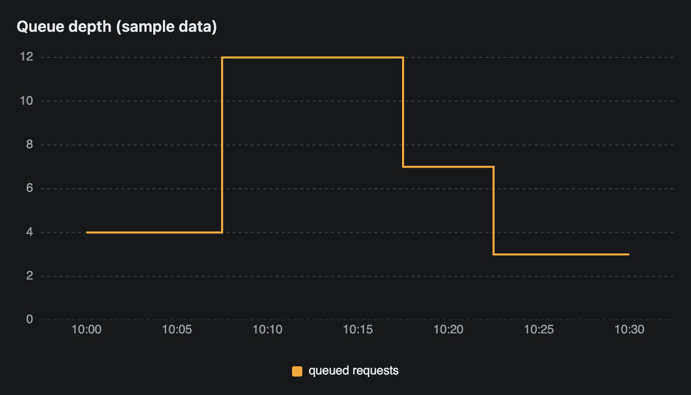
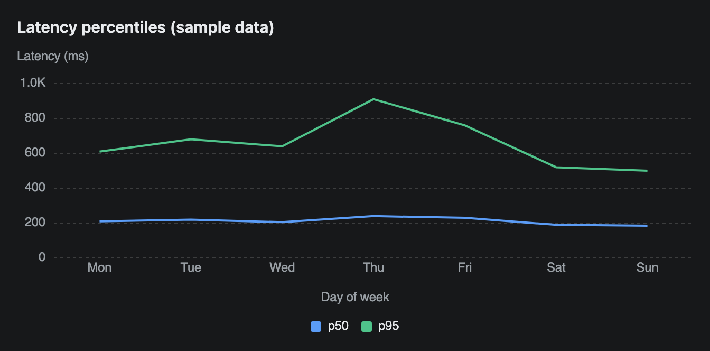

# LineChart

A line chart over categories, such as time buckets. Each series is one line, and a legend under the chart names them. This page also documents `Series`, which the area and radar charts reuse.


## Signature

```text
LineChart(labels: string[], series: Series[], variant?: "linear" | "natural" | "step", xLabel?: string, yLabel?: string, height?: number)
Series(category: string, values: number[])
```

## When to use

- A trend over time, such as GPU utilisation or latency per hour.
- Several series you want to compare directly, line against line.

Not for parts of a growing total ([AreaChart](AreaChart.md)), one value per category ([BarChart](BarChart.md)) or shares of a whole ([PieChart](PieChart.md)).

## Arguments

### LineChart

| # | Argument | Type | Required | Notes |
|---|---|---|---|---|
| 1 | `labels` | string[] | yes | The x axis, left to right. Plain text, spaced evenly. Not parsed as dates. |
| 2 | `series` | Series[] | yes | One `Series` per line. Each must have as many values as there are labels. |
| 3 | `variant` | `"linear"`, `"natural"` or `"step"` | no | `"natural"` is the default and draws smooth curves. `"linear"` joins points with straight segments. |
| 4 | `xLabel` | string | no | A title centred under the x axis. |
| 5 | `yLabel` | string | no | A title above the y axis, in the top left. It is horizontal, not rotated. |
| 6 | `height` | number | no | Chart height in pixels, legend included. Axis titles are drawn outside it and add about 40 px. Leave it out for the built-in height, about 310 px in these screenshots. |

### Series

| # | Argument | Type | Required | Notes |
|---|---|---|---|---|
| 1 | `category` | string | yes | The series name. It appears in the legend. The signature calls it `category`, but it names the line. |
| 2 | `values` | number[] | yes | One number per label, in the same order. |

## Examples

### Several series with the defaults

Three nodes on one chart. With no `variant` the lines are smooth, and the legend colours follow the order of the series.

```openui
root = Stack([title, chart])
title = Text("GPU utilisation by node, last hour (sample data)", "heading")
chart = LineChart(["10:00", "10:10", "10:20", "10:30", "10:40", "10:50"], [s1, s2, s3])
s1 = Series("spark-1", [62, 71, 84, 91, 88, 79])
s2 = Series("spark-2", [45, 48, 52, 61, 58, 55])
s3 = Series("spark-3", [30, 28, 41, 66, 72, 69])
```


### One series with the step variant

`"step"` suits a value that holds until it changes, such as queue depth. The third argument is the variant, so the other optional arguments are left out.

```openui
root = Stack([title, chart])
title = Text("Queue depth (sample data)", "heading")
chart = LineChart(["10:00", "10:05", "10:10", "10:15", "10:20", "10:25", "10:30"], [q], "step")
q = Series("queued requests", [4, 4, 12, 12, 7, 3, 3])
```



### Straight segments, axis titles and height

`"linear"` joins the points with straight lines. `xLabel`, `yLabel` and a `height` of 220 follow it in order.

```openui
root = Stack([title, chart])
title = Text("Latency percentiles (sample data)", "heading")
chart = LineChart(["Mon", "Tue", "Wed", "Thu", "Fri", "Sat", "Sun"], [p50, p95], "linear", "Day of week", "Latency (ms)", 220)
p50 = Series("p50", [210, 220, 205, 240, 230, 190, 185])
p95 = Series("p95", [610, 680, 640, 910, 760, 520, 500])
```



## Tips and pitfalls

- Keep every `values` array as long as `labels`. A shorter series is drawn as zeros for the missing points (the line fell to 0 in a test). Extra values are ignored.
- The y axis always starts at 0. A value that moves between 95 and 99 looks almost flat.
- All series share one y scale. A series 100 times larger than the others squashes them.
- Large ticks are shortened: 1000 shows as `1.0K`.
- The `"step"` line changes value halfway between two labels, not on the label itself.
- Skip an optional argument with `null`. `LineChart(labels, [s], null, "Hour")` keeps the default variant and sets `xLabel`.
- From the chart code, a click on a legend entry hides that series and hovering shows a tooltip. A screenshot cannot show either.

## Related

[AreaChart](AreaChart.md) stacks the same data into a total. [BarChart](BarChart.md) shows one value per category. [RadarChart](RadarChart.md) also uses `Series`. [Metric](Metric.md) shows a single headline number.
