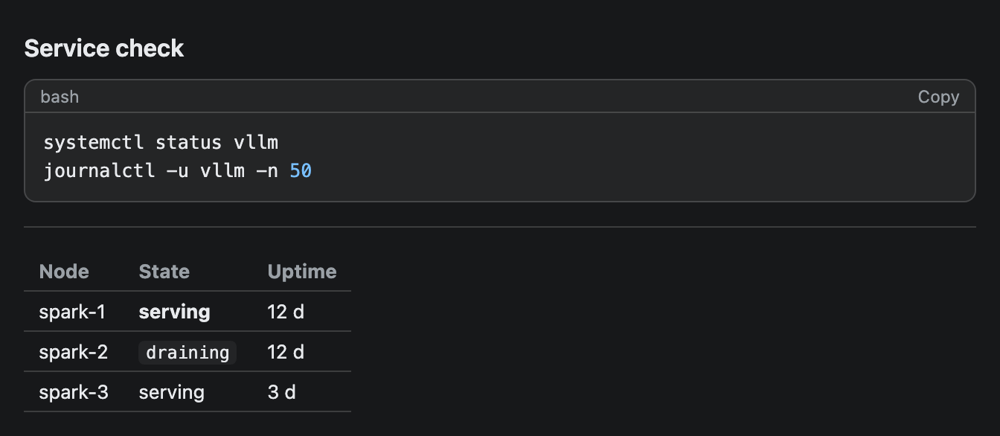
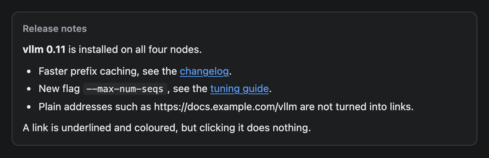

# Markdown

Formatted text from a Markdown string: headings, bold, italic, code, lists, quotes, tables, code blocks and rules. Write newlines as `\n` inside the string.


## Signature

```text
Markdown(text: string)
```

## When to use

- Several paragraphs, a list or a short runbook.
- A sentence with a bold word or an inline command.
- A table whose cells need bold or code, or a code block inside prose.

Not for a single styled line (use [Text](Text.md)) or for plain data tables (use [Table](Table.md)).

## Arguments

| # | Argument | Type | Required | Notes |
|---|---|---|---|---|
| 1 | `text` | string | yes | The Markdown source. Use `\n` for a line break, `\n\n` for a blank line, and `\"` for a double quote. |

What the renderer handles, taken from its source:

| You write | You get |
|---|---|
| `# ` to `###### ` | Headings, all bold, from 22 px down to 13 px. |
| `**bold**` or `__bold__` | Bold. |
| `*italic*` | Italic. Asterisks only. |
| `` `code` `` | Inline code on a light background. |
| `[text](url)` | Link text, underlined and coloured. Not clickable. |
| `- `, `* ` or `+ ` | Bullet list. |
| `1. ` or `1) ` | Numbered list. |
| `> ` | Quote: muted text with a bar on the left. |
| `---`, `***` or `___` | Horizontal rule. |
| A pipe table with a separator row under the header | Table. |
| Three backticks, then an optional language | Code block with a Copy button, as in [CodeBlock](CodeBlock.md). |

## Examples

### A short runbook

Headings, bold and italic words, inline code, a numbered list, a bullet list and a quote in one string.

```openui
root = Stack([doc])
doc = Markdown("# Restart runbook\n\nUse this when **vllm** stops answering on a node. Check the *queue depth* first.\n\n## Steps\n\n1. Drain the node with `drain spark-1`.\n2. Wait for in-flight requests to finish.\n3. Restart the service.\n4. Confirm the health check passes.\n\n## Do not\n\n- Restart two nodes at once.\n- Restart during a benchmark run.\n\n> If the node does not recover within 5 minutes, escalate and leave it drained.")
```


### Code, a rule and a table

This page is itself Markdown, so the three backticks of the code fence are written as `\u0060\u0060\u0060` here. In a widget, plain backticks work the same way.

```openui
root = Stack([doc])
doc = Markdown("### Service check\n\n\u0060\u0060\u0060bash\nsystemctl status vllm\njournalctl -u vllm -n 50\n\u0060\u0060\u0060\n\n---\n\n| Node | State | Uptime |\n|---|---|---|\n| spark-1 | **serving** | 12 d |\n| spark-2 | `draining` | 12 d |\n| spark-3 | serving | 3 d |")
```



### Links

Links are drawn but do nothing when clicked, and a bare address is not turned into a link.

```openui
root = Stack([card])
card = Card([doc], "Release notes")
doc = Markdown("**vllm 0.11** is installed on all four nodes.\n\n- Faster prefix caching, see the [changelog](https://docs.example.com/vllm/changelog).\n- New flag `--max-num-seqs`, see the [tuning guide](https://docs.example.com/vllm/tuning).\n- Plain addresses such as https://docs.example.com/vllm are not turned into links.\n\nA link is underlined and coloured, but clicking it does nothing.")
```



## Tips and pitfalls

- A single `\n` inside a paragraph becomes a space. Leave a blank line (`\n\n`) to start a new paragraph. The same holds inside a quote: its lines join into one paragraph.
- Lists are flat. Indentation is ignored, so a nested item shows at the top level. Consecutive bullet and numbered lines merge into one list that follows the style of the first line.
- Not handled, and shown as typed: `~~strike~~`, `_underscore italics_`, HTML tags, and ``. An image line shows a `!` followed by a link. Use [Image](Image.md) for pictures. A task list shows a bullet with `[ ]` in it.
- Table column alignment (`:--`, `--:`) is ignored, and the table is only as wide as its content. A very wide table scrolls sideways.
- A link keeps its address in a tooltip title. The renderer is a small hand-written one with no HTML, so no tag in the string can run.
- Headings differ little below `###`. `####`, `#####` and `######` are 14.5, 14 and 13 px, close to body text.
- A code fence that is never closed runs to the end of the string.

## Related

[Text](Text.md) for one styled line. [CodeBlock](CodeBlock.md) for code on its own. [Table](Table.md) for plain tables. [Callout](Callout.md) for a highlighted note.
