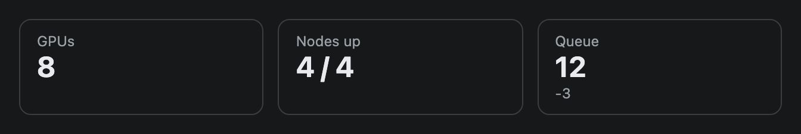
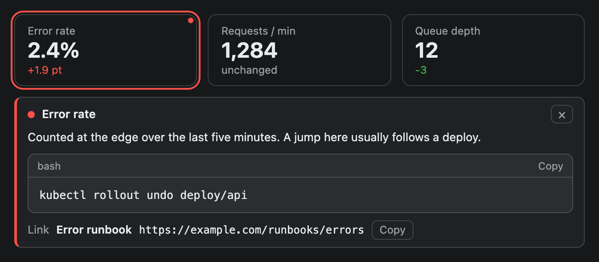

# Metric

A KPI tile: a small label, a large value and an optional coloured delta. Put several in a row for an at-a-glance status strip.


## Signature

```text
Metric(label: string, value: string, delta?: string, tone?: "good" | "warn" | "bad" | "neutral", tooltips?: Tooltip[])
```

## When to use

- A handful of headline numbers at the top of a dashboard: GPUs up, queue depth, error rate.
- Pair each number with a comparison in `delta`, such as `"+4% vs 1h ago"`.

Not for a long list of values (use [Table](Table.md)) or a trend over time (use [LineChart](LineChart.md)).

## Arguments

| # | Argument | Type | Required | Notes |
|---|---|---|---|---|
| 1 | `label` | string | yes | Small caption above the value. Keep it short. |
| 2 | `value` | string | yes | The big number. It is a **string**: write `"87%"` or `"4 / 4"`, not `87`. |
| 3 | `delta` | string | no | A line under the value. Leave it out and the tile has no third line. |
| 4 | `tone` | `"good"`, `"warn"`, `"bad"` or `"neutral"` | no | Colours the `delta` text green, amber, red or grey. Defaults to `"neutral"`. |
| 5 | `tooltips` | array of `Tooltip` | no | At most one: a hover tooltip and a click panel for the tile. Written last, so pass `null` for a skipped `delta` or `tone`. See [Tooltips](#tooltips). |

## Examples

### All four tones

The tone colours only the delta line. The tile border stays neutral.

```openui
root = Stack([title, tiles])
title = Text("Metric tones", "heading")
tiles = Stack([good, warn, bad, neutral], "row", "m", true)
good = Metric("Uptime", "99.98%", "+0.02 pt", "good")
warn = Metric("p95 latency", "840 ms", "+90 ms", "warn")
bad = Metric("Error rate", "2.4%", "+1.9 pt", "bad")
neutral = Metric("Requests / min", "1,284", "unchanged", "neutral")
```


### Minimal tiles

Only `label` and `value` are required. A tile with no delta is just a label and a number.

```openui
root = Stack([tiles])
tiles = Stack([gpus, nodes, queue], "row", "m", true)
gpus = Metric("GPUs", "8")
nodes = Metric("Nodes up", "4 / 4")
queue = Metric("Queue", "12", "-3")
```



## Tooltips

Pass one `Tooltip` as the last argument: `Metric("Error rate", "2.4%", "+1.9 pt", "bad", [t1])`. Write `null` for a `delta` or `tone` you skip, because `tooltips` is last. The target is the tile's own `label`, and the whole tile is the target, so one tooltip is the most a Metric takes. The tile gets a dot at its top right corner. Hover or Tab to it for the hint, which is drawn below the tile (over the content that follows it, up to about three lines, because the tile has no free space around it; a Metric that ends the widget keeps up to 72 px of empty space below it for this); click it, or press Enter or Space, to open a panel. In a row of tiles that wraps (`Stack([...], "row", "m", true)`) the panel takes a line of its own below all the tiles, as wide as the row, and the tiles keep their place and their height. In a row that does not wrap, or in a column, the panel sits under its tile and is as wide as the tile. The full rules are on the [Tooltip](Tooltip.md) page.

```openui
root = Stack([tiles])
tiles = Stack([m1, m2, m3], "row", "m", true)
m1 = Metric("Error rate", "2.4%", "+1.9 pt", "bad", [a1])
m2 = Metric("Requests / min", "1,284", "unchanged")
m3 = Metric("Queue depth", "12", "-3", "good")
a1 = Tooltip("Error rate", "Share of requests that failed", "Counted at the edge over the last five minutes. A jump here usually follows a deploy.", "kubectl rollout undo deploy/api", "bash", "bad", "https://example.com/runbooks/errors", "Error runbook")
```



## Tips and pitfalls

- `tone` only colours the `delta`. With no `delta` there is nothing to colour, so a tone alone has no visible effect.
- Tiles share a row equally and wrap. Use `Stack([...], "row", "m", true)` (the last argument is `wrap`) so more than about four still fit a 640 px column (the widest a preview frame gets).
- A Metric has a minimum size of 120 px along the stack's main direction (the code sets `flex: 1 1 120px`). In a row that is a starting width. In a column it is a starting **height**, so a lone Metric placed directly under `root` is about 120 px tall with empty space. Put it in a one-item row, `Stack([tile], "row")`, to fit its content. [Card](Card.md) has the same behaviour at 160 px.
- Values are plain text. Nothing formats numbers for you, so write `"1,284"` or `"840 ms"` yourself.
- The tone is your judgement, not computed: higher latency is `"warn"` and higher uptime is `"good"` only because you say so.

## Related

[Stack](Stack.md) lays tiles out in a row. [Card](Card.md) wraps a strip under a title. [Table](Table.md) and [LineChart](LineChart.md) cover more data.
