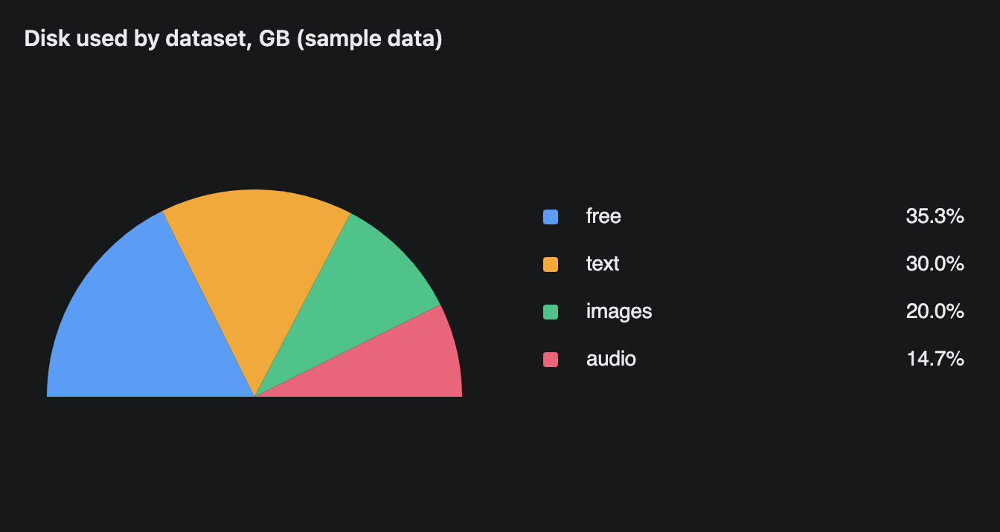
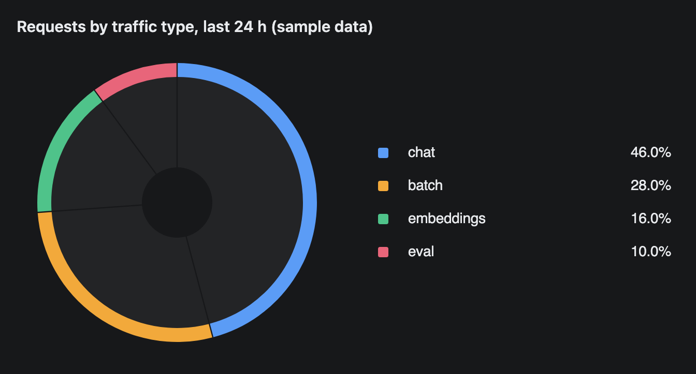

# PieChart

A pie or donut chart of parts of a whole. A legend on the right lists each slice with its share as a percentage.


## Signature

```text
PieChart(labels: string[], values: number[], variant?: "pie" | "donut", appearance?: "circular" | "semiCircular")
```

## When to use

- Shares of one total at one moment: memory per model, requests per type, disk per dataset.
- Three to six slices, where a rough share is enough.

Not for change over time ([LineChart](LineChart.md), [AreaChart](AreaChart.md)) or for comparing close values, where bars read better ([BarChart](BarChart.md)).

## Arguments

| # | Argument | Type | Required | Notes |
|---|---|---|---|---|
| 1 | `labels` | string[] | yes | One name per slice. |
| 2 | `values` | number[] | yes | One raw number per slice, in the same order as `labels`. Not percentages. The chart works out the shares. |
| 3 | `variant` | `"pie"` or `"donut"` | no | Default `"pie"`, a filled disc. `"donut"` draws a thin ring. |
| 4 | `appearance` | `"circular"` or `"semiCircular"` | no | Default `"circular"`. `"semiCircular"` draws the top half only. |

The component description asks for at most 8 slices.

## Examples

### A filled pie

The default variant is the most legible. The inputs are not sorted, but the slices and the legend come out largest first.

```openui
root = Stack([title, chart])
title = Text("GPU memory by model on spark-1, GB (sample data)", "heading")
chart = PieChart(["qwen3-32b", "llama-3.3-70b", "gemma-3-27b", "embeddings", "free"], [38, 52, 18, 6, 14])
```


### A semicircular pie

`"pie"` is spelled out so `"semiCircular"` can follow it as the fourth argument. The result is a half disc with the flat edge down.

```openui
root = Stack([title, chart])
title = Text("Disk used by dataset, GB (sample data)", "heading")
chart = PieChart(["text", "images", "audio", "free"], [90, 60, 44, 106], "pie", "semiCircular")
```



### A donut

`"donut"` gives a thin ring. It is readable, but it is not the donut most charting tools draw. See the notes below.

```openui
root = Stack([title, chart])
title = Text("Requests by traffic type, last 24 h (sample data)", "heading")
chart = PieChart(["chat", "batch", "embeddings", "eval"], [4600, 2800, 1600, 1000], "donut")
```



## Tips and pitfalls

- Slices and legend rows are sorted by value, largest first. Your input order is not kept.
- The legend shows percentages with one decimal. It does not show the raw values.
- With more than 8 slices every slice is still drawn, but the legend shows only the first 8 plus a `10 labels` row with an expand control (tested with 10).
- The donut is the weakest variant. The coloured ring is only about a tenth of the radius. Inside it is a grey disc split by thin dark lines, with a small dark hole in the middle. It reads as a pie with a coloured rim. Use `"pie"` when the shares matter.
- Small slices become slivers on the donut. In a test with 94.5%, 4.2%, 0.9% and 0.4%, the two smallest were thin lines that are easy to miss.
- `"semiCircular"` keeps the room of a full circle, so there is empty space above and below the half disc. A semicircular donut shows a thin arc over a grey half disc.
- A value that is not a number counts as 0, and a label with no value gets 0.
- From the chart code, clicking a legend row hides that slice and hovering shows a tooltip. A screenshot cannot show either.

## Related

[BarChart](BarChart.md) compares values side by side. [LineChart](LineChart.md) shows a trend. [AreaChart](AreaChart.md) shows a growing total split into parts. [Metric](Metric.md) shows one headline number.
