# UI components

Every component the `render_widget` tool can draw, with a screenshot, the exact signature, an explanation of each argument, two or three runnable examples and the pitfalls found by rendering them. There are 22 components, plus 10 small helpers that live on their parent's page (`TabItem`, `Series`, `DagNode`, `Entity`, `Relation`, `GeoPoint`, `FaqItem`, `InfraNode`, `InfraZone`, `InfraLink`).

Click a preview to open the page. All screenshots are real renders of the example beside them (dark theme, 2x), produced by [`tools/shoot.py`](../../tools/shoot.py). Charts and the data in them are sample data.

## Reading an example

OpenUI Lang is one statement per line. Arguments are **positional**, strings are double-quoted, and every name must be reachable from `root`:

```openui
root = Stack([title, tiles])
title = Text("Cluster", "heading")
tiles = Stack([up, queue], "row", "m", true)
up = Metric("Nodes up", "4 / 4", "all healthy", "good")
queue = Metric("Queue", "12", "-3")
```

Read it top-down: `root` is a column holding a heading and a row of two Metric tiles. The model never sees this page. It gets the same signatures from `render_widget(reference=true)`, which is generated from the runtime, and `tools/check_docs.py` fails if a page's signature drifts from it.

## Components

### Layout and text

| Component | Preview | What it does |
|---|---|---|
| [**Stack**](Stack.md) | <a href="Stack.md">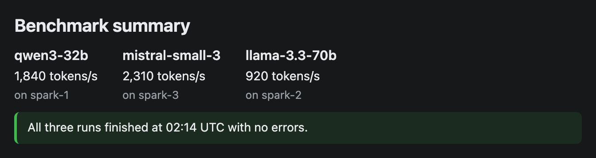</a> | A flex container that lays its children out in a column or a row. Every widget starts with one, because `root` must be a Stack. |
| [**Text**](Text.md) | <a href="Text.md"></a> | A line or short paragraph of plain text in one of five styles. Use it for titles, headings, notes and short commands. |
| [**Card**](Card.md) | <a href="Card.md">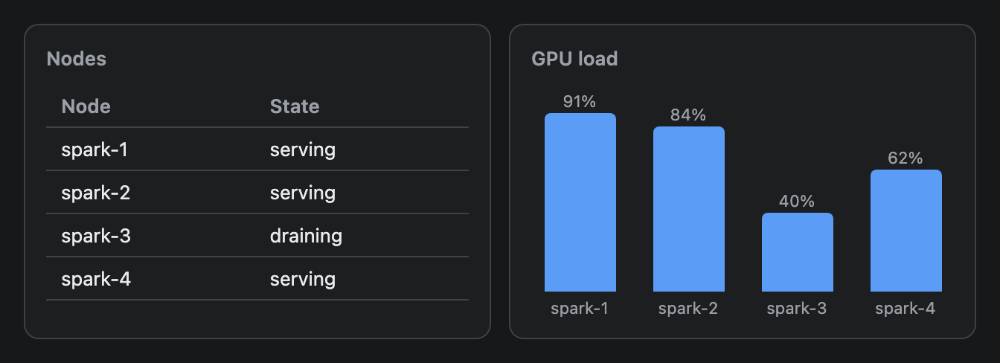</a> | A bordered panel with an optional title. Put related content inside it, and put several Cards in a row to build a dashboard. |
| [**Tabs**](Tabs.md) | <a href="Tabs.md">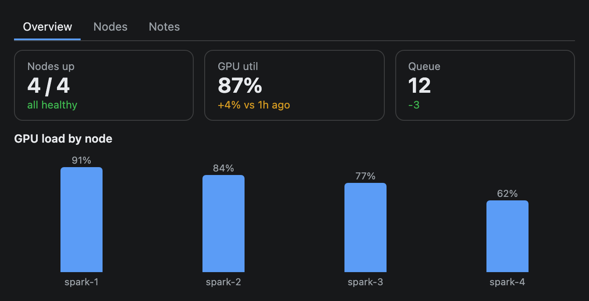</a> | A tabbed container. A strip of labels sits on top and the content of the selected tab shows below it. Each tab is a TabItem. |

### Numbers and tables

| Component | Preview | What it does |
|---|---|---|
| [**Metric**](Metric.md) | <a href="Metric.md">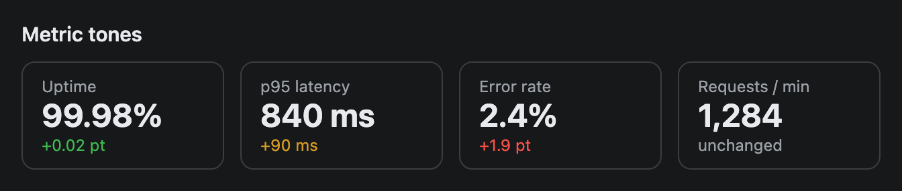</a> | A KPI tile: a small label, a large value and an optional coloured delta. Put several in a row for an at-a-glance status strip. |
| [**Table**](Table.md) | <a href="Table.md">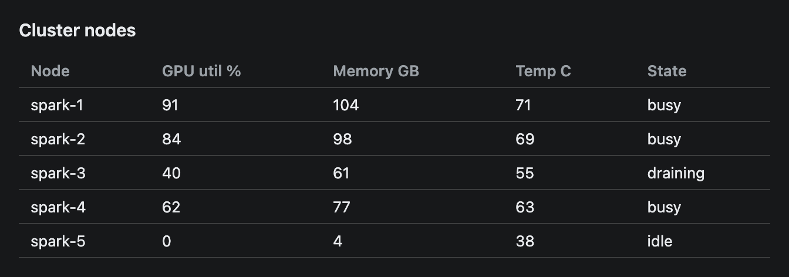</a> | A data table with a header row. Give it column names and rows of strings or numbers. |
| [**Callout**](Callout.md) | <a href="Callout.md">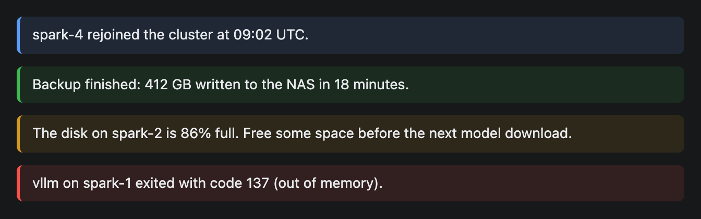</a> | A highlighted note with a coloured bar on its left edge. Four tones say how much attention it needs. |

### Charts

| Component | Preview | What it does |
|---|---|---|
| [**LineChart**](LineChart.md) | <a href="LineChart.md">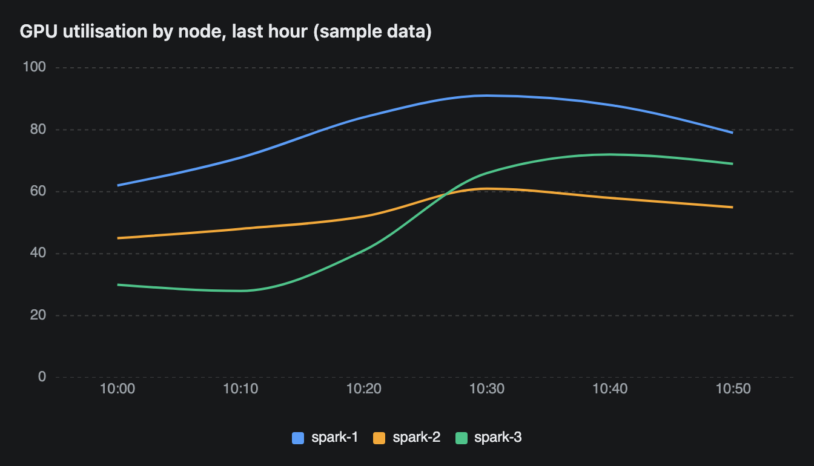</a> | A line chart over categories, such as time buckets. Each series is one line, and a legend under the chart names them. This page also documents `Series`, which the area and radar charts reuse. |
| [**AreaChart**](AreaChart.md) | <a href="AreaChart.md"></a> | A filled chart where the series are stacked on top of each other. The top edge is the total, and each coloured band is one series' share of it. It is a stacked chart only, with no overlapping option. |
| [**BarChart**](BarChart.md) | <a href="BarChart.md"></a> | A vertical bar chart for one series: a label under each bar and its value on top. Give it two arrays of the same length. |
| [**PieChart**](PieChart.md) | <a href="PieChart.md">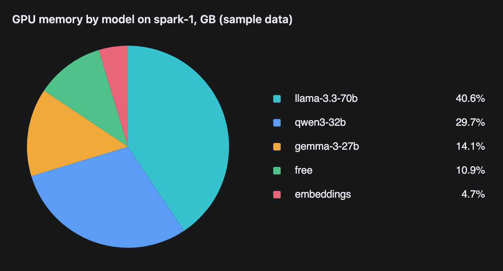</a> | A pie or donut chart of parts of a whole. A legend on the right lists each slice with its share as a percentage. |
| [**RadarChart**](RadarChart.md) | <a href="RadarChart.md"></a> | A radar (spider) chart. Each label is a spoke, and each series is a closed shape joining its values on those spokes. Use it to compare a few things across several metrics. |

### Diagrams and maps

| Component | Preview | What it does |
|---|---|---|
| [**Dag**](Dag.md) | <a href="Dag.md"></a> | A directed graph of boxes and arrows, laid out in layers for you. Use it for pipelines, task graphs and dependency chains. Each box can carry a status such as done or failed. |
| [**Erd**](Erd.md) | <a href="Erd.md"></a> | An entity-relationship diagram. Each table is a box with its columns, and lines with crow's-foot ends show how the tables relate. Use it to explain a database schema. |
| [**GeoMap**](GeoMap.md) | <a href="GeoMap.md">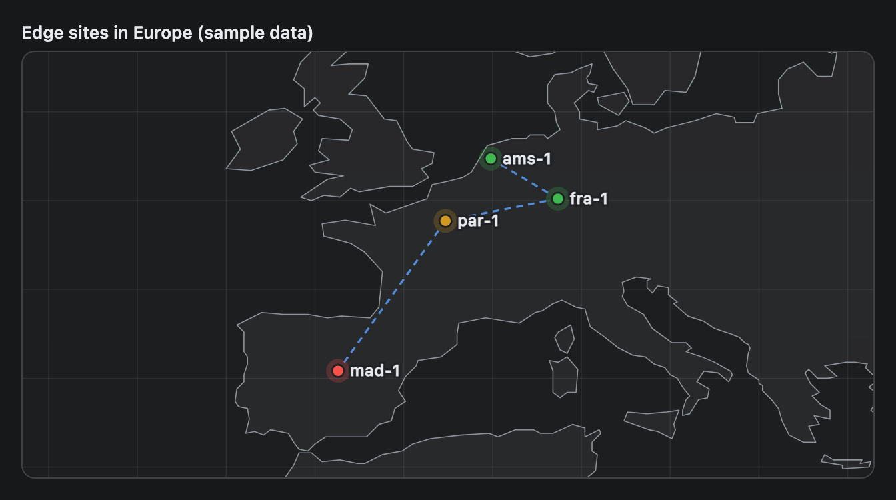</a> | An offline world map with coloured pins and optional dashed links. It draws coastlines from data shipped with the plugin, so it needs no network and no map tiles. The view zooms to fit your pins. |
| [**InfraMap**](InfraMap.md) | <a href="InfraMap.md"></a> | A map of infrastructure. Zones such as networks, racks or clouds hold nodes such as servers, databases and queues, and labelled arrows show which node talks to which. A node can carry an icon for its kind and a health status. |

### Rich content

| Component | Preview | What it does |
|---|---|---|
| [**Markdown**](Markdown.md) | <a href="Markdown.md">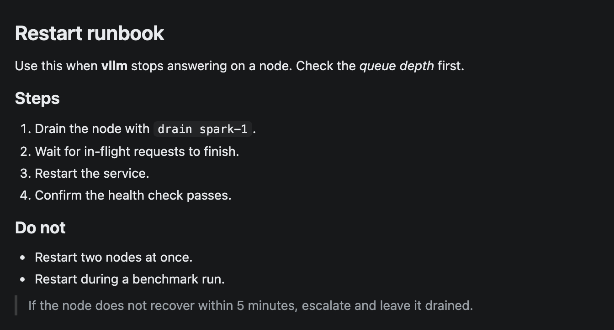</a> | Formatted text from a Markdown string: headings, bold, italic, code, lists, quotes, tables, code blocks and rules. Write newlines as `\n` inside the string. |
| [**CodeBlock**](CodeBlock.md) | <a href="CodeBlock.md"></a> | A box of code with simple syntax colours, an optional title and a Copy button. Write newlines as `\n` inside the string. |
| [**Image**](Image.md) | <a href="Image.md">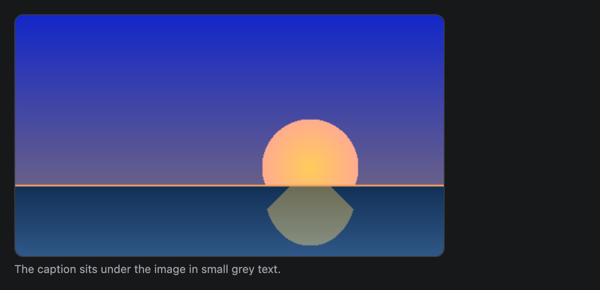</a> | A picture from a local file or a `data:` address, with optional alt text and a caption. The plugin reads the file and embeds it in the widget. |
| [**Faq**](Faq.md) | <a href="Faq.md"></a> | A list of questions that open to show their answers. The answers are Markdown, so they can hold lists, bold text and code. |

### Interaction

| Component | Preview | What it does |
|---|---|---|
| [**Button**](Button.md) | <a href="Button.md">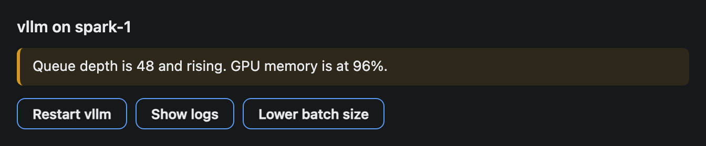</a> | A clickable button. A click sends text back to the AI as the user's next message, so the AI can act and draw a fresh widget. |
| [**Choice**](Choice.md) | <a href="Choice.md">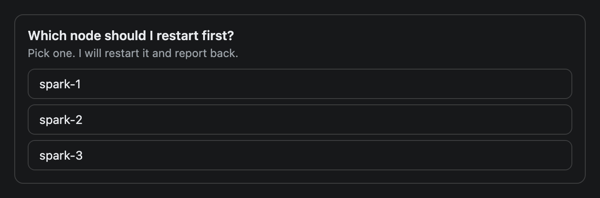</a> | A question with a short list of buttons for the user to pick from. A click sends the choice back to the agent as the next chat message. |

## Surprises worth knowing

Found by rendering every example. Each is explained, with a screenshot where it helps, on the page linked.

| Component | What to expect |
|---|---|
| [Card](Card.md), [Metric](Metric.md) | Have a minimum size (160 px and 120 px) along the stack's main axis. Directly in a column that is a minimum **height**, so a lone one looks tall and empty. Wrap it in a one-item row. |
| [Text](Text.md), [Callout](Callout.md) | Plain text only. A newline collapses to a space and `**bold**` prints as typed. Use [Markdown](Markdown.md) to format. |
| [Table](Table.md) | Wider than its column (a preview frame is at most 640 px), it scrolls sideways with no visual cue. A row with too few or too many cells is accepted. |
| [BarChart](BarChart.md) | Bars scale to the largest value, not to 0-100. |
| [LineChart](LineChart.md), [AreaChart](AreaChart.md) | A series shorter than `labels` is drawn as zeros for the missing points. The y axis always starts at 0. |
| [PieChart](PieChart.md) | The `donut` variant renders poorly (a thin ring over a grey disc). The default pie is fine. |
| [Dag](Dag.md) | Direction switches to top-to-bottom for any graph of four or more layers. Only an edge that closes a cycle is dropped, silently. |
| [GeoMap](GeoMap.md) | Links are straight lines on a flat map. Pins close together print overlapping labels. |
| [InfraMap](InfraMap.md) | Shrinks to fit its column (a preview frame is at most 640 px), then scrolls sideways with no visual cue (about 4 zones fit 640 px). `InfraLink` takes node **id strings**, not variable names or labels, and the validator rejects a mistake with the ids it knows. |
| [Markdown](Markdown.md) | Lists are flat (no nesting), and strikethrough, `_italics_` and HTML print as typed. |
| [CodeBlock](CodeBlock.md) | Any language gets some colouring (strings, numbers, a word before `(`), not only the listed ones. |
| [Tabs](Tabs.md) | Only the first tab shows in a screenshot. Items in a tab have no spacing: use one Stack per tab. |
| [Button](Button.md), [Choice](Choice.md) | Only the message text is sent back. The optional `context` of `@ToAssistant` is ignored. Choice does not enforce its 2-6 option advice. A screenshot cannot show a click. |

## Adding or changing a page

Follow the layout of [Metric](Metric.md), put the example in `examples/<name>-<variant>.oui`, copy it byte for byte into the page, and render it with `python3 tools/shoot.py docs/ui-components/examples/<file>.oui docs/ui-components/images/<file>.png`. Then run `python3 tools/check_docs.py`. It checks structure, signatures, that each code block equals its example file, that each example validates and has a screenshot, and that this index links every component. It does not judge the prose, so read the page and look at the screenshots.
