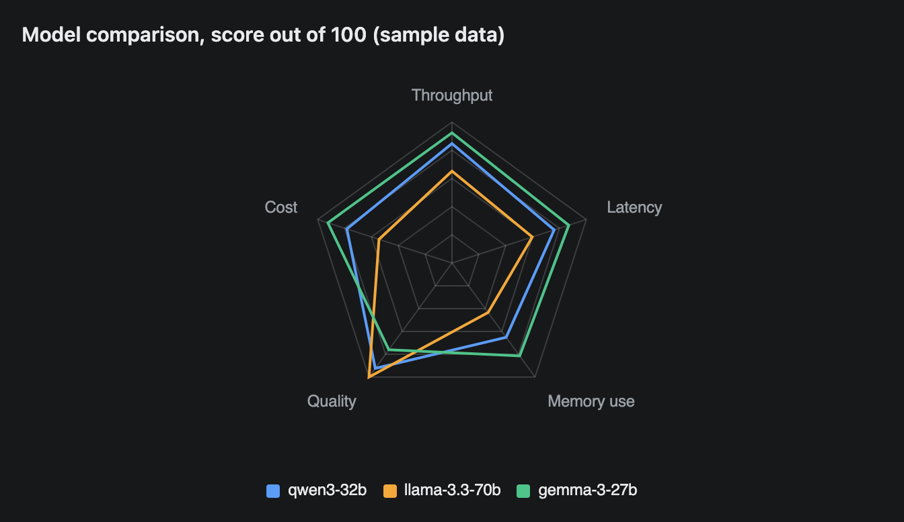
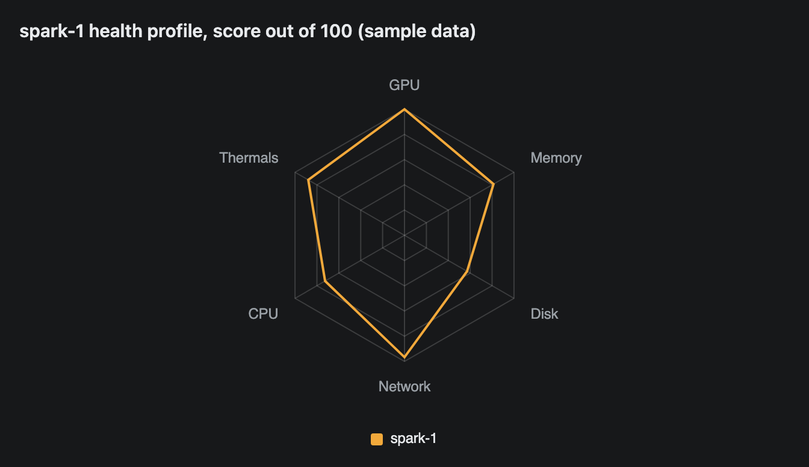
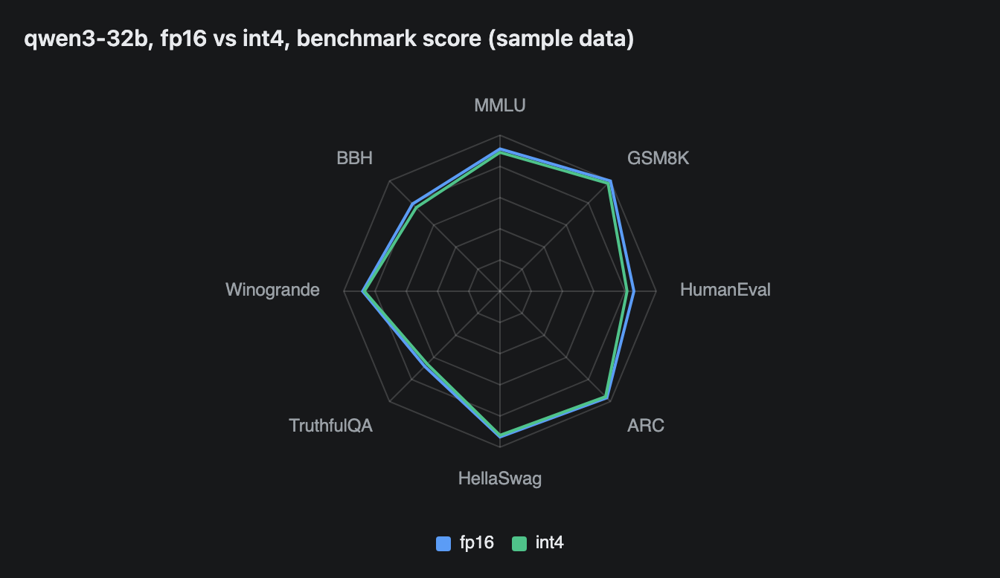

# RadarChart

A radar (spider) chart. Each label is a spoke, and each series is a closed shape joining its values on those spokes. Use it to compare a few things across several metrics.



## Signature

```text
RadarChart(labels: string[], series: Series[])
Series(category: string, values: number[])
```

## When to use

- Two to four things scored on the same scale across four to eight metrics, such as models, nodes or releases.
- A quick view of strengths and weaknesses, where the overall shape matters more than exact numbers.

Not for change over time ([LineChart](LineChart.md)) or for exact values ([Table](Table.md)). The rings carry no numbers.

## Arguments

### RadarChart

| # | Argument | Type | Required | Notes |
|---|---|---|---|---|
| 1 | `labels` | string[] | yes | One spoke per label. The first is at the top, the rest follow clockwise. |
| 2 | `series` | Series[] | yes | One `Series` per shape. Each has one value per label. |

### Series

`Series(category, values)` is the same helper used by [LineChart](LineChart.md), which documents it in full. Here the first argument is the entity's name, shown in the legend, and `values` has one number per spoke in label order.

## Examples

### Compare three entities

Every axis is a score out of 100 where higher is better, so the shapes are comparable. A shape that touches the outer ring on a spoke has the top score on that spoke.

```openui
root = Stack([title, chart])
title = Text("Model comparison, score out of 100 (sample data)", "heading")
chart = RadarChart(["Throughput", "Latency", "Memory use", "Quality", "Cost"], [a, b, c])
a = Series("qwen3-32b", [78, 70, 60, 85, 72])
b = Series("llama-3.3-70b", [60, 55, 40, 92, 50])
c = Series("gemma-3-27b", [85, 80, 75, 70, 85])
```


### A single profile

With one series the legend has one entry. This suits a health profile, where you look for the spokes that fall short.

```openui
root = Stack([title, chart])
title = Text("spark-1 health profile, score out of 100 (sample data)", "heading")
chart = RadarChart(["GPU", "Memory", "Disk", "Network", "CPU", "Thermals"], [s])
s = Series("spark-1", [91, 74, 52, 88, 66, 80])
```



### Eight axes and close results

Two series that score within a few points overlap almost completely. The scale starts at 0, so small gaps are hard to see.

```openui
root = Stack([title, chart])
title = Text("qwen3-32b, fp16 vs int4, benchmark score (sample data)", "heading")
chart = RadarChart(["MMLU", "GSM8K", "HumanEval", "ARC", "HellaSwag", "TruthfulQA", "Winogrande", "BBH"], [a, b])
a = Series("fp16", [83, 91, 78, 88, 85, 62, 80, 72])
b = Series("int4", [81, 89, 74, 87, 84, 60, 79, 69])
```



## Tips and pitfalls

- All spokes share one scale. The centre is 0 and the outer ring is the largest value in any series. In the first example llama-3.3-70b's 92 for quality touches the ring.
- Mixed units break the chart. A series of `[1000, 20, 30]` drew one long spike with the other two axes collapsed at the centre. Turn each metric into a score on one scale first.
- Make "higher is better" on every spoke. For latency or cost, plot a score such as 100 minus the normalised value, and say so in your heading.
- The rings have no numbers. From the chart code, hovering a point shows a tooltip with the values. A screenshot cannot show it.
- Shapes are outlines with no fill, so overlapping series stay visible.
- Each series needs a value for every label. A missing value counts as 0.
- Three labels give a triangle, five a pentagon and eight an octagon.
- A click on a legend entry hides that series. This comes from the chart code.

## Related

[LineChart](LineChart.md) documents `Series` and shows trends. [Table](Table.md) shows exact numbers. [BarChart](BarChart.md) compares one metric across categories. [Metric](Metric.md) shows a single headline number.
