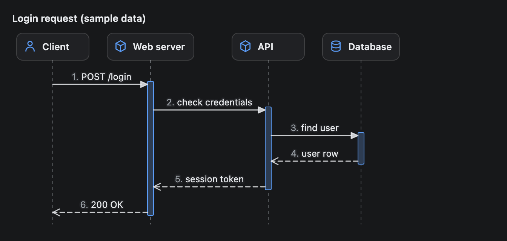
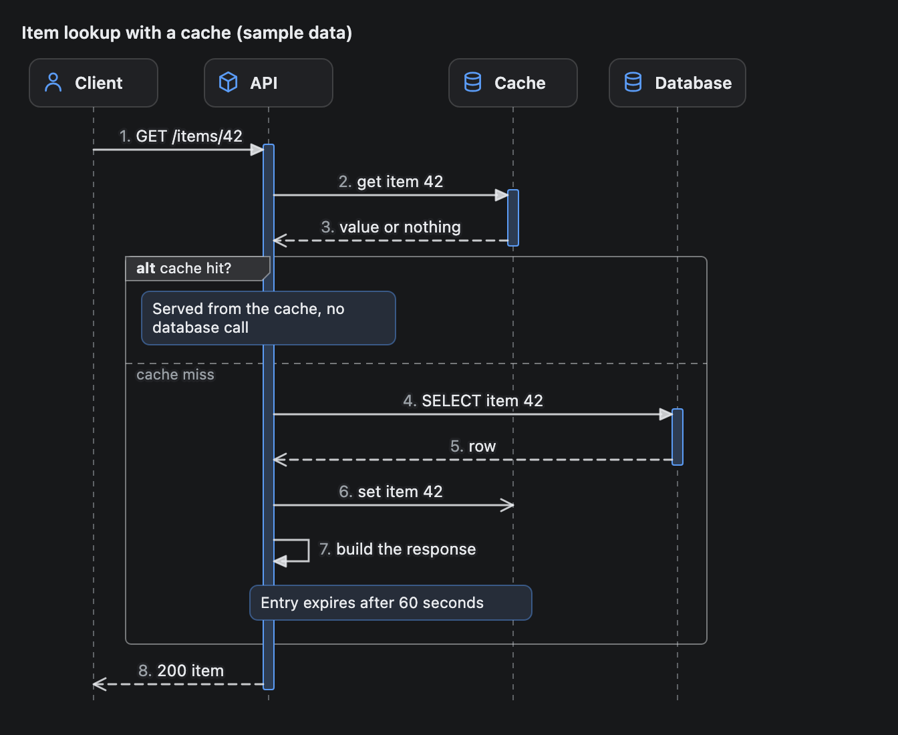
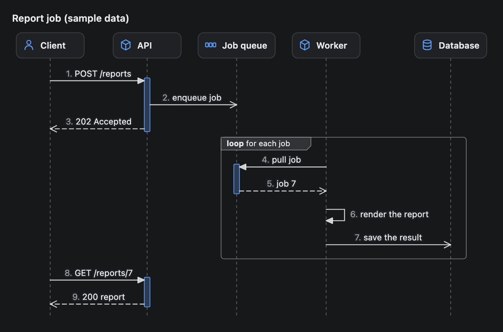

# SequenceDiagram

A sequence diagram: the parts of a system as columns, and the calls between them as arrows from top to bottom. Use it to show who calls whom, in what order, and what comes back. Groups mark a branch or a loop, and notes add a remark.



## Signature

```text
SequenceDiagram(participants: SeqParticipant[], steps: (SeqMessage | SeqNote | SeqGroup)[], title?: string, numbered?: boolean)
SeqParticipant(id: string, label: string, kind?: "actor" | "service" | "database" | "queue" | "external")
SeqMessage(from: string, to: string, label: string, style?: "sync" | "async" | "return", id?: string)
SeqNote(over: string, text: string, to?: string)
SeqGroup(kind: "alt" | "opt" | "loop" | "par", label: string, steps: (SeqMessage | SeqNote | SeqGroup)[], elseSteps?: (SeqMessage | SeqNote | SeqGroup)[], elseLabel?: string)
```

## When to use

- Explain how a request travels: which service calls which, in what order, and what each one answers.
- Show a branch (a cache hit or a miss) or a repeated step (a worker pulling jobs) in the middle of a flow.
- Describe an API call sequence, a login flow or a hand-off between a client and a background job.

Not for how parts are wired without an order ([InfraMap](InfraMap.md)), steps that depend on each other ([Dag](Dag.md)) or more than about 5 participants and 20 steps (split it into two diagrams).

## Arguments

A SequenceDiagram holds SeqParticipants (the columns) and steps (the rows). A step is a SeqMessage, a SeqNote or a SeqGroup, and a SeqGroup holds more steps. Messages and notes point at a participant by its `id`. The four helpers are only used inside a SequenceDiagram.

### SequenceDiagram

| # | Argument | Type | Required | Notes |
|---|---|---|---|---|
| 1 | `participants` | SeqParticipant[] | yes | One column each, left to right in the order you list them. At most 10. |
| 2 | `steps` | (SeqMessage \| SeqNote \| SeqGroup)[] | yes | The rows, top to bottom in order. At most 100 in total, nested steps and the groups themselves included. |
| 3 | `title` | string | no | A bold line above the diagram. |
| 4 | `numbered` | boolean | no | `true` (the default) puts a muted `1.`, `2.` before each message label, in order of appearance, nested groups included. `false` leaves them off. |

### SeqParticipant

| # | Argument | Type | Required | Notes |
|---|---|---|---|---|
| 1 | `id` | string | yes | Unique in the diagram. Messages and notes point at it. Keep it short (`api`). It is never drawn. |
| 2 | `label` | string | yes | The text in the header box. Cut at 22 characters. |
| 3 | `kind` | `"actor"`, `"service"`, `"database"`, `"queue"` or `"external"` | no | Only changes the icon in the header: a person, a cube, a cylinder, three small boxes, or an arrow leaving a box (with a dashed border). Defaults to `"service"`. |

### SeqMessage

| # | Argument | Type | Required | Notes |
|---|---|---|---|---|
| 1 | `from` | string | yes | The **id** of the participant that sends it. |
| 2 | `to` | string | yes | The **id** of the participant that receives it. Equal to `from` makes a self-call: a small loop on the right of the lifeline, with its label beside it. |
| 3 | `label` | string | yes | The text above the arrow, centred between the two lifelines. Cut at 48 characters. |
| 4 | `style` | `"sync"`, `"async"` or `"return"` | no | `"sync"` (the default) is a solid line with a filled arrowhead. `"async"` is a solid line with an open arrowhead. `"return"` is a dashed line with an open arrowhead, for answers. |
| 5 | `id` | string | no | A name for the message. Must be unique. It is never drawn. |

### SeqNote

| # | Argument | Type | Required | Notes |
|---|---|---|---|---|
| 1 | `over` | string | yes | The **id** of the participant the note sits over. |
| 2 | `text` | string | yes | The words in the box, wrapped to the box width. `\n` starts a new line. |
| 3 | `to` | string | no | Another participant **id**. The box then spans from `over` to `to`. |

### SeqGroup

| # | Argument | Type | Required | Notes |
|---|---|---|---|---|
| 1 | `kind` | `"alt"`, `"opt"`, `"loop"` or `"par"` | yes | The keyword in the label tab: a choice between branches, an optional part, a repeat, or things that happen in parallel. |
| 2 | `label` | string | yes | Shown after the keyword in the tab (`alt cache hit?`). Cut at 40 characters. |
| 3 | `steps` | (SeqMessage \| SeqNote \| SeqGroup)[] | yes | The steps inside the frame. A group can hold groups, up to 3 levels deep. |
| 4 | `elseSteps` | (SeqMessage \| SeqNote \| SeqGroup)[] | no | A second branch. It is drawn below a dashed divider inside the same frame. |
| 5 | `elseLabel` | string | no | The words on the divider. Defaults to `else`. Cut at 40 characters. |

### Activation bars

There is no argument for them. A thin bar on a participant shows that it is working on a call, and the diagram works it out from the messages:

- A `"sync"` message opens a bar on the participant that receives it.
- The next `"return"` message from that participant back to the sender closes it. With several open calls between the same two participants, a return closes the most recent one.
- A `"sync"` message that never gets a matching return has no bar. Nothing else opens a bar: `"async"` and `"return"` messages never do.
- Returns are matched in the order the steps are written. When both branches of an `alt` answer the same call, the bar closes at the first branch's `return` and the `return` in `elseSteps` starts from a bare lifeline (for example `call`, then `hit` as a return in `steps` and `miss` as a return in `elseSteps`: the bar ends at `hit`).
- A `"return"` whose `from` and `to` are the same participant is drawn as a dashed self loop, and it can close a self `"sync"` call.
- A second call that arrives while a bar is open starts a bar beside the first, a little to the right.

Arrows end at the edge of a bar, so a call into a busy participant lands on the bar.

## Examples

### A login request

The diagram at the top of this page. Every call is `"sync"` and every answer is a `"return"`, so each participant that was called shows a bar from the call to its answer. Message 3 to the database is answered by message 4, and message 2 to the API is answered by message 5, so the bars nest in time like the calls.

```openui
root = Stack([diagram])
diagram = SequenceDiagram([client, web, api, db], [m1, m2, m3, m4, m5, m6], "Login request (sample data)")
client = SeqParticipant("client", "Client", "actor")
web = SeqParticipant("web", "Web server")
api = SeqParticipant("api", "API")
db = SeqParticipant("db", "Database", "database")
m1 = SeqMessage("client", "web", "POST /login")
m2 = SeqMessage("web", "api", "check credentials")
m3 = SeqMessage("api", "db", "find user")
m4 = SeqMessage("db", "api", "user row", "return")
m5 = SeqMessage("api", "web", "session token", "return")
m6 = SeqMessage("web", "client", "200 OK", "return")
```


### A cache lookup with two branches

An `alt` group holds the two outcomes. The first branch is only a note. After `elseLabel` (`"cache miss"`) the second branch asks the database, writes the answer back to the cache without waiting (`"async"`) and calls a step on its own (a self-call). The second note passes `to` and spans from the API to the cache. The `"get item 42"` call is answered by message 3 before the group starts, so its bar ends there. The request from the client stays open until message 8, so its bar runs through the whole group.

```openui
root = Stack([diagram])
diagram = SequenceDiagram([client, api, cache, db], [m1, m2, m3, lookup, m8], "Item lookup with a cache (sample data)")
client = SeqParticipant("client", "Client", "actor")
api = SeqParticipant("api", "API")
cache = SeqParticipant("cache", "Cache", "database")
db = SeqParticipant("db", "Database", "database")
m1 = SeqMessage("client", "api", "GET /items/42")
m2 = SeqMessage("api", "cache", "get item 42")
m3 = SeqMessage("cache", "api", "value or nothing", "return")
lookup = SeqGroup("alt", "cache hit?", [hit], [m4, m5, m6, m7, note2], "cache miss")
hit = SeqNote("api", "Served from the cache, no database call")
m4 = SeqMessage("api", "db", "SELECT item 42")
m5 = SeqMessage("db", "api", "row", "return")
m6 = SeqMessage("api", "cache", "set item 42", "async")
note2 = SeqNote("api", "Entry expires after 60 seconds", "cache")
m7 = SeqMessage("api", "api", "build the response")
m8 = SeqMessage("api", "client", "200 item", "return")
```



### An async job with a loop

Queueing the job is `"async"` (open arrowhead, no bar on the queue), and the API answers the client at once with a `"return"`. The worker side repeats in a `loop` group: it pulls a job, renders it (a self-call) and saves the result without waiting. The last two messages are a second request from the client, after the job is done.

```openui
root = Stack([diagram])
diagram = SequenceDiagram([client, api, queue, worker, db], [m1, m2, m3, work, m8, m9], "Report job (sample data)")
client = SeqParticipant("client", "Client", "actor")
api = SeqParticipant("api", "API")
queue = SeqParticipant("queue", "Job queue", "queue")
worker = SeqParticipant("worker", "Worker")
db = SeqParticipant("db", "Database", "database")
m1 = SeqMessage("client", "api", "POST /reports")
m2 = SeqMessage("api", "queue", "enqueue job", "async")
m3 = SeqMessage("api", "client", "202 Accepted", "return")
work = SeqGroup("loop", "for each job", [m4, m5, m6, m7])
m4 = SeqMessage("worker", "queue", "pull job")
m5 = SeqMessage("queue", "worker", "job 7", "return")
m6 = SeqMessage("worker", "worker", "render the report")
m7 = SeqMessage("worker", "db", "save the result", "async")
m8 = SeqMessage("client", "api", "GET /reports/7")
m9 = SeqMessage("api", "client", "200 report", "return")
```



## Tips and pitfalls

- Messages and notes take participant **id strings**. A variable name (`SeqMessage(api, db, "x")`) or a label (`"Database"` when the id is `"db"`) is rejected before anything is drawn. The validator lists the known ids and, for a label, the id you meant: `` SeqMessage "find user" uses unknown participant id `Database` in `to` (...). `Database` is a label; the id is `db`. ``
- The validator also rejects: a duplicate participant id, a duplicate message `id`, a note `over` or `to` that is not a participant, more than 10 participants, more than 100 steps, groups nested more than 3 deep, a step that is not a `SeqMessage`, `SeqNote` or `SeqGroup`, and an empty `participants` list. One participant is allowed only when every message is a self-call.
- Use `"return"` for answers and `"sync"` for calls that wait. If every message is `"sync"` and nothing returns, there are no bars. Mark fire-and-forget calls `"async"`.
- A `"sync"` call is matched with the next `"return"` that goes back from the receiver to the sender, wherever that return is, even inside another group. Put the return right after the work it answers, or the bar stretches.
- Make one `SeqGroup` per decision; put the other side in `elseSteps`, not in a second group, and put short words in its label (`cache hit?`). `elseSteps` is the second branch of the same frame; a third branch is a second group.
- Keep ids and labels short. The columns widen to fit the longest message label between neighbours, so a long label widens the gap. A label is cut at 48 characters, a header at 22 (a wide character such as Chinese counts as two).
- Size: a diagram keeps its natural width and sits at the left. In the preview frame (the app caps it at 40rem and never above 640 px; 560 px at the app's default 14 px font) it shrinks to fit, but not below 78% of its natural width. Past that it scrolls sideways. About 5 participants with short labels fit (588 px); 6 are 708 px and shrink; 10 scroll. In native mode the diagram uses the width of the chat column: it stays at its natural width, left aligned, when there is room, and shrinks and then scrolls in a column that is narrower. Height: native mode has no height limit, but the preview frame stops at about 1,200 px (roughly 30 plain messages, fewer with groups, notes and self-calls) and hides its scrollbar, so a taller diagram is cut. Keep a diagram to about 20 steps and split longer flows into two diagrams.
- A self-call needs room for its label to the right of the loop, so the gap to the next column grows with it. On the last column the diagram grows on the right instead.
- The text is real text, so it can be selected and copied in both modes (native mode overrides the app's own no-select rule for SVG). A label that was cut shows its full text as a tooltip when you hover over it. Colours come from the theme, in light and dark.
- You cannot place a row or reorder columns: rows follow the order of `steps` and columns the order of `participants`. Put the participant that starts the story first.

## Related

[InfraMap](InfraMap.md) draws how parts are connected. [Dag](Dag.md) draws steps and dependencies. [Table](Table.md) lists calls with details. [Card](Card.md) wraps a diagram under a heading.
