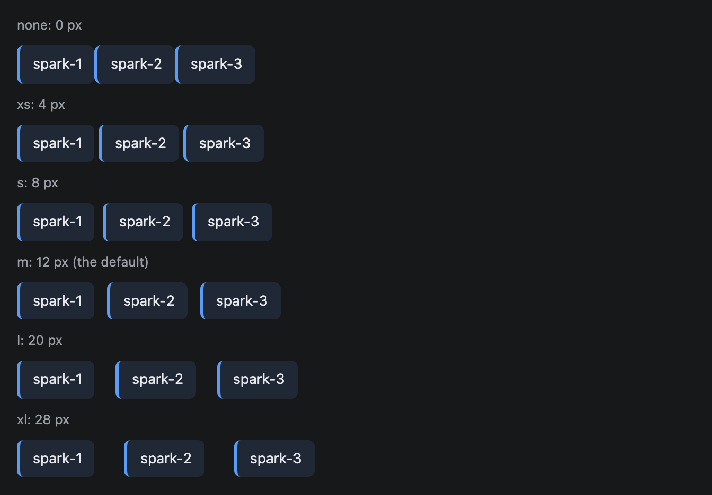
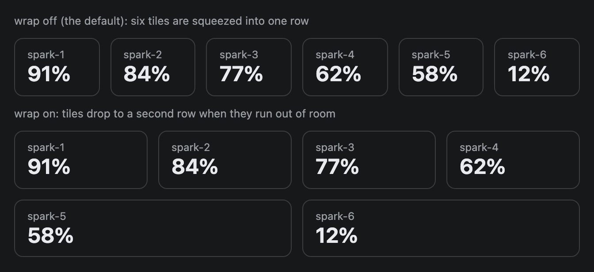

# Stack

A flex container that lays its children out in a column or a row. Every widget starts with one, because `root` must be a Stack.


## Signature

```text
Stack(children: any[], direction?: "row" | "column", gap?: "none" | "xs" | "s" | "m" | "l" | "xl", wrap?: boolean)
```

## When to use

- As `root`, and around any group of items that should share the same spacing.
- With `"row"` to put [Metric](Metric.md) tiles, [Card](Card.md)s or [Button](Button.md)s side by side.
- Nested: a row of columns, or a column of rows.

Not for alternate views of one subject (use [Tabs](Tabs.md)) or a titled, bordered group (use [Card](Card.md)).

## Arguments

| # | Argument | Type | Required | Notes |
|---|---|---|---|---|
| 1 | `children` | array of components | yes | The items, in order. Usually variable names, as in `Stack([title, chart])`. A variable that is in no parent's array does not render. |
| 2 | `direction` | `"row"` or `"column"` | no | Defaults to `"column"`: top to bottom. `"row"` puts the children side by side, all stretched to the height of the tallest. |
| 3 | `gap` | `"none"`, `"xs"`, `"s"`, `"m"`, `"l"` or `"xl"` | no | Space between children: 0, 4, 8, 12, 20 and 28 px. Defaults to `"m"`. |
| 4 | `wrap` | boolean | no | `true` lets a row start a new line when it runs out of room. Defaults to off. |

## Examples

### A row of columns

Stacks nest. Each model is a column Stack of three Text lines, and the outer row puts the three columns side by side.

```openui
root = Stack([title, panels, footer])
title = Text("Benchmark summary", "title")
panels = Stack([left, middle, right], "row", "xl")
left = Stack([leftName, leftRate, leftNode], "column", "xs")
leftName = Text("qwen3-32b", "heading")
leftRate = Text("1,840 tokens/s")
leftNode = Text("on spark-1", "muted")
middle = Stack([middleName, middleRate, middleNode], "column", "xs")
middleName = Text("mistral-small-3", "heading")
middleRate = Text("2,310 tokens/s")
middleNode = Text("on spark-3", "muted")
right = Stack([rightName, rightRate, rightNode], "column", "xs")
rightName = Text("llama-3.3-70b", "heading")
rightRate = Text("920 tokens/s")
rightNode = Text("on spark-2", "muted")
footer = Callout("All three runs finished at 02:14 UTC with no errors.", "success")
```


### All six gaps

The same three items with every gap value. The gap applies between items in a row and in a column alike.

```openui
root = Stack([gNone, rNone, gXs, rXs, gS, rS, gM, rM, gL, rL, gXl, rXl])
gNone = Text("none: 0 px", "muted")
rNone = Stack([Callout("spark-1"), Callout("spark-2"), Callout("spark-3")], "row", "none")
gXs = Text("xs: 4 px", "muted")
rXs = Stack([Callout("spark-1"), Callout("spark-2"), Callout("spark-3")], "row", "xs")
gS = Text("s: 8 px", "muted")
rS = Stack([Callout("spark-1"), Callout("spark-2"), Callout("spark-3")], "row", "s")
gM = Text("m: 12 px (the default)", "muted")
rM = Stack([Callout("spark-1"), Callout("spark-2"), Callout("spark-3")], "row", "m")
gL = Text("l: 20 px", "muted")
rL = Stack([Callout("spark-1"), Callout("spark-2"), Callout("spark-3")], "row", "l")
gXl = Text("xl: 28 px", "muted")
rXl = Stack([Callout("spark-1"), Callout("spark-2"), Callout("spark-3")], "row", "xl")
```



### Wrap off and on

Without `wrap` a row squeezes its children into one line. With `wrap` they move to a second line.

```openui
root = Stack([offLabel, off, onLabel, on])
offLabel = Text("wrap off (the default): six tiles are squeezed into one row", "muted")
off = Stack([a1, a2, a3, a4, a5, a6], "row")
a1 = Metric("spark-1", "91%")
a2 = Metric("spark-2", "84%")
a3 = Metric("spark-3", "77%")
a4 = Metric("spark-4", "62%")
a5 = Metric("spark-5", "58%")
a6 = Metric("spark-6", "12%")
onLabel = Text("wrap on: tiles drop to a second row when they run out of room", "muted")
on = Stack([b1, b2, b3, b4, b5, b6], "row", "m", true)
b1 = Metric("spark-1", "91%")
b2 = Metric("spark-2", "84%")
b3 = Metric("spark-3", "77%")
b4 = Metric("spark-4", "62%")
b5 = Metric("spark-5", "58%")
b6 = Metric("spark-6", "12%")
```



## Tips and pitfalls

- Arguments are positional. To set only the gap you still write the direction first: `Stack([a, b], "column", "s")`. To turn on `wrap` you write all four: `Stack(items, "row", "m", true)`.
- A row without `wrap` never overflows. It shrinks its children instead: six Metric tiles end up about 96 px wide each.
- With `wrap`, the tiles on the last line grow to fill it. In the third example `spark-5` and `spark-6` are wider than the tiles above them.
- A [Card](Card.md) or [Metric](Metric.md) alone in a column is tall even when it holds one line: at least 160 px for a Card and 120 px for a Metric. Put it in a row (a one-item row works) to avoid that. The [Card](Card.md) page shows it.
- Stack has no arguments for width, padding, alignment or background. Direction, gap and wrap are all you get.
- A [Callout](Callout.md) in a row is only as wide as its text. In a column it fills the width.

## Related

[Card](Card.md) adds a border and a title. [Metric](Metric.md) tiles are usually placed in a row. [Tabs](Tabs.md) switch between views.
