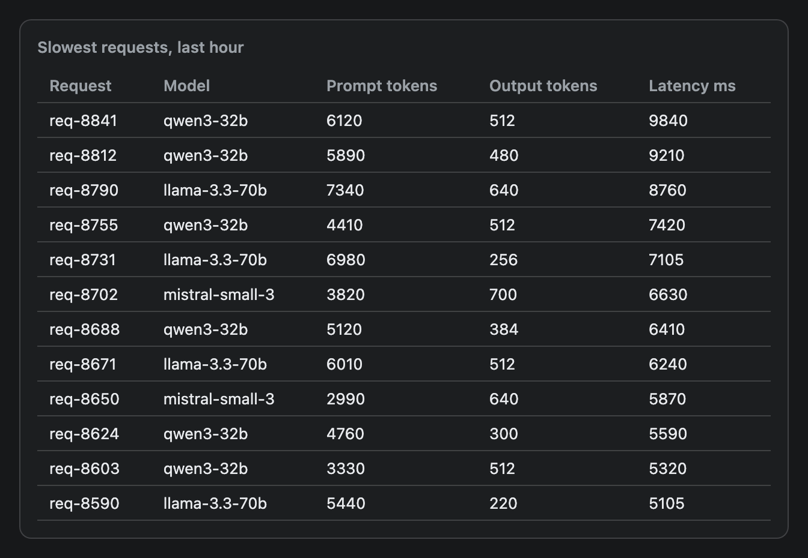
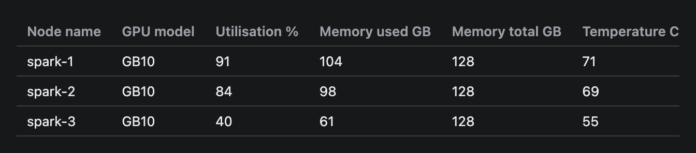

# Table

A data table with a header row. Give it column names and rows of strings or numbers.


## Signature

```text
Table(columns: string[], rows: (string | number)[][])
```

## When to use

- Comparing a handful of items across several attributes: nodes, models, requests.
- Exact values, where a chart would hide the numbers.
- Up to about 12 rows. Past that, show the top rows and say how many you left out.

Not for a trend over time (use [LineChart](LineChart.md)) or one series of numbers (use [BarChart](BarChart.md)).

## Arguments

| # | Argument | Type | Required | Notes |
|---|---|---|---|---|
| 1 | `columns` | array of strings | yes | The header labels, left to right. Headers never wrap. |
| 2 | `rows` | array of arrays of strings or numbers | yes | One inner array per row, with one value per column. |

## Examples

### Strings and numbers

Cells can be text or numbers. Numbers print exactly as written and line up on the left.

```openui
root = Stack([title, nodes])
title = Text("Cluster nodes", "heading")
nodes = Table(["Node", "GPU util %", "Memory GB", "Temp C", "State"], [["spark-1", 91, 104, 71, "busy"], ["spark-2", 84, 98, 69, "busy"], ["spark-3", 40, 61, 55, "draining"], ["spark-4", 62, 77, 63, "busy"], ["spark-5", 0, 4, 38, "idle"]])
```


### Twelve rows in a card

Twelve rows is about the most a widget table should carry. A [Card](Card.md) gives the table a title.

```openui
root = Stack([card])
card = Card([slow], "Slowest requests, last hour")
slow = Table(["Request", "Model", "Prompt tokens", "Output tokens", "Latency ms"], [["req-8841", "qwen3-32b", 6120, 512, 9840], ["req-8812", "qwen3-32b", 5890, 480, 9210], ["req-8790", "llama-3.3-70b", 7340, 640, 8760], ["req-8755", "qwen3-32b", 4410, 512, 7420], ["req-8731", "llama-3.3-70b", 6980, 256, 7105], ["req-8702", "mistral-small-3", 3820, 700, 6630], ["req-8688", "qwen3-32b", 5120, 384, 6410], ["req-8671", "llama-3.3-70b", 6010, 512, 6240], ["req-8650", "mistral-small-3", 2990, 640, 5870], ["req-8624", "qwen3-32b", 4760, 300, 5590], ["req-8603", "qwen3-32b", 3330, 512, 5320], ["req-8590", "llama-3.3-70b", 5440, 220, 5105]])
```



### A table wider than the column

Nine columns do not fit in 640 px, so the table scrolls sideways. The image shows only the left part: the last three columns are off to the right.

```openui
root = Stack([wide])
wide = Table(["Node name", "GPU model", "Utilisation %", "Memory used GB", "Memory total GB", "Temperature C", "Power draw W", "Driver version", "Last seen"], [["spark-1", "GB10", 91, 104, 128, 71, 212, "570.124", "09:14:03"], ["spark-2", "GB10", 84, 98, 128, 69, 198, "570.124", "09:14:02"], ["spark-3", "GB10", 40, 61, 128, 55, 140, "570.124", "09:14:03"]])
```



## Tips and pitfalls

- Every row is drawn. There is no paging, sorting or height limit, so a 40-row table makes a very tall widget. Keep to about 12 rows.
- Numbers are not formatted. `6120` stays `6120` and `0.5` stays `0.5`. Write `"6,120"` as a string if you want a separator.
- Header cells never wrap, and the table sits in a box that scrolls sideways. Wide tables work, but nothing in the picture hints that columns are hidden, so keep to about six columns. I could not confirm whether a scrollbar is visible in the desktop app.
- Body cells wrap, and a narrow column breaks at a hyphen. In a test with a short first header, `spark-1` wrapped into `spark-` and `1`. A longer header such as `Node name` keeps the column wide enough.
- Give every row as many cells as there are columns. A short row leaves a gap with a missing border and a long row adds a cell past the header. The validator accepts both.
- An empty `rows` array draws just the header.
- Cells are plain text: no bold, colour or links. For those, write a table inside [Markdown](Markdown.md).
- A Table has no title of its own. Put a [Text](Text.md) heading above it or wrap it in a [Card](Card.md).

## Related

[Card](Card.md) titles a table. [BarChart](BarChart.md) shows one column of numbers as bars. [Markdown](Markdown.md) can draw tables with formatted cells.
