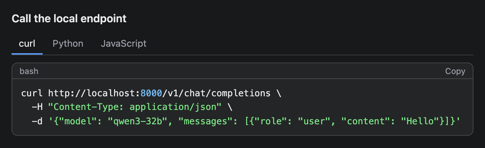

# Tabs

A tabbed container. A strip of labels sits on top and the content of the selected tab shows below it. Each tab is a TabItem.


## Signature

```text
Tabs(items: TabItem[])
TabItem(label: string, content: any[])
```

## When to use

- Alternate views of one subject: overview, nodes, notes.
- The same snippet in several languages.
- Detail you want available but not in the way.

Not for steps that must be read in order, or for content the reader must see at once. A tab that is not selected is hidden.

## Arguments

### Tabs

| # | Argument | Type | Required | Notes |
|---|---|---|---|---|
| 1 | `items` | array of TabItem | yes | The tabs, left to right. The first one is open when the widget loads. |

### TabItem

| # | Argument | Type | Required | Notes |
|---|---|---|---|---|
| 1 | `label` | string | yes | The text in the tab strip. Keep it to one or two words. |
| 2 | `content` | array of components | yes | What the tab shows. Wrap it in a single [Stack](Stack.md): `[panel]`. |

A TabItem on its own renders nothing. It only works inside `Tabs`.

## Examples

### A dashboard in three tabs

The first tab is the one people see, so it holds the headline numbers and the chart. The other two tabs appear when the reader clicks them.

```openui
root = Stack([tabs])
tabs = Tabs([overview, nodes, notes])
overview = TabItem("Overview", [panel])
panel = Stack([kpis, chart])
kpis = Stack([up, util, queue], "row", "m", true)
up = Metric("Nodes up", "4 / 4", "all healthy", "good")
util = Metric("GPU util", "87%", "+4% vs 1h ago", "warn")
queue = Metric("Queue", "12", "-3", "good")
chart = BarChart(["spark-1", "spark-2", "spark-3", "spark-4"], [91, 84, 77, 62], "GPU load by node", "%")
nodes = TabItem("Nodes", [nodeTable])
nodeTable = Table(["Node", "State", "Uptime"], [["spark-1", "serving", "12 d"], ["spark-2", "serving", "12 d"], ["spark-3", "serving", "3 d"], ["spark-4", "serving", "12 d"]])
notes = TabItem("Notes", [noteText])
noteText = Callout("spark-3 was rebooted on 21 Oct after a driver update.", "info")
```


### The same call in three languages

Every tab holds one [CodeBlock](CodeBlock.md). Only the curl tab is drawn here. Python and JavaScript are one click away.

```openui
root = Stack([title, tabs])
title = Text("Call the local endpoint", "heading")
tabs = Tabs([curlTab, pyTab, jsTab])
curlTab = TabItem("curl", [curlCode])
curlCode = CodeBlock("curl http://localhost:8000/v1/chat/completions \\\n  -H \"Content-Type: application/json\" \\\n  -d '{\"model\": \"qwen3-32b\", \"messages\": [{\"role\": \"user\", \"content\": \"Hello\"}]}'", "bash")
pyTab = TabItem("Python", [pyCode])
pyCode = CodeBlock("from openai import OpenAI\n\nclient = OpenAI(base_url=\"http://localhost:8000/v1\", api_key=\"none\")\nreply = client.chat.completions.create(\n    model=\"qwen3-32b\",\n    messages=[{\"role\": \"user\", \"content\": \"Hello\"}],\n)\nprint(reply.choices[0].message.content)", "python")
jsTab = TabItem("JavaScript", [jsCode])
jsCode = CodeBlock("const res = await fetch(\"http://localhost:8000/v1/models\");\nconsole.log(await res.json());", "js")
```



## Tips and pitfalls

- A screenshot shows only the first tab. I clicked through the first example in a browser: `Nodes` showed the table, `Notes` showed the callout, `Overview` came back with its content. Put the most useful tab first.
- Only the selected tab is drawn. The others are still part of the source, so every TabItem and its content must be reachable from `root` like any other variable.
- Items in a tab's `content` array are placed one after another with no space between them. Before I wrapped them in a Stack, the metric tiles touched the chart title. Use one Stack per tab, as the first example does.
- Clicking a tab only switches the view. It does not send anything to the AI.
- You cannot start on another tab. The first item always opens first.
- Eight tabs with labels of up to three words fit in a 640 px column by wrapping the longer labels onto two lines. Keep to about five short labels.
- Tabs of different height make the widget grow and shrink as the reader switches. I did not check how the chat handles that.

## Related

[Card](Card.md) gives each tab a titled panel. [Stack](Stack.md) groups a tab's content. [CodeBlock](CodeBlock.md) and [Table](Table.md) are common tab contents.
