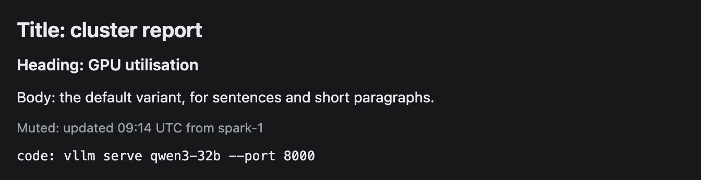
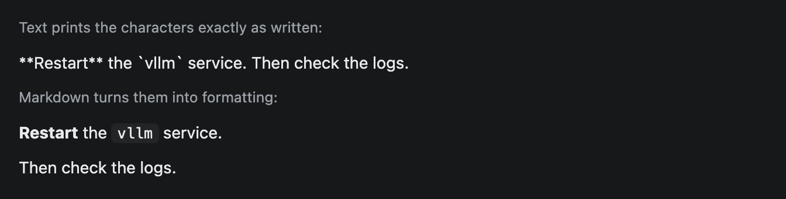
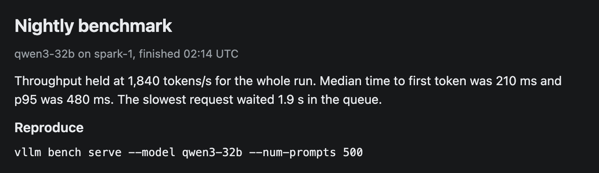

# Text

A line or short paragraph of plain text in one of five styles. Use it for titles, headings, notes and short commands.



## Signature

```text
Text(text: string, variant?: "title" | "heading" | "body" | "muted" | "code")
```

## When to use

- Titles and section headings at the top of a widget.
- A muted line for a timestamp, a source or a caption.
- A short command or ID in the `"code"` style.

Not for bold words inside a sentence, lists or links. Those need [Markdown](Markdown.md). Not for multi-line code (use [CodeBlock](CodeBlock.md)).

## Arguments

| # | Argument | Type | Required | Notes |
|---|---|---|---|---|
| 1 | `text` | string | yes | The words to show. Plain text only. |
| 2 | `variant` | `"title"`, `"heading"`, `"body"`, `"muted"` or `"code"` | no | The style. Defaults to `"body"`. |

The five variants:

| Variant | Size | Look |
|---|---|---|
| `"title"` | 20 px | Bold. One per widget. |
| `"heading"` | 15 px | Semi-bold. Section headings. |
| `"body"` | 14 px | Normal weight. Sentences and short paragraphs. |
| `"muted"` | 12.5 px | Grey. Timestamps, sources, captions. |
| `"code"` | 12.5 px | Monospace, no background. |

## Examples

### All five variants

Each variant on its own line. The last one uses the monospace font.

```openui
root = Stack([title, heading, body, muted, code])
title = Text("Title: cluster report", "title")
heading = Text("Heading: GPU utilisation", "heading")
body = Text("Body: the default variant, for sentences and short paragraphs.")
muted = Text("Muted: updated 09:14 UTC from spark-1", "muted")
code = Text("code: vllm serve qwen3-32b --port 8000", "code")
```


### Text versus Markdown

Text prints every character as written. The same words in Markdown get bold and code styling, and a blank line starts a new paragraph.

```openui
root = Stack([plainLabel, plain, richLabel, rich])
plainLabel = Text("Text prints the characters exactly as written:", "muted")
plain = Text("**Restart** the `vllm` service.\nThen check the logs.")
richLabel = Text("Markdown turns them into formatting:", "muted")
rich = Markdown("**Restart** the `vllm` service.\n\nThen check the logs.")
```



### A report header

A realistic top section: title, muted subtitle, one paragraph, a heading and a command.

```openui
root = Stack([title, subtitle, summary, reproduceHeading, command])
title = Text("Nightly benchmark", "title")
subtitle = Text("qwen3-32b on spark-1, finished 02:14 UTC", "muted")
summary = Text("Throughput held at 1,840 tokens/s for the whole run. Median time to first token was 210 ms and p95 was 480 ms. The slowest request waited 1.9 s in the queue.")
reproduceHeading = Text("Reproduce", "heading")
command = Text("vllm bench serve --model qwen3-32b --num-prompts 500", "code")
```



## Tips and pitfalls

- Text is plain. `**bold**`, backticks and `#` appear exactly as typed (second example, top block). Use [Markdown](Markdown.md) when you need formatting.
- Line breaks do not survive. A `\n` inside the string shows as a single space, so "Restart the vllm service.\nThen check the logs." reads as one line. Use one Text per line, or [Markdown](Markdown.md) with a blank line between paragraphs.
- Long text wraps at the column width. It is never cut off.
- There is no argument for colour, size, bold or alignment. The five variants are the whole palette.
- `"code"` is a styled line, not a code block. It has no background, no highlighting and no Copy button, and it collapses runs of spaces. Use [CodeBlock](CodeBlock.md) for anything the reader will copy.

## Related

[Markdown](Markdown.md) for formatted text. [CodeBlock](CodeBlock.md) for code. [Callout](Callout.md) for a highlighted note. [Stack](Stack.md) to arrange lines.
