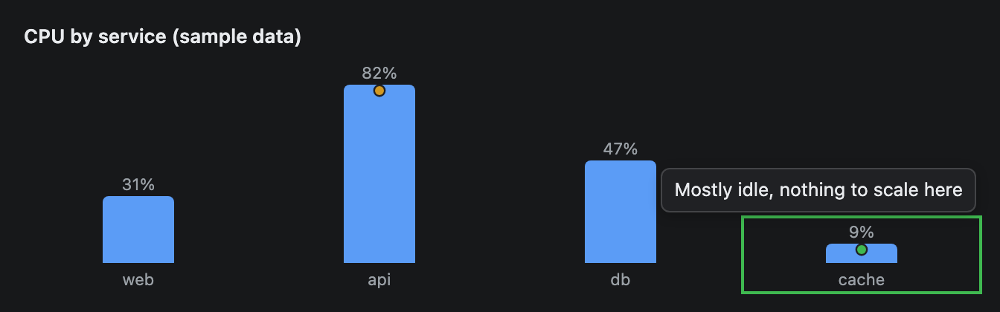
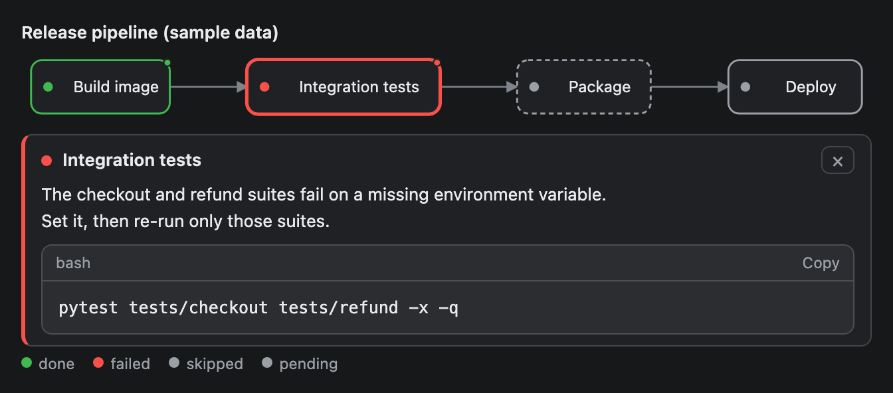
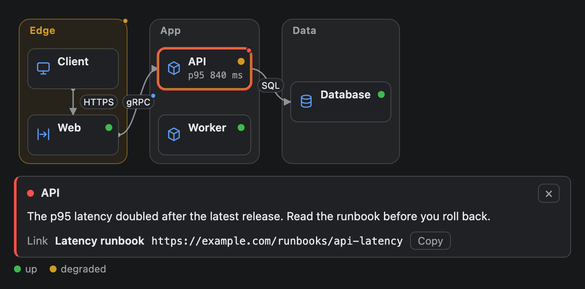
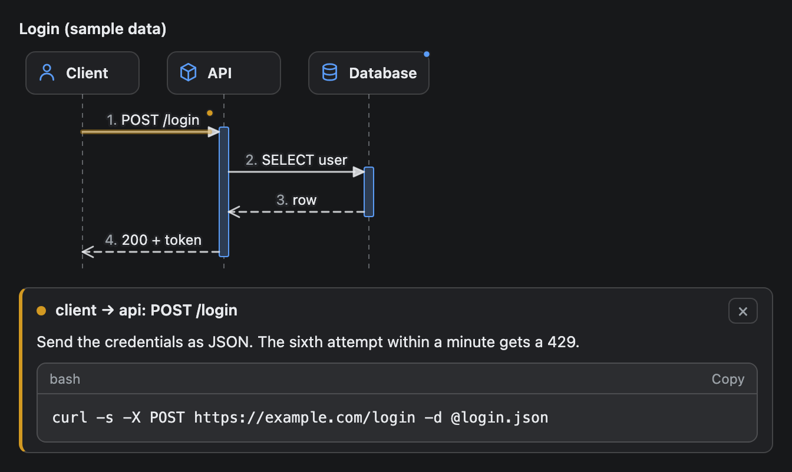

# Tooltip

A short note that appears when the reader hovers one element of a diagram, a table, a metric tile, a bar chart, a map or an image, with an optional panel of detail, code and a link that opens when they click it. It works on [Dag](Dag.md), [Erd](Erd.md), [InfraMap](InfraMap.md), [SequenceDiagram](SequenceDiagram.md), [Table](Table.md), [Metric](Metric.md), [BarChart](BarChart.md), [GeoMap](GeoMap.md) and [Image](Image.md).





## Signature

```text
Tooltip(target: string, hint?: string, detail?: string, code?: string, language?: string, tone?: "info" | "good" | "warn" | "bad", link?: string, linkLabel?: string)
```

## When to use

- A step, table row, column, cell, server, bar, pin, link or call that needs one more fact than its label can carry: why it failed, what it costs, how to re-run it.
- A command or a snippet the reader will want to copy, shown in the panel with a Copy button.
- A pointer to a runbook or a page, as a link in the panel.

A `Tooltip` is never a free-standing component, and the validator rejects one that is not in the `tooltips` of one of the nine components below. `Button`, `Choice`, `Stack`, `Card`, `Tabs`, `Text`, `Markdown`, `Callout`, `Faq`, `CodeBlock` and the library charts (`LineChart`, `AreaChart`, `PieChart`, `RadarChart`) do not take tooltips. A tooltip goes in the `tooltips` argument, and its `target` says which element it belongs to. `tooltips` is the LAST argument of the component, so any optional argument before it must be written as `null`: `Dag(nodes, edges, null, null, [t1, t2])` is a Dag with no `direction` and no `title`, and `Metric("Latency", "120 ms", null, null, [t1])` is a Metric with no `delta` and no `tone`.

**When not to add a tooltip.** Leave an element alone when its label already says everything. A diagram where every box has a tooltip is noisier than one with none: about 8 per component is plenty, and the validator allows at most 60 tooltips per component. Do not repeat the label in the hint, do not put long prose in `detail` (use [Markdown](Markdown.md) next to the diagram), and do not use a tooltip for the main message of the widget. 

## Arguments

| # | Argument | Type | Required | Notes |
|---|---|---|---|---|
| 1 | `target` | string | yes | The element this is about. What each component accepts is in the next table. |
| 2 | `hint` | string | no | The text of the hover tooltip. Short, 140 characters at most. |
| 3 | `detail` | string | no | Text for the panel, 800 characters at most. Line breaks are kept and long lines wrap. |
| 4 | `code` | string | no | A command or snippet for the panel, 2,000 characters and 40 lines at most. It is highlighted and has a Copy button. |
| 5 | `language` | string | no | The language of `code`, such as `bash`, `python` or `sql`. An unknown name still gets simple colouring. 20 characters at most. |
| 6 | `tone` | `"info"`, `"good"`, `"warn"` or `"bad"` | no | The colour of the dot, the outline and the panel edge. Default `"info"`. |
| 7 | `link` | string | no | An `http://` or `https://` address, 300 characters at most. See the link rules below. |
| 8 | `linkLabel` | string | no | A few words shown next to the address, 60 characters at most. It never replaces the address. |

Every argument after `target` can be `null`, but at least one of `hint`, `detail`, `code` and `link` must be given: a tooltip with none of them would do nothing.

### Where tooltips work

| Component | `target` | Example |
|---|---|---|
| [Dag](Dag.md) | A node id. Edges cannot have a tooltip. | `"build"` |
| [Erd](Erd.md) | An entity name, or `entity.column`. The column is the first word of a field string. | `"orders"`, `"orders.user_id"` |
| [InfraMap](InfraMap.md) | A node id; `zone:` and the zone name for a zone; the two node ids joined by `>` for a link, such as `web>api`. | `"api"`, `"zone:Edge"`, `"web>api"` |
| [SequenceDiagram](SequenceDiagram.md) | A participant id, or the `id` of a `SeqMessage`. A message without an `id` cannot have a tooltip, so give the ones you want to comment on an id. | `"client"`, `"login"` |
| [Table](Table.md) | `row:3` (the third data row, counted from 1), `col:status` (a column header) or `cell:3.status` (the row number, a dot, then the header; the first dot splits it). | `Table(columns, rows, [t1])` with `"row:2"`, `"col:status"`, `"cell:3.service"` |
| [Metric](Metric.md) | Its own `label`. The whole tile is the target, so a Metric takes one tooltip at most. | `Metric("Error rate", "2.4%", null, null, [t1])` with `"Error rate"` |
| [BarChart](BarChart.md) | A bar's label. The whole column (value, bar and label) is the target. | `BarChart(labels, values, null, null, [t1])` with `"api"` |
| [GeoMap](GeoMap.md) | A pin's `label`, or `A>B` for a link between two pins (`"web>api"`). A link has a wider invisible hit area. Pins closer than about 20 px, or a link shorter than about 25 px, cannot be told apart with the mouse; Tab reaches each one. | `GeoMap(points, links, null, [t1])` with `"web"`, `"web>api"` |
| [Image](Image.md) | The word `image`. The whole picture is the target, so an Image takes one tooltip at most. There are no hotspots or regions. | `Image(src, null, null, [t1])` with `"image"` |

A target must name exactly one element. The validator rejects a target that matches nothing (it lists up to five valid ones), two tooltips for the same target, and a target that is ambiguous: two links between the same pair of nodes or pins, two columns with the same name in one entity, one id that is both a participant and a message, two table columns with the same header (`col:` and `cell:` targets), two bars with the same label, or two pins with the same label.

### What the reader sees

- **Dot.** An element with a tooltip has a small dot in the tone colour, a pointer cursor, and can be reached with Tab. The dot is at the top right corner of a Metric tile, an image or a map pin, inside the top of a bar, and right after the text of a table header, cell or row (a row's dot follows the text of its first cell). Nothing moves when a tooltip appears. A table row, a column header or a cell with a tooltip keeps its own role, so a screen reader still reads a table with its rows, headers and cells: it is only made focusable, and its tooltip is read as its description while it shows.
- **Hover or keyboard focus.** The element gets an outline in the tone colour and a tooltip shows the `hint`. With no `hint` it shows the first line of `detail`, cut at 100 characters, and with neither it says "Click for details". The tooltip never makes the page taller. It sits above the element, or below it, or beside it in a short component, and it does not cover the element you point at when there is room around it. A Metric tile fills its box, so its tooltip is drawn below the tile, over the content that follows it, up to about three lines (a Metric that is the last thing in a widget keeps up to 72 px of empty space below it for this, so the frame does not cut the tooltip). An Image that fills a narrow column has its tooltip drawn over the picture, and the tooltip of a table header can hide the cells of the first row when there is no room above it. Beside the element the tooltip gets narrower so the text wraps, down to about 140 px (100 px when that is the only way to keep the element visible). In a component too short for the wrapped text, the text is cut with an ellipsis. Keep a hint to a few words and put anything that must not be cut in `detail`: the panel shows the `detail`, and shows the hint only when there is no `detail`.
- **Click, Enter or Space.** One detail panel opens directly under the component, with the name of the element, a close button, then `detail`, `code` and the link line. A tooltip with only a `hint` shows the hint in the panel, because a touch screen has no hover. Click the same element again, click the close button, press Escape or click the component's background to close it. Clicking another element replaces the panel. The text in the panel can be selected. Two components in one widget each keep their own panel, so two panels can be open at once. A component inside [Tabs](Tabs.md) loses its open panel when the reader switches tab. A wide [Table](Table.md) scrolls sideways inside the component, and a tooltip for a cell that has scrolled out of view waits until the cell is back.
- **Thin targets.** A message arrow, an InfraMap link or a GeoMap link has a wider invisible hit area, so it is easy to point at.

#### Height in preview mode

The panel opens below the component and adds to the height of the widget: about 70 px for a hint only, and about 400 px for a detail of five lines, a code block of eight lines and a link (measured at 73 px and 391 px). This holds for every component on this page. The preview frame is at most 1,200 px tall and has no scrollbar, so a panel that falls below that line cannot be seen, and the click seems to do nothing. In preview mode keep a widget that has tooltips under about 800 px: about 20 steps of a SequenceDiagram, about 8 rows of a top-to-bottom Dag, or a table of about 12 rows with a panel and the components around it. Native mode has no height cap. In a row of Metric tiles that wraps (a Stack with `"row"` and `wrap` true), the open panel of a tile takes a line of its own below all the tiles, as wide as the row, so the other tiles keep their place and their height; in any other layout it sits under its tile.

### Links

Only `http://` and `https://` addresses are accepted, written in lowercase, with a host, no `user:password@` part and no spaces. The address must read the same as the one the app opens, so the validator also rejects any invisible character (a zero-width space, a right-to-left override and the like), any non-ASCII character in the host or the port (write an international host as punycode, `xn--...`), and a port that is not a number from 1 to 65535. Accents and other letters are fine in the path and the query. `javascript:`, `data:`, `file:`, `mailto:` and every other scheme are rejected, and so is an address that starts with `//`. The renderer checks again before it draws the link.

The panel always shows the full address as text, with `linkLabel` beside it and a Copy button. Whether the address can be clicked depends on where the widget runs:

| Where | What the reader gets |
|---|---|
| Native mode in the desktop app, when the app offers its own link opener | The address is a button. A click hands it to the app, once per click, and the app opens it in the browser. Nothing is ever opened without a click. |
| Preview mode (the default), an exported page, or native mode without the opener | The address is plain text to select, with the Copy button. It is not a link, because the sandbox blocks navigation. |

## Examples

### A failed step with a command

The failed test node has a hint, a detail text and a command. The screenshot shows the panel open; the green dot on Build image marks a second tooltip.

```openui
root = Stack([flow])
flow = Dag([n1, n2, n3, n4], [["build", "test"], ["test", "package"], ["package", "deploy"]], "LR", "Release pipeline (sample data)", [a1, a2])
n1 = DagNode("build", "Build image", "done")
n2 = DagNode("test", "Integration tests", "failed")
n3 = DagNode("package", "Package", "skipped")
n4 = DagNode("deploy", "Deploy", "pending")
a1 = Tooltip("test", "2 of 48 tests failed", "The checkout and refund suites fail on a missing environment variable.\nSet it, then re-run only those suites.", "pytest tests/checkout tests/refund -x -q", "bash", "bad")
a2 = Tooltip("build", "Image came from the cache", null, null, null, "good")
```


### A warning zone, a link and a node with a runbook

A zone, a link between two nodes and a node each have a tooltip. The open panel belongs to the API node: it has a `link`, so the last line shows the address, its label and a Copy button. In native mode that address is a button that opens in the browser.

```openui
root = Stack([map])
map = InfraMap([z1, z2, z3], [l1, l2, l3], null, "LR", [a1, a2, a3])
z1 = InfraZone("Edge", [n1, n2], "warn")
z2 = InfraZone("App", [n3, n4])
z3 = InfraZone("Data", [n5])
n1 = InfraNode("client", "Client", "client")
n2 = InfraNode("web", "Web", "gateway", "up")
n3 = InfraNode("api", "API", "service", "degraded", "p95 840 ms")
n4 = InfraNode("worker", "Worker", "service", "up")
n5 = InfraNode("db", "Database", "database", "up")
l1 = InfraLink("client", "web", "HTTPS")
l2 = InfraLink("web", "api", "gRPC")
l3 = InfraLink("api", "db", "SQL")
a1 = Tooltip("zone:Edge", "Faces the internet", "Everything in this zone takes public traffic. Renew its TLS certificate before the end of the month.", null, null, "warn")
a2 = Tooltip("web>api", "gRPC, 2 s timeout", "Calls from web to api time out after 2 seconds and are retried once.")
a3 = Tooltip("api", "Slow since the last deploy", "The p95 latency doubled after the latest release. Read the runbook before you roll back.", null, null, "bad", "https://example.com/runbooks/api-latency", "Latency runbook")
```



### A message with code and a participant

`login` is the `id` of the first `SeqMessage`, so it can be the target of a tooltip. The panel shows the command in a highlighted code block.

```openui
root = Stack([flow])
flow = SequenceDiagram([p1, p2, p3], [m1, m2, m3, m4], "Login (sample data)", true, [a1, a2])
p1 = SeqParticipant("client", "Client", "actor")
p2 = SeqParticipant("api", "API")
p3 = SeqParticipant("db", "Database", "database")
m1 = SeqMessage("client", "api", "POST /login", "sync", "login")
m2 = SeqMessage("api", "db", "SELECT user", "sync", "lookup")
m3 = SeqMessage("db", "api", "row", "return")
m4 = SeqMessage("api", "client", "200 + token", "return")
a1 = Tooltip("login", "Limited to 5 tries a minute", "Send the credentials as JSON. The sixth attempt within a minute gets a 429.", "curl -s -X POST https://example.com/login -d @login.json", "bash", "warn")
a2 = Tooltip("db", "Read replica", "Logins read from a replica, so a new account can take a second to appear.")
```



### A hover tooltip only

Two nodes have a hint and nothing else. With the pointer on the API node, the tooltip shows its hint and the node gets an outline in the tone colour; no panel is open.

```openui
root = Stack([chart])
chart = BarChart(["web", "api", "db", "cache"], [31, 82, 47, 9], "CPU by service (sample data)", "%", [a1, a2])
a1 = Tooltip("api", "Busiest service", null, null, null, "warn")
a2 = Tooltip("cache", "Mostly idle, nothing to scale here", null, null, null, "good")
```


## Tips and pitfalls

- Give a `SeqMessage` an `id` (`SeqMessage("client", "api", "POST /login", "sync", "login")`) before you point a tooltip at it. A message without an `id` cannot be a target.
- `hint` is for the hover: one short line. Put the explanation in `detail` and the command in `code`. Do not repeat the same sentence in both.
- A link opens only in native mode with the desktop app's opener. In the default preview mode the reader copies it, so say what it is in `linkLabel` and do not write "click here".
- A `link` with a space, a `user:password@` part or any scheme other than `http` and `https` fails validation. Check the address before you add it.
- The dot sits on the top right corner of the element, so it can touch a status dot on a crowded InfraMap node. It is 6 px wide.
- In a Table, two columns with the same header cannot take `col:` or `cell:` tooltips: rename one header first.
- Tooltips do not send anything to the agent. They show what you wrote and nothing more; use a [Button](Button.md) or a [Choice](Choice.md) next to the diagram to ask the reader a question.
- Without Node on the machine the validator does not run: a target that matches nothing is then ignored, and a bad value draws as missing.
- Keep it to about 8 per component. If everything needs a remark, split the diagram or the table.

## Related

[Dag](Dag.md), [Erd](Erd.md), [InfraMap](InfraMap.md), [SequenceDiagram](SequenceDiagram.md), [Table](Table.md), [Metric](Metric.md), [BarChart](BarChart.md), [GeoMap](GeoMap.md) and [Image](Image.md) take the `tooltips` argument. [CodeBlock](CodeBlock.md) shows a longer snippet beside a diagram. [Markdown](Markdown.md) holds text too long for a panel.
